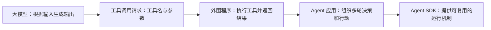
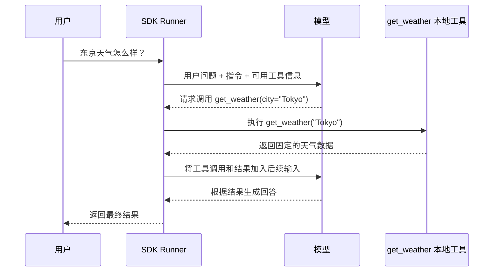
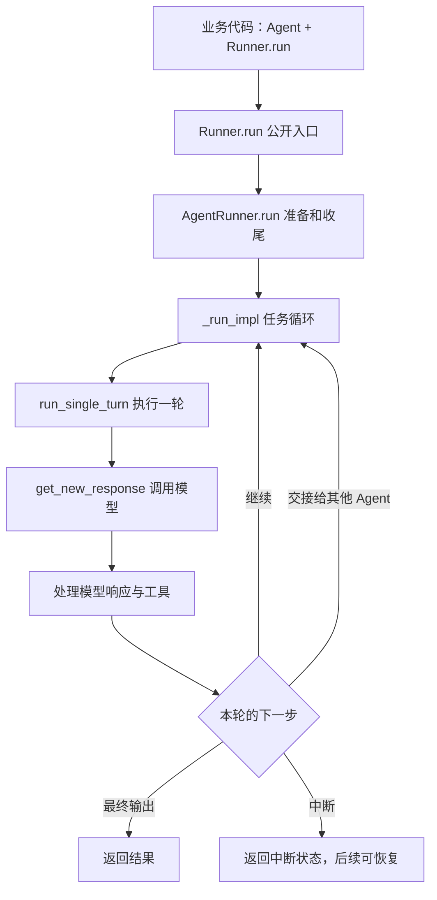
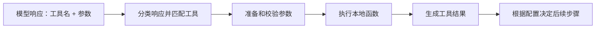

# 从一次天气查询，看懂 OpenAI Agents SDK 的执行循环

> **分享草稿｜源码阅读版**  
> 研究范围：OpenAI Agents SDK Python，v0.24.0，commit `17d994bd3045dae71acda676a4ef4762ed8ecd94`。  
> 面向读者：了解大模型和基本编程概念、希望进一步理解 Agent 运行机制的同学。  
> 状态：源码阅读与模拟模型实验草稿；正文中的流程示意和第 7 节实际实验结果已分别标注。

## 先从一个问题开始

我们写下一个查天气的函数，把它交给 Agent，然后问一句“东京天气怎么样”。模型本身不会自动运行我们电脑里的 Python 函数。那么，从模型提出调用工具，到程序拿到结果并组织回答，中间是谁在工作？

本次分享沿着这个问题展开，重点回答：

1. 模型、工具和执行器分别负责什么？
2. SDK 怎样把模型输出变成一次工具执行，并决定继续、交接还是结束？
3. 模型前后有哪些可观察的插入点？遇到异常和重复调用如何验证？

一句话概括：**模型输出下一步的意图；SDK 负责准备输入、调用模型、处理响应和工具，并调度下一步。** 这是本地函数工具路径的概括；不同工具类型、配置和中断场景会有不同分支。

## 0. 从大模型到 Agent SDK

先从一个问题出发：**大模型能提出工具调用请求，为什么还需要 Agent SDK？**

大模型接收输入并生成输出。在支持工具调用的接口中，应用可以提供工具名称、描述和参数格式；模型随后可能返回结构化的工具调用请求，例如 `get_weather(city="Tokyo")`。模型输出这个请求，本身并不会让我们机器上的 Python 函数自动执行。

外围程序需要接住请求：找到工具、处理参数、执行函数、把结果交回模型，并决定是否继续下一轮。实际模型能力和接口行为取决于所选模型、接口及配置。



这里的 Agent 是便于讨论的工作定义：**由模型参与决策，结合工具与执行流程完成任务的系统**。在本 SDK 中，`Agent` 类主要承载配置，运行由 `Runner` 和其他组件配合完成。SDK 提供工具调用、运行循环、交接、护栏与可观察性等能力；开发者仍需提供目标、工具及相应配置。

> **现场互动：**如果模型回复“调用天气工具”，但应用不执行工具，模型能从这个工具获得天气数据吗？先请听众判断，再进入下面的例子。

## 1. 一个能读懂的例子

仓库中的 [天气例子](https://github.com/openai/openai-agents-python/blob/17d994bd3045dae71acda676a4ef4762ed8ecd94/examples/basic/tools.py) 可以简化成这样：

```python
@tool
def get_weather(city: str) -> Weather:
    """获取指定城市的天气。"""
    return Weather(city=city, temperature_range="14-20C", conditions="Sunny with wind.")

agent = Agent(
    name="Hello world",
    instructions="You are a helpful agent.",
    tools=[get_weather],
)

result = await Runner.run(agent, input="What's the weather in Tokyo?")
print(result.final_output)
```

> 这是为讲解而简化的代码，不是文件逐字摘录。原例子中的天气数据是固定值，没有调用真实天气服务。`@tool` 把函数包装成 SDK 可使用的工具；`await` 表示等待异步调用完成。

三个角色各有职责：

| 角色 | 在例子中的职责 | 不应混淆的地方 |
| --- | --- | --- |
| Agent | 保存指令、可用工具等配置 | 创建 Agent 不代表已经调用模型 |
| 模型 | 处理输入，生成文本或工具调用请求 | 不直接执行这个本地 Python 函数 |
| Runner / SDK | 组织运行、解析回复、执行本地工具和控制后续流程 | SDK 不是模型本身 |

### 从提问到回答：一种可能的过程



图展示的是模型**选择调用工具**且配置为工具后继续请求模型的一种正常路径；模型也可能直接回答、调用其他可用工具，或者发生异常。对默认的函数工具行为，Agent 的 `tool_use_behavior` 默认为 `run_llm_again`；也可配置工具结果直接结束，不应把“工具执行后必定再请求模型”当成通用规则。[源码：Agent 配置](https://github.com/openai/openai-agents-python/blob/17d994bd3045dae71acda676a4ef4762ed8ecd94/src/agents/agent.py#L391)

## 2. 先建立源码地图



这张图只画非流式主线。实际代码还有会话、流式输出、并发护栏、恢复、错误处理等分支。

| 想回答的问题 | 入口 | 阅读重点 |
| --- | --- | --- |
| 配置在哪 | [`agent.py: Agent`](https://github.com/openai/openai-agents-python/blob/17d994bd3045dae71acda676a4ef4762ed8ecd94/src/agents/agent.py#L318) | 指令、工具、handoffs、模型等 |
| 用户从哪里启动 | [`run.py: Runner.run`](https://github.com/openai/openai-agents-python/blob/17d994bd3045dae71acda676a4ef4762ed8ecd94/src/agents/run.py#L279) | 公开入口与参数传递 |
| 一次任务如何继续 | [`run.py: _run_impl`](https://github.com/openai/openai-agents-python/blob/17d994bd3045dae71acda676a4ef4762ed8ecd94/src/agents/run.py#L629) | 循环和 `next_step` 分支 |
| 一轮请求发生什么 | [`run_loop.py: run_single_turn`](https://github.com/openai/openai-agents-python/blob/17d994bd3045dae71acda676a4ef4762ed8ecd94/src/agents/run_internal/run_loop.py#L2787) | 整理输入、调用模型、处理回复 |
| 工具怎么被执行 | [`tool_execution.py: execute_function_tool_calls`](https://github.com/openai/openai-agents-python/blob/17d994bd3045dae71acda676a4ef4762ed8ecd94/src/agents/run_internal/tool_execution.py#L2341) | 本地函数工具的调用 |

> 现场讲解建议：先用地图定位，再从例子走一遍；不要从 `run.py` 的第一行开始逐行阅读。

## 3. 从 Runner 进入执行循环

在 [Runner.run 的实现](https://github.com/openai/openai-agents-python/blob/17d994bd3045dae71acda676a4ef4762ed8ecd94/src/agents/run.py#L349)中，正常路径的关键代码可以概括为：

```python
runner = DEFAULT_AGENT_RUNNER
return await runner.run(starting_agent, input, ...)
```

其中 `...` 表示省略的参数，并非源码原样。`DEFAULT_AGENT_RUNNER` 是 `AgentRunner()` 的实例；[`AgentRunner.run`](https://github.com/openai/openai-agents-python/blob/17d994bd3045dae71acda676a4ef4762ed8ecd94/src/agents/run.py#L574) 会整理配置、管理运行前后的上下文与资源，再调用 `_run_impl`。

`Runner` 是开发者使用的公开入口；源码中明确将 `AgentRunner` 标为实验性内部类。阅读它是为了理解实现，业务代码不应依赖直接使用或继承它。

### `_run_impl` 在循环什么？

在 [`while True`](https://github.com/openai/openai-agents-python/blob/17d994bd3045dae71acda676a4ef4762ed8ecd94/src/agents/run.py#L1032) 中，SDK 会安排一轮执行；一轮完成后查看 `turn_result.next_step`。下面是逻辑示意，省略了历史管理、异常、护栏和恢复等分支：

```python
while 任务未结束:
    本轮结果 = await run_single_turn(当前_agent, 输入和历史, 配置)

    if 本轮结果.next_step 是最终输出:
        检查输出并返回结果
    elif 本轮结果.next_step 是交接:
        当前_agent = 交接目标
        准备交接输入
    elif 本轮结果.next_step 是继续:
        保存需要的信息，进入下一轮
    elif 本轮结果.next_step 是中断:
        返回可供后续恢复的状态
```

这里的“下一步”由 SDK 的响应处理逻辑生成，循环负责根据它调度。`while True` 的退出并不只有正常回答：异常、轮次限制、护栏或中断等都会影响执行；轮次达到上限时也可能由配置的处理器处理。

## 4. 一轮执行：请求模型、解析响应、执行工具

### 4.1 模型调用前，SDK 准备了什么？

在 [`run_single_turn`](https://github.com/openai/openai-agents-python/blob/17d994bd3045dae71acda676a4ef4762ed8ecd94/src/agents/run_internal/run_loop.py#L2787) 中，SDK 会收集工具、handoffs 和输出配置，整理原始输入与已生成的内容，然后调用 `get_new_response`。

继续进入 [`get_new_response`](https://github.com/openai/openai-agents-python/blob/17d994bd3045dae71acda676a4ef4762ed8ecd94/src/agents/run_internal/run_loop.py#L2926)，可以看到 SDK 调用 `model.get_response(...)`，向模型实现传入指令、输入、工具、handoffs 等参数。具体如何发请求由所选模型实现负责；也可以使用测试替身，因此不能把每次调用都断言为真实网络请求。

```text
Agent 配置 + 用户问题 + 已有上下文
                  │
                  ▼
      SDK 整理模型可用的输入
                  │
                  ▼
        model.get_response(...)
```

**关键区别：**传给模型的是可用工具的描述和参数等信息；本地 Python 函数仍由 SDK 在收到调用请求后执行。

### 4.2 模型提出工具调用后，SDK 怎么找到函数？

[`process_model_response`](https://github.com/openai/openai-agents-python/blob/17d994bd3045dae71acda676a4ef4762ed8ecd94/src/agents/run_internal/turn_resolution.py#L3133) 对模型输出分类：包括普通输出、函数工具调用、handoff 及其他类型。函数会建立工具名到工具对象的查找关系，再处理 `response.output` 中的项目。

随后响应处理逻辑将可执行的工具调用交给工具执行流程。对于本地函数工具，[`execute_function_tool_calls`](https://github.com/openai/openai-agents-python/blob/17d994bd3045dae71acda676a4ef4762ed8ecd94/src/agents/run_internal/tool_execution.py#L2341) 负责组织调用；实际过程还涉及参数处理、工具 hooks、错误处理等。



这是**本地函数工具**的概括，不代表托管的 web search 等工具都在本地以同样方式执行。也不能假设每次工具异常都直接中止：错误处理取决于工具和运行配置，需要结合实验观察。

### 4.3 下一轮为何能看到工具结果？

SDK 会把模型响应和工具执行产生的项目纳入后续执行所需的上下文。默认函数工具行为下，本轮执行完工具后通常继续循环，下一次模型请求因此可以利用工具结果。具体输入组织会受到 session、服务端会话等配置影响。

可以把它想成：**模型提出问题，SDK 替它完成外部操作，再把结果交回去；模型据此继续作答。**

## 5. Handoff：把控制交给另一个 Agent

课程的多 Agent 章节把 **handoff** 和 **Agent as tool** 作了对比。它帮助我们理解两种协作关系：

```text
Handoff：
用户 → Agent A → 交接给 Agent B → B 接着处理并可能给出最终回答

Agent as tool：
用户 → 主 Agent → 调用包装成工具的子 Agent → 结果回到主 Agent → 主 Agent 继续
```

这是简化示意：交接后的 Agent 也可以继续调用工具、继续交接，或遇到其他运行状态。`Agent.as_tool()` 让子 Agent 像工具一样被调用；其结果可返回主 Agent，由主 Agent 决定后续。课程例子参见 [Aurelio Labs 多 Agent 章节](https://github.com/aurelio-labs/agents-sdk-course/blob/main/chapters/04-multi-agent.ipynb)。

从源码看，handoff 产生下一步信息后，`_run_impl` 在 [`NextStepHandoff` 分支](https://github.com/openai/openai-agents-python/blob/17d994bd3045dae71acda676a4ef4762ed8ecd94/src/agents/run.py#L2386)把 `current_agent` 更新为目标 Agent，并调整交接后的输入；后续循环由新 Agent 接着处理。这个代码点回答了“交接后谁来继续执行”。

## 6. Hooks、Guardrails 和 Trace：围绕主线的能力

老板特别提到模型调用前后与插件插入点。把这三种能力放回执行链路中，比较容易分清：

| 能力 | 主要作用 | 例子 / 注意点 |
| --- | --- | --- |
| Hooks | 在生命周期事件发生时调用开发者提供的回调 | `on_llm_start` / `on_llm_end`、`on_tool_start` / `on_tool_end`；可用于记录和接入自定义逻辑 |
| Guardrails | 对输入、输出或相关操作进行检查，并可影响执行 | 输入护栏在一些配置下可能与执行并行，不能一概画成“模型调用前必然完成” |
| Tracing | 记录运行过程中的 Trace / Span，便于观察链路 | 便于查看过程；它本身不是决定下一步的执行循环 |

[`get_new_response`](https://github.com/openai/openai-agents-python/blob/17d994bd3045dae71acda676a4ef4762ed8ecd94/src/agents/run_internal/run_loop.py#L2968) 在模型请求前调用 `on_llm_start`；[本轮响应处理](https://github.com/openai/openai-agents-python/blob/17d994bd3045dae71acda676a4ef4762ed8ecd94/src/agents/run_internal/run_loop.py#L2890)中可看到 `on_llm_end`。工具执行处也有相应 hooks。不同路径可能存在延迟触发、并发或恢复逻辑；具体时序要结合对应路径观察，不能只凭方法名推断。

> 可用于现场提问：如果一次任务调用了两次模型，`on_llm_start` 会出现几次？先让听众预测，再查看第 7 节的 hooks 实验。

## 7. 实际实验：工具调用、异常与停止条件

本节是 **2026-11-06 在 Cloud IDE 实际运行**的记录。源码基线为 `17d994bd3045dae71acda676a4ef4762ed8ecd94`，Python 3.11.11，SDK 0.24.0；远端工作目录为 `/root/codex-workspaces/openai-agents-sdk-study-17d994bd`。本地 `run.py` 中已有的学习注释未同步到远端；实验使用固定 commit 的源码，没有把注释当作行为改动。两端实验脚本 SHA-256 均为 `25593a7f7ee088b1b3baf33f0d9c174fa22743367f146e236ec25f87eda81258`。

实验使用 SDK 的 `ScriptedModel` 预设模型每一步返回什么：**没有请求真实模型，也没有获取实时天气**。脚本关闭了 tracing，因此这里展示的是脚本记录的模型调用输入和工具结果，并非 Trace 截图。模型最终的 `scripted final answer` 也是预设内容，不能证明模型理解了工具输出。

本地材料：[实验脚本](./weather_loop_experiment.py) · [完整输出](./weather_loop_experiment.log)。远端执行命令及退出码：

```shell
cd /root/codex-workspaces/openai-agents-sdk-study-17d994bd
.study-runtime/python/bin/python3.11 .study-runtime/weather_loop_experiment.py
# 脚本退出码：0；各场景异常由脚本捕获后打印
```

### 先让听众预测，再揭晓结果

| 场景 | 人为设置 | 实际模型调用次数 | 工具函数执行次数 | 实际观察 |
| --- | --- | ---: | ---: | --- |
| 正常基线 | 第一次返回 `get_weather(city="Tokyo")` | 2 | 1 | 工具输出固定天气；第二次模型输入包含调用及结果 |
| 工具异常 | 工具函数主动抛出 `RuntimeError` | 2 | 1 | 本次默认配置下，工具输出是通用错误消息，随后进入第二次模型调用 |
| 参数类型错误 | 预设 `city` 为数字 `123` | 2 | 0 | 本次默认配置下，工具函数未执行，通用错误消息进入第二次模型调用 |
| 重复调用 | 连续预设工具调用，设置 `max_turns=2` | 2 | 2 | 抛出 `MaxTurnsExceeded`；第三次预设模型回复未执行 |

这些结果只说明此版本、脚本和默认错误处理配置下的行为。错误处理器、工具行为及模型响应改变时，结果也可能不同；没有验证缺失参数、非法 JSON、网络错误或其他工具类型。

### 基线：工具结果确实回到了第二次模型输入

下面摘自实际输出；`second_input` 为脚本记录的第二次模型调用输入，为便于阅读进行了排版：

```text
model_calls: 2    tool_invocations: ["Tokyo"]
tool_output: Tokyo: sunny, 14-20C

second_input:
  用户消息：Tokyo weather?
  function_call：get_weather，参数 {"city":"Tokyo"}，call_id=call_1
  function_call_output：Tokyo: sunny, 14-20C，call_id=call_1
```

同一个 `call_id` 将工具请求和工具结果关联起来。这里能观察到 SDK 把工具结果放进后续输入；最终回答是脚本固定提供的文字，而非模型根据结果生成的真实回答。

### 失败：两种失败，工具是否执行并不一样

异常实验中，工具函数已经被调用并主动抛出 `RuntimeError`；参数实验中，传入的 `city` 是数字，工具函数的调用记录为空。两者在本次默认配置下都被记录为同一条工具输出：

```text
An error occurred while running the tool. Please try again.
```

随后 SDK 均发起了第二次模拟模型调用，并把这条工具输出放进输入。因此，**仅看最后这条通用错误消息不足以判断函数是否执行过**；还应结合工具调用记录与参数处理位置排查。

### 循环：设置了两轮上限

```text
exception: MaxTurnsExceeded Max turns (2) exceeded
model_calls: 2  tool_invocations: ["Tokyo", "Tokyo"]
```

该脚本连续安排工具请求，`max_turns=2`。在第二次工具执行后，继续尝试下一轮时触发上限异常。本实验没有覆盖自定义轮次错误处理器，也没有验证对已发生工具副作用的回滚。

环境说明：首次运行时 Python 缺少 `_ssl`，原因是系统 OpenSSL 1.0.2 不满足 Python 构建要求。随后在专用学习目录编译了 OpenSSL 1.1.1f 并重建 Python；`import ssl` 成功后才执行实验。该旧版库仅用于这次模拟模型的学习环境，不作为真实联网模型调用的配置建议。


### 补充实验：观察 hooks 与 handoff

下面的记录同样来自 Cloud IDE 固定版本，使用 `ScriptedModel` 预先编排模型回复，并关闭 tracing；它展示的是**hooks 事件记录，不是 Trace 界面或真实模型输出**。[实验脚本](./agent_handoff_hooks_experiment.py) · [完整输出](./agent_handoff_hooks_experiment.log)。

**实验 A：一次工具调用会触发几次模型 hooks？** 在模型第一次返回工具调用、第二次返回最终文本的设定下，实际记录为：

```text
llm_start:weather → llm_end:weather
→ tool_start:get_weather → tool_body:Tokyo → tool_end:get_weather
→ llm_start:weather → llm_end:weather
```

这次运行调用模型两次，因此观察到两组模型 hooks；中间是一组工具 hooks 与一次真实执行的本地工具函数。顺序来自本次单工具、非流式正常路径，不能直接推广到并发、多工具或中断恢复的所有情况。脚本对顺序做了断言并通过。

**实验 B：handoff 后由谁接着处理？** 预设 `triage` 的模型提出 `transfer_to_specialist`，再让 `specialist` 的模拟模型给出最终文本，实际记录为：

```text
llm_start:triage → llm_end:triage
→ handoff:triage->specialist
→ llm_start:specialist → llm_end:specialist

LAST AGENT: specialist
MODEL CALLS: 1 1
```

`LAST AGENT` 是 `specialist`，两个 Agent 各调用了一次各自的模拟模型。实际是否发起 handoff 由运行时的模型输出和配置决定；这个实验只证明 SDK 如何处理**已预设**的交接请求，没有测量真实模型的路由能力。脚本对事件顺序、最终 Agent 和调用次数做了断言并通过。

复现命令（在固定版本的远端目录中运行）：

```shell
.study-runtime/python/bin/python3.11 .study-runtime/agent_handoff_hooks_experiment.py
# 退出码：0，两个场景的断言均通过
```

### 源码小改动：直接观察循环的下一步

为了把流程图和真实代码对应起来，在 **Cloud IDE 的独立实验 worktree** 中，对固定 commit 的 `src/agents/run.py` 加入了一行教学用打印：在每轮结果返回、进入后续分支判断之前，打印 `type(turn_result.next_step).__name__`。这是带输出副作用的观察性改动，只用于实验，并非 SDK 原有行为，也没有应用到本地 SDK 仓库。

[查看源码补丁](./源码观察-next-step.patch) · [查看完整运行记录](./源码观察-next-step-CloudIDE运行记录.log)

基于 `17d994bd3045dae71acda676a4ef4762ed8ecd94` 的远端实验目录为 `/root/codex-workspaces/openai-agents-sdk-instrumentation-17d994bd`；使用 `PYTHONPATH` 指向这个目录的 `src`，加载路径在日志中也已打印核对。分别运行了前述天气实验与 hooks/handoff 实验，两条命令都成功退出；handoff 与 hooks 的脚本断言通过。节选实际打印：

```text
正常工具调用：NextStepRunAgain → NextStepFinalOutput
工具异常：    NextStepRunAgain → NextStepFinalOutput
错误参数：    NextStepRunAgain → NextStepFinalOutput
达到轮次上限：NextStepRunAgain → NextStepRunAgain → MaxTurnsExceeded
Agent 交接：  NextStepHandoff  → NextStepFinalOutput
```

这说明在这些预设场景下，循环确实收到了与讲解对应的下一步类型；不是对所有分支和异常的覆盖，也不说明真实模型一定会选择这些动作。达到轮次上限时抛出异常，**不会再打印一个最终输出类型**。学习时可打开补丁，在 `run.py` 里找到打印位置，沿着后面的 `if / elif` 判断继续阅读。


## 8. 可以带走的判断

- **何时选择普通工具？** 当已有函数或服务能完成任务，希望 Agent 通过工具调用获得结果时，可以从函数工具入手。要额外考虑输入校验、错误处理和外部副作用。
- **何时考虑 Agent as tool？** 主 Agent 需要把一个子任务交给另一个 Agent，并希望拿回结果、自己继续组织回答时，可以考虑这种方式；实际是否适合还需要结合任务复杂度、时延和成本验证。
- **何时考虑 handoff？** 后续对话需要交由另一个角色接手时，可以考虑 handoff。是否保留哪些历史、如何切换，需要结合具体配置查看。
- **什么时候看 Trace？** 当结果不符合预期、要分辨模型决定与工具执行问题时，Trace 和 hooks 能提供观察线索；真实数据及敏感信息如何处理需要按项目要求配置。

这些是基于机制的使用思路，不是经过项目场景评测的选型结论。

## 9. 现场如何让听众参与

建议以文档和源码为主线，辅以短练习：

1. **先预测**：给出天气例子，让大家猜模型、SDK、工具各做什么，再揭晓时序图。
2. **跟一次代码**：现场从 `Runner.run` 跳到 `_run_impl` 和一次工具调用，让听众指出“什么时候请求模型、什么时候执行函数”。
3. **分组判断**：工具报错或参数错误时先投票写预期，再展示第 7 节的模拟实验记录，并解释它不代表真实模型行为。
4. **听众可选动手**：打开 [互动练习 Notebook](./Agent运行循环-互动练习.ipynb)，分别预测工具调用、错误参数、轮次上限和 handoff 的结果，再运行代码验证。Notebook 不调用真实模型，也不需要模型密钥。

Colab 便于共享和逐单元操作，但参与前要确认听众的网络、账号与模型访问条件。可优先提供不需要模型密钥的模拟响应练习；如需真实模型，明确个人凭据和费用，不将密钥或敏感数据写入共享文档。Colab 的笔记本内容可共享，运行时和安装的库不会随之共享，且运行时可能因空闲被回收：[Colab FAQ](https://research.google.com/colaboratory/faq.html)。若访问不便，由讲者演示 Cloud IDE、听众先参与预测和源码定位即可。

### Notebook 使用与验证

[互动练习 Notebook](./Agent运行循环-互动练习.ipynb) 可用于现场或课后练习。Cloud IDE 已通过 nbclient 从头执行：15 个单元格，其中 6 个代码单元格均成功，加载路径指向固定提交的 SDK 源码；[查看运行记录](./Agent运行循环-互动练习-CloudIDE运行记录.log)。本次执行目录为 `/root/codex-workspaces/openai-agents-sdk-study-17d994bd`，Notebook 在 `.study-runtime/agent-loop-workshop.ipynb`，使用该目录的 Python 3.11.11 和 Jupyter kernel `agents-study`。

Colab 中需先确认网络与账号可用，并在 Notebook 指示下安装 `openai-agents==0.24.0`。这个版本号固定了发行包版本，但**尚未核实发行包与本次固定 commit 的源码完全一致**；本次也没有实际验证 Colab 环境。课堂 Notebook 使用预设模型回复，不需要 API key，其结果不能代表真实模型的路由和推理表现。

## 10. 参考资料与后续补充

- [项目总览与 Kickoff](https://km.sankuai.com/collabpage/2794524902)：A 主线聚焦执行循环与工具调用；项目强调源码、实际运行和实验。
- [OpenAI Agents SDK Python 固定版本源码](https://github.com/openai/openai-agents-python/tree/17d994bd3045dae71acda676a4ef4762ed8ecd94)。
- [Aurelio Labs Agents SDK Course：多 Agent](https://github.com/aurelio-labs/agents-sdk-course/blob/main/chapters/04-multi-agent.ipynb)：借鉴示例驱动和 handoff / Agent as tool 的对比。课程章节安装 `openai-agents==0.1.0`，与本文源码版本不同，不能直接作为 v0.24.0 实现证据。
- [writing-tech-post 写作方法](https://github.com/pedronauck/skills/blob/main/skills/mine/writing-tech-post/SKILL.md)：借鉴“明确读者与主张、用源码支撑机制、区分示意和实测”。

**分享前待补：**自行跟读并复核关键源码与已验证的小改动，补充讲解者自己的取舍判断；如需真实模型演示，另行准备兼容环境和访问条件。
