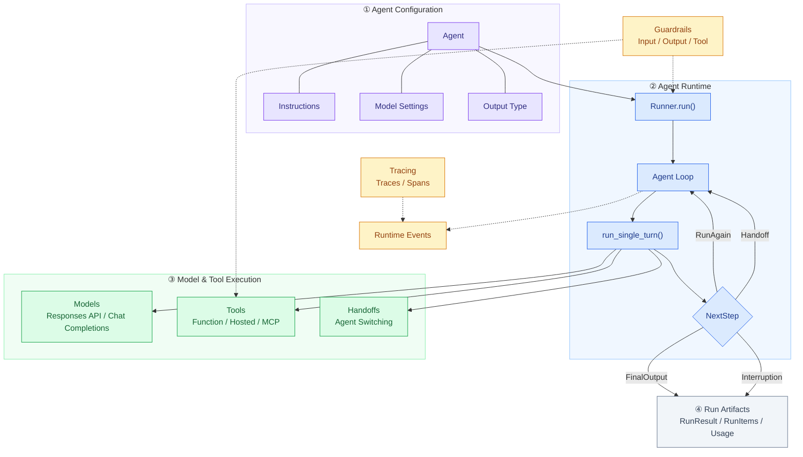
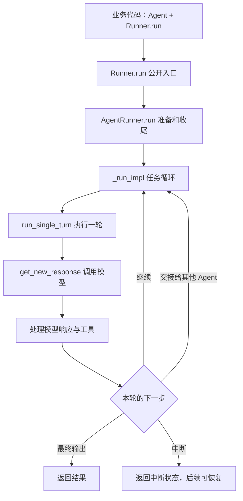
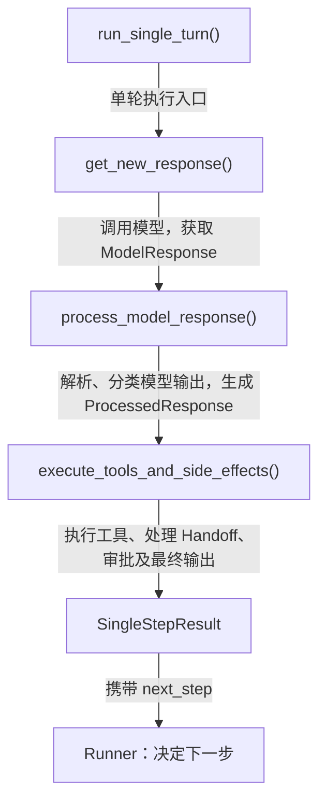
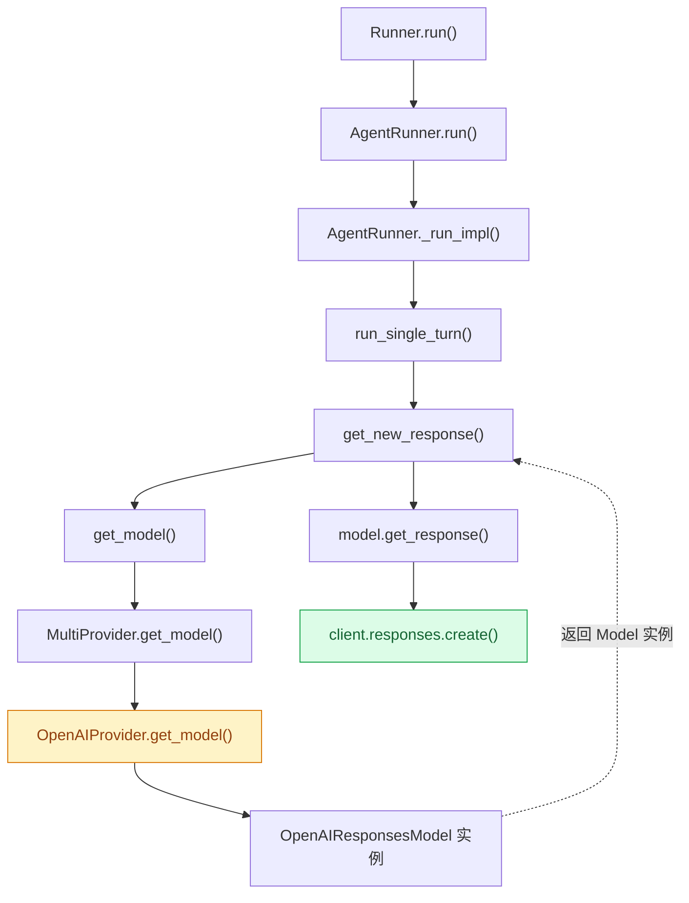
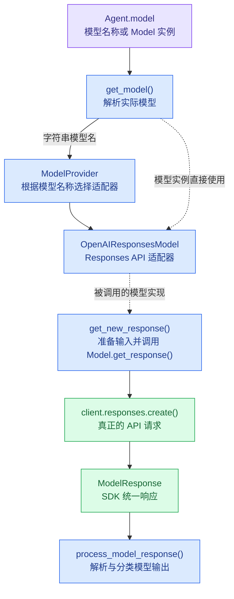

### 1、agents sdk？
1）解决什么问题？
普通LLM调用：一问一答。Prompt-> LLM -> Answers
Agent：需要执行多个步骤完成任务。Agent = LLMs+Tools+Memory+Logic
问明天天气适合户外运动吗？ -> 模型查天气 -> 模型得到结果，台风天 -> 模型根据信息给出回答。

- 复杂问题可能不只查一轮工具，而且还会查memory（比如用户住在哪个城市）等其他context，这些调用需要有管理。

Agents SDK：提供通用的agent运行能力，相当于是构建agent的一个脚手架。
- Agent配置转化为模型请求
- 处理模型返回的function tool call
- 执行tools、把tools返回的结构给模型
- agent loop

* takeaways
- 但agent sdk并非必要，就像写前端可以直接写js，但是vue/react等框架帮我们更好构建应用。
- sdk只是提供可复用的运行机制，供我们组装，用于搭建Agent。数据、业务规则等需要自己实现。


### 2、整体架构


核心抽象：
Agent: 配置对象，本身不运行，name、instructions、tools、models
Runner：执行agent loop，管理每次运行的状态和控制流
Tool：Agent能调用的外部能力
Handoff：特殊的tool，允许改变执行任务的agent

```python
@tool
def get_weather(city: str) -> Weather:
    """获取指定城市的天气。"""
    return Weather(city=city, temperature_range="14-20C", conditions="Sunny with wind.")

agent = Agent(
    name="Hello world",
    instructions="You are a helpful agent.",
    tools=[get_weather],
    model=""
    handoffs=[]
)

result = await Runner.run(agent, input="What's the weather in Tokyo?")
print(result.final_output)
```

* takeaway: sdk把agent和runner分开设计，分离Agent配置和执行过程。每次执行有独立的运行状态。

```
agents配置
- run A
    - history = [A]
- run B
    - history = [B]
``` 

### 3、核心机制：Agent Loop

1) While True



Runner._run_impl()的骨架：
> Runner 本质上是一个运行控制器。它反复执行模型轮次，并通过 `NextStep` 状态机决定结束、继续、切换 Agent 或暂停。模型调用和工具执行的细节被封装在单轮执行逻辑中。
> 回答：什么时候运行下一轮？

```python
async def _run_impl_(starting_agent, input, max_turns=10):
    current_agent = starting_agent
    original_input = ItemHelpers.input_to_items(input)
    generated_items = []
    current_turn = 0

    while True:
        current_turn += 1

        if max_turns is not None and current_turn > max_turns:
            raise MaxTurnsExceeded()

        # 1. 执行一轮：准备输入、调用模型、
        # 解析响应、执行本地工具或 Handoff
        turn_result = await run_single_turn(
            agent=current_agent,
            original_input=original_input,
            generated_items=generated_items,
        )

        # 2. 更新本轮产生的消息与工具结果
        # Handoff 可能过滤或改写输入历史
        original_input = turn_result.original_input
        generated_items = (
            turn_result.pre_step_items
            + turn_result.new_step_items
        )

        # 3. 根据执行结果决定下一步
        next_step = turn_result.next_step

        if isinstance(next_step, NextStepFinalOutput):
            # 还需完成输出护栏、Hooks、持久化等
            return await finalize_result(turn_result)

        elif isinstance(next_step, NextStepHandoff):
            current_agent = next_step.new_agent
            continue

        elif isinstance(next_step, NextStepInterruption):
            # 保存暂停状态，等待审批后恢复
            return build_interruption_result(turn_result)

        elif isinstance(next_step, NextStepRunAgain):
            continue

```

* key considerations
next step有4个类型，循环看next_step的类型来分发
- NextStepFinalOutput - 产生满足结束条件的最终输出（没调工具、没切 Agent）
- NextStepHandoff - 模型调了一个 handoff 工具，把控制权移交给另一个 Agent，current_agent 换人，循环继续。
- NextStepRunAgain - 模型调了普通工具，工具结果已经被附加到 input 里，需要再次执行模型调用
- NextStepInterruption：


2) 单轮执行：模型调用+工具分发

```python
# 伪代码：省略复杂参数、Hooks、Guardrails 等
async def run_single_turn(agent, input, context):

    # 阶段一：准备并调用模型
    tools = await get_all_tools(agent, context)
    handoffs = await get_handoffs(agent, context)
    instructions = await agent.get_system_prompt(context)
    output_schema = get_output_schema(agent)

    response = await get_new_response(
        agent=agent,
        instructions=instructions,
        input=input,
        tools=tools,
        handoffs=handoffs,
        output_schema=output_schema,
    )

    # 阶段二：解析和分类模型输出
    processed = process_model_response(
        agent=agent,
        response=response,
        all_tools=tools,
        handoffs=handoffs,
        output_schema=output_schema,
    )

    # 阶段三：执行工具并决定下一步
    return await execute_tools_and_side_effects(
        agent=agent,
        processed_response=processed,
        model_response=response,
        context=context,
    )
``` 



假设一次模型相应同时包含：
```json 
[
    FunctionCall("get_weather", {"city": "上海"}),
    FunctionCall("get_time", {"city": "上海"}),
    Message("正在查询天气和时间")
]
``` 

解析阶段识别出两个工具调用（识别工具调用ID和参数）和模型消息。
执行阶段负责处理处理 Function Tool 执行、Handoff，以及这些操作产生的副作用和后续控制流。
最后返回结果格式：SingleStepResult（src/agents/run_internal/run_steps.py:192），携带本轮执行产物和next_step交给Runner决定下一步。
```python 

@dataclass
class SingleStepResult:
    original_input: str | list
    model_response: ModelResponse

    pre_step_items: list[RunItem]
    new_step_items: list[RunItem]

    next_step: (
        NextStepRunAgain
        | NextStepHandoff
        | NextStepFinalOutput
        | NextStepInterruption
    )

    tool_input_guardrail_results: list
    tool_output_guardrail_results: list
``` 


** recap: 单轮执行负责完成一次模型交互及其本地处理，runner负责整个任务的生命周期。两者通过 SingleStepResult.next_step 解耦。

3) Model Provider * Responses API

Agent 配置中的 model="gpt-4.1" 只是一个字符串，Runner 如何找到具体 Model，并最终发起 Responses API 请求？


顺着刚刚的思路，从Runner.run()开始一路到run_single_turn()，这里面就开始调用模型了。




也就是get_new_reponses往后，这是后面的整体调用链。


这边首先要区分三个概念
1、Agent.model 声明使用哪个模型，如下：

```python
from agents import Agent, Runner

agent = Agent(
    name="Weather Agent",
    instructions="你是一个天气助手",
    model="gpt-5.6-sol", # just a string
    tools=[get_weather]
)
```

2、ModelProvider 根据模型名称找到相应的Model对象
gpt-5.2 -> OpenAIProvider

3、Model对象：定义如何调用模型以及如何返回统一结果
OpenAIResponseModel


```python
from agents import Agent, Runner, RunConfig

agent = Agent(
    name="Weather Agent",
    instructions="你是一个天气助手",
    model="gpt-5.6-sol", # just a string
    tools=[get_weather]
)

result = await Runner.run(
    agent,
    "上海天气怎么样？",
    run_config=RunConfig(model="gpt-5.6-luna") 
)
```
openai-agents-python/src/agents/run_internal/run_loop.py:2961
openai-agents-python/src/agents/run_internal/turn_preparation.py:134

```python
def get_model(agent, run_config):
    # 运行配置优先
    if isinstance(run_config.model, Model):
        return run_config.model

    elif isinstance(run_config.model, str):
        return run_config.model_provider.get_model(
            run_config.model
        )

    # 再检查 Agent 配置
    elif isinstance(agent.model, Model):
        return agent.model

    return run_config.model_provider.get_model(
        agent.model
    )
```

* takeway
- 运行级模型配置优先于 Agent 配置。
- 如果已经提供了 Model 实例，就不需要 Provider 再去解析
    - 可以将自定义 Model 实现直接配置给 Agent，而不一定依赖 OpenAI 的默认 Provider


Model Provider具体做什么？
openai-agents-python/src/agents/models/openai_provider.py:244
```python

# 根据真实源码简化
def get_model(self, model_name):

    # 1. 确定模型名称
    name = model_name or get_default_model()

    # 2. 提供OpenAI API客户端
    client = self._get_client()

    # 3. 判断使用哪种模型 API
    if not self._use_responses:
        return OpenAIChatCompletionsModel(
            model=name,
            openai_client=client,
        )

    # 4. 默认 Responses HTTP 路径
    return OpenAIResponsesModel(
        model=name,
        openai_client=client,
    )
```


为什么需要 Model Provider？ 如何支持 Responses API、Chat Completions 和第三方模型，同时让 Runner 不依赖具体 API？

### 4、design tradeoffs
1、Runner.run(agent, input) vs agent.run(input)

2、Handoff 借道 function calling 是巧思也是限制

把"切 Agent"建模成"调一个特殊工具"，复用 function calling 协议——这招很聪明，没改模型接口就实现了多 Agent 协作。

但限制是：handoff 的"转交时机"完全交给模型自己判断，写在 tool description 里。如果你想做更精细的控制（比如"必须先收集到 X 信息再转交"），你得自己加 guardrail——SDK 提供了 @input_guardrail，但用起来有点啰嗦。这地方比起 LangGraph 那种"显式状态机"的设计要弱一点。

### 5、application
简单的"单 Agent + 工具调用"或者"两三层 handoff 的客服分流"，我会直接上这个 SDK，省事。但如果是复杂的状态机（比如订单审批流，固定步骤、固定分支），我宁可用 LangGraph 显式建图，或者干脆自己写——因为复杂业务最怕的就是"模型自己决定下一步"。