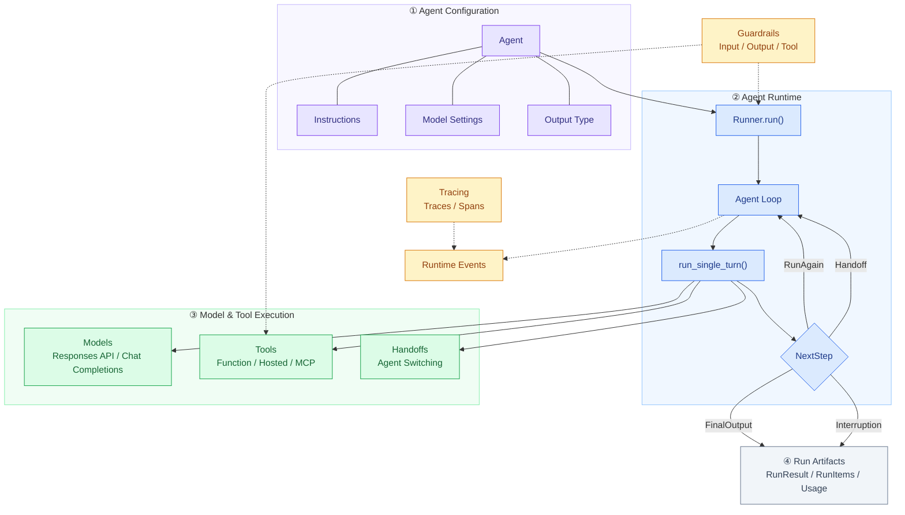
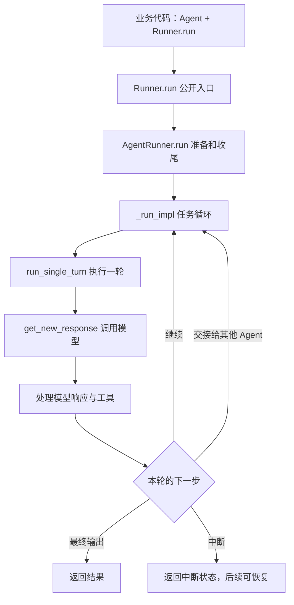
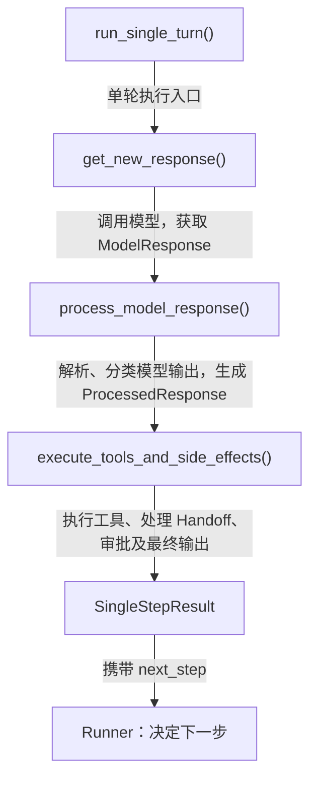
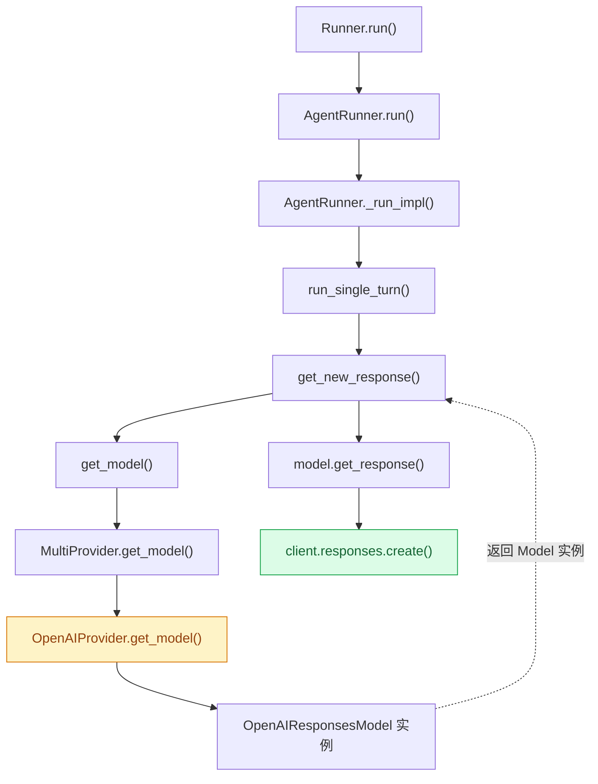
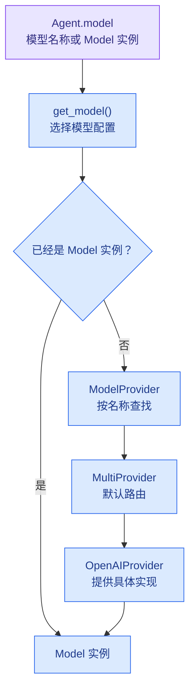
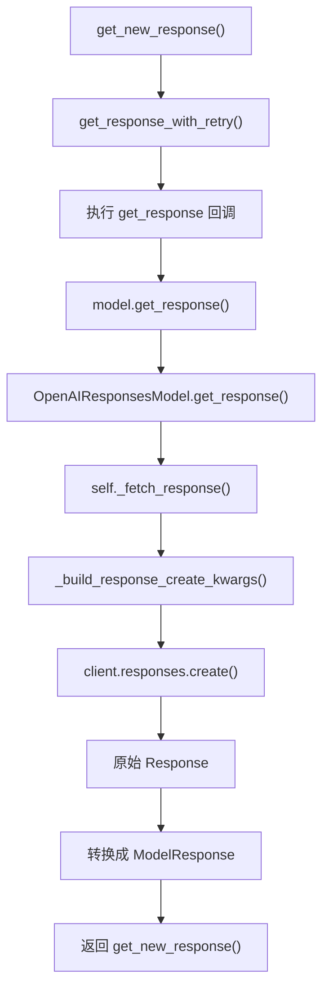

# 从一次模型调用到 Agent Runtime：深入 OpenAI Agents SDK Python 核心源码

> **研究目标：** 理解 OpenAI Agents SDK 的架构设计与核心执行机制，重点研究模型、工具和执行器如何协作，以及 Agent 如何继续执行、切换 Agent、暂停和结束任务。
>
> **研究方法：** 问题 → 结构 → 调用链 → 设计取舍 → 实验验证 → 应用。
>
> 本文围绕 Python SDK 的非流式执行主链路展开。源码片段中会区分实际源码和为了理解而编写的精简伪代码。

---

# 一、为什么需要 Agents SDK？

假设现在需要开发一个 AI 助手。

用户问：

> 明天上海适合户外跑步吗？

如果只是普通的 LLM 应用，我们很可能直接把问题发送给模型：

```text
Prompt → LLM → Answer
```

但很快就会遇到一个问题：

**模型怎么知道上海明天的真实天气？**

即使模型能够回答，它也不一定掌握实时天气数据。

为了给出可靠的建议，我们需要让模型先查询天气，再根据结果判断。

于是，执行流程变成：

```text
用户：明天上海适合跑步吗？
    ↓
模型：需要查询上海明天的天气
    ↓
调用天气 API
    ↓
返回天气数据：台风预警
    ↓
模型根据天气结果判断
    ↓
回答：不建议户外跑步
```

模型不再只是生成文本，而是参与了一个多步骤的任务。

如果任务再复杂一点，比如根据用户的运动习惯、居住位置、天气和附近场所制定计划，系统可能还需要读取 Memory、查询多个工具，甚至将任务交给其他 Agent。

可以用一个概念性公式理解：

**Agent ≈ LLM + Tools + Context / Memory + Execution Logic**

这里的 Memory 是可选能力，不是每个 Agent 都必须有持久记忆。

## 1.1 真正复杂的是执行过程

我们完全可以直接使用 Responses API，自己实现一个 Agent：

```python
# 教学伪代码

while True:
    response = await call_model()

    if response.has_tool_calls:
        results = await execute_tools(response)
        update_history(results)
    else:
        return response.final_output
```

看起来不复杂。

但真实业务中还会遇到：

- 模型一次请求多个工具怎么办？
- 工具参数错误或执行失败怎么办？
- 模型一直请求工具，无法结束怎么办？
- 模型想切换另一个 Agent，谁来管理控制权？
- 任务需要人工审批，怎么暂停和恢复？
- 多轮模型调用的上下文、状态与用量由谁管理？

这些都是 Agent 应用普遍面临的问题。

**OpenAI Agents SDK 就是为这类问题提供通用运行机制的框架。**

主要能力包括：

- 将 Agent 配置转成模型请求。
- 识别并处理模型产生的 Function Tool Call。
- 执行工具，将结果反馈给模型。
- 管理 Agent Loop。
- 支持多 Agent Handoff。
- 提供 Guardrails、Session、Tracing 等能力。

可以类比 Vue / React。

即使没有前端框架，我们也能直接使用 JavaScript 开发应用；但框架可以封装通用的运行机制。

同理，Agents SDK 并非构建 Agent 的必要条件。开发者完全可以自己基于 Responses API 实现执行循环。

**Takeaway：Agents SDK 提供的是可复用的 Agent Runtime，而不是具体业务能力。**

那么，OpenAI 是怎样组织这套 Runtime 的？

---

# 二、整体架构：Agent 和 Runner 为什么分开？

先看整体架构。

## 2.1 SDK 核心架构图



这是概念架构图，不是严格的函数调用顺序。

可以先认识四个核心抽象：

| 抽象 | 核心职责 |
|---|---|
| Agent | 配置对象，声明名称、指令、模型和工具等 |
| Runner | 执行 Agent Loop，管理运行状态和控制流 |
| Tool | Agent 能调用的外部能力 |
| Handoff | 将执行任务的控制权转交给另一个 Agent |

## 2.2 看一个最小示例

```python
from dataclasses import dataclass
from agents import Agent, Runner, function_tool

@dataclass
class Weather:
    city: str
    temperature_range: str
    conditions: str

@function_tool
def get_weather(city: str) -> Weather:
    """获取指定城市的天气。"""
    return Weather(
        city=city,
        temperature_range="14-20C",
        conditions="Sunny with wind."
    )

agent = Agent(
    name="Hello world",
    instructions="You are a helpful agent.",
    tools=[get_weather],
    model="gpt-4.1",
    handoffs=[],
)

result = await Runner.run(
    agent,
    input="What's the weather in Tokyo?"
)

print(result.final_output)
```

天气数据为模拟数据。

注意这两个对象：

```python
agent = Agent(...)
```

```python
result = await Runner.run(agent, input)
```

为什么不是直接：

```python
result = await agent.run(input)
```

而是需要一个独立的 Runner？

## 2.3 配置和执行分离

Agent 主要负责声明能力：

```text
Agent
├── name
├── instructions
├── tools
├── handoffs
├── model
├── model_settings
├── output_type
└── guardrails
```

Runner 则负责真正执行这些配置。

例如，同一个天气助手可以服务不同用户：

```text
           Weather Agent 配置
                  │
          ┌───────┴───────┐
          ▼               ▼
        Run A           Run B
    用户 A 的输入      用户 B 的输入
    独立执行状态       独立执行状态
```

这里复用的是 Agent 配置，每次 Run 维护各自的执行状态。

但要注意：

**Agent 和 Runner 不分开，也可以实现复用。**

分离的主要价值是明确职责边界，使能力声明与执行逻辑解耦。

此外，Agent 对象并非严格不可变；如果开发者主动共享 Session、Context 或其他可变对象，仍然需要处理状态隔离。

**Takeaway：Agent 定义“能做什么”，Runner 决定“怎么运行”。**

那么 Runner 收到请求以后做了什么？

---

# 三、Agent Loop：Runner 如何推进任务？

现在回到：

```python
result = await Runner.run(agent, input)
```

顺着调用链往下看。

## 3.1 从 Runner.run() 到 _run_impl()



核心调用链：

```text
Runner.run()
    ↓
AgentRunner.run()
    ↓
AgentRunner._run_impl()
    ↓
run_single_turn()
```

源码：

`src/agents/run.py`

`src/agents/run_internal/run_loop.py`

最值得研究的是 `_run_impl()`，因为它负责整个 Agent 的执行循环。

## 3.2 _run_impl()：一个 while True

从源码提炼的核心骨架：

```python
# 教学伪代码，省略 Session、Hooks、Guardrails 等细节

async def simplified_run(starting_agent, input, max_turns=10):
    current_agent = starting_agent
    original_input = ItemHelpers.input_to_items(input)
    generated_items = []
    current_turn = 0

    while True:
        current_turn += 1

        if max_turns is not None and current_turn > max_turns:
            raise MaxTurnsExceeded()

        # 1. 执行一次模型交互及本地处理
        turn_result = await run_single_turn(
            agent=current_agent,
            original_input=original_input,
            generated_items=generated_items,
        )

        # 2. 更新本轮产生的消息与工具结果
        # Handoff 可能过滤或改写输入历史
        original_input = turn_result.original_input
        generated_items = (
            turn_result.pre_step_items
            + turn_result.new_step_items
        )

        # 3. 根据执行结果决定下一步
        next_step = turn_result.next_step

        if isinstance(next_step, NextStepFinalOutput):
            # 完成 Guardrails、Hooks、持久化等
            return await finalize_result(turn_result)

        elif isinstance(next_step, NextStepHandoff):
            current_agent = next_step.new_agent
            continue

        elif isinstance(next_step, NextStepInterruption):
            # 保存状态，等待审批后恢复
            return build_interruption_result(turn_result)

        elif isinstance(next_step, NextStepRunAgain):
            continue
```

这里的 `finalize_result()` 和 `build_interruption_result()` 是为了表达职责而抽象出的教学函数，不是源码中的精确调用。

这段代码可以归纳为：

**执行一轮 → 获取执行结果 → 判断下一步 → 继续或结束。**

为什么要有循环？

因为模型可能需要执行多个步骤：

```text
第 1 轮：模型查询天气
    ↓
执行 get_weather
    ↓
第 2 轮：模型发现还需要场地信息
    ↓
执行 search_places
    ↓
第 3 轮：模型生成最终建议
```

## 3.3 NextStep：把下一步动作表示成类型

注意：

```python
next_step = turn_result.next_step
```

Runner 不需要直接分析模型原始输出，只需要根据 Single Turn 的执行结果决定下一步。

主要有四种 NextStep：

| 类型 | 含义 |
|---|---|
| `NextStepRunAgain` | 当前 Agent 需要再次调用模型 |
| `NextStepHandoff` | 切换 Agent 后继续 |
| `NextStepFinalOutput` | 已产生候选最终输出，进入收尾阶段 |
| `NextStepInterruption` | 暂停执行，保留恢复状态 |

为什么使用这些类型，而不是多个布尔变量？

假设：

```python
should_continue = True
should_handoff = False
should_finish = True
```

多个布尔值可能出现互相矛盾的组合。

使用不同类型可以更明确地表达控制流。

这是一种状态机设计。

注意：

`NextStepFinalOutput` 不代表任务之前从未执行工具。

模型可能在前面的轮次已经调用过工具，最后才返回答案。

而 `NextStepHandoff` 会更新：

```python
current_agent = next_step.new_agent
```

让下一轮使用新的 Agent 配置。

## 3.4 max_turns 限制什么？

看这一段：

```python
current_turn += 1

if max_turns is not None and current_turn > max_turns:
    raise MaxTurnsExceeded()
```

这里的 Turn 主要指一次逻辑模型调用及其响应处理。

**Turn 不等于 Tool Call。**

例如：

```text
第 1 次模型调用
    ├── Tool Call A
    ├── Tool Call B
    └── Tool Call C

第 2 次模型调用
    └── Final Output
```

虽然执行了三个工具，但是只有两个模型轮次。

同一次逻辑模型请求内部发生的重试，也不会单独增加 Turn。

**Takeaway：Runner 本质上是一个运行控制器，通过 Agent Loop 和 NextStep 状态机推进任务。**

现在我们已经知道 Runner 如何控制整个任务。

但它调用的 `run_single_turn()` 到底做了什么？

---

# 四、Single Turn：一次模型交互是如何完成的？

`run_single_turn()` 负责完成当前轮次的模型交互及本地处理。

可以从源码中提炼出三个阶段。

## 4.1 单轮执行的核心伪代码

```python
# 教学伪代码：省略复杂参数、Hooks、Guardrails 等

async def run_single_turn(agent, input, context):

    # 阶段一：准备并调用模型
    tools = await get_all_tools(agent, context)
    handoffs = await get_handoffs(agent, context)
    instructions = await agent.get_system_prompt(context)
    output_schema = get_output_schema(agent)

    response = await get_new_response(
        agent=agent,
        instructions=instructions,
        input=input,
        tools=tools,
        handoffs=handoffs,
        output_schema=output_schema,
    )

    # 阶段二：解析和分类模型输出
    processed = process_model_response(
        agent=agent,
        response=response,
        all_tools=tools,
        handoffs=handoffs,
        output_schema=output_schema,
    )

    # 阶段三：执行工具并决定下一步
    return await execute_tools_and_side_effects(
        agent=agent,
        processed_response=processed,
        model_response=response,
        context=context,
    )
```

对应流程图：



为什么把模型响应解析和工具执行分开？

假设模型同时返回：

```json
[
  {
    "type": "function_call",
    "name": "get_weather",
    "arguments": "{\"city\":\"上海\"}",
    "call_id": "call_weather"
  },
  {
    "type": "function_call",
    "name": "get_time",
    "arguments": "{\"city\":\"上海\"}",
    "call_id": "call_time"
  },
  {
    "type": "message",
    "role": "assistant",
    "content": [
      {
        "type": "output_text",
        "text": "正在查询天气和时间"
      }
    ]
  }
]
```

这是教学示例，并不代表模型每次调用工具时都会同时返回文本消息。

解析阶段负责识别：

- 两个 Function Tool Call。
- 工具名称、参数和 Call ID。
- 模型生成的消息。

执行阶段负责处理：

- 工具参数校验。
- 工具执行和结果收集。
- Handoff。
- 审批、异常及其他副作用。
- 下一步控制流决策。

**这意味着 SDK 将“模型想做什么”和“如何执行”拆成了两个阶段。**

## 4.2 SingleStepResult 返回什么？

源码：

`src/agents/run_internal/run_steps.py` → `SingleStepResult`

精简结构：

```python
@dataclass
class SingleStepResult:
    original_input: str | list
    model_response: ModelResponse

    pre_step_items: list[RunItem]
    new_step_items: list[RunItem]

    next_step: (
        NextStepRunAgain
        | NextStepHandoff
        | NextStepFinalOutput
        | NextStepInterruption
    )

    tool_input_guardrail_results: list
    tool_output_guardrail_results: list
```

这里仅保留关键字段。

重点是：

`new_step_items`：记录本轮产生的消息、工具调用和工具结果等。

`next_step`：告诉 Runner 下一步应该继续、切换、结束还是中断。

因此可以理解为：

**SingleStepResult = 本轮执行产物 + 下一步控制指令。**

到这里，Runner 和 Single Turn 的职责已经比较清楚。

不过，我们刚才跳过了一个关键过程：

```python
response = await get_new_response(...)
```

这个函数究竟是怎么调用模型的？

---

# 五、模型是怎么被调用的？从字符串到 Responses API

先不考虑复杂的 Provider 设计。

我们只追踪一个最普通的例子：

```python
agent = Agent(
    name="Weather Agent",
    model="gpt-4.1"
)
```

这里的 `"gpt-4.1"` 只是一个字符串。

现在 `Runner.run()` 已经执行到：

```python
get_new_response()
```

接下来 SDK 必须完成两件事：

**第一，找到对应的模型实现。**

**第二，使用这个模型实现发起 API 请求。**

这就是整个模型调用模块的主线。

## 5.1 先看完整调用链



这张图展示默认无前缀模型名称、Responses HTTP 模式下的典型路径。

模型对象已经由应用提供时，可以跳过 Provider 解析。

## 5.2 第一步：get_model() 找到模型实例

在 `get_new_response()` 中：

```python
model = get_model(execution_agent, run_config)
```

源码：

`src/agents/run_internal/turn_preparation.py` → `get_model()`

它主要做两件事：

1. 确定模型配置来自 `RunConfig.model` 还是 `Agent.model`。
2. 判断配置是 Model 实例，还是需要解析的模型名称。

精简代码：

```python
def get_model(agent, run_config):
    # RunConfig.model 优先
    if isinstance(run_config.model, Model):
        return run_config.model

    if isinstance(run_config.model, str):
        return run_config.model_provider.get_model(
            run_config.model
        )

    # 其次使用 Agent.model
    if isinstance(agent.model, Model):
        return agent.model

    return run_config.model_provider.get_model(
        agent.model
    )
```

这里有一个关键规则：

**如果已经是 Model 实例，就直接使用；如果是模型名称字符串，就交给 ModelProvider 查找。**

例如：

```python
agent = Agent(
    name="Assistant",
    model="gpt-4.1-mini"
)

result = await Runner.run(
    agent,
    "你好",
    run_config=RunConfig(model="gpt-4.1")
)
```

本次运行优先使用 `RunConfig.model`。

但为什么：

```python
run_config.model_provider.get_model(...)
```

最终会进入 `MultiProvider.get_model()`？

因为 `RunConfig` 默认这样配置：

```python
model_provider: ModelProvider = field(
    default_factory=MultiProvider
)
```

其中：

- `ModelProvider` 是抽象基类，定义 `get_model()` 接口。
- `MultiProvider` 是默认具体实现。
- `default_factory=MultiProvider` 表示未显式指定时创建 MultiProvider 实例。

所以：

```python
run_config.model_provider.get_model("gpt-4.1")
```

默认实际执行：

```python
MultiProvider.get_model("gpt-4.1")
```

这是 Python 的动态方法分派。

如果开发者传入：

```python
RunConfig(model_provider=MyProvider())
```

则会执行自定义的 `MyProvider.get_model()`。

**也就是说，调用方依赖 ModelProvider 接口，但实际调用哪个实现由运行时对象决定。**

### MultiProvider 与 OpenAIProvider 怎么协作？

`MultiProvider` 主要负责路由。

对于没有 Provider 前缀的 `"gpt-4.1"`，默认交给 `OpenAIProvider`。

```text
MultiProvider.get_model("gpt-4.1")
    ↓
OpenAIProvider.get_model("gpt-4.1")
    ↓
OpenAIResponsesModel(...)
```

源码：

`src/agents/models/multi_provider.py`

`src/agents/models/openai_provider.py`

`OpenAIProvider` 会根据配置返回不同的 Model 实现：

```python
# 精简伪代码

def get_model(self, model_name):
    name = model_name or get_default_model()
    client = self._get_client()

    if not self._use_responses:
        return OpenAIChatCompletionsModel(
            model=name,
            openai_client=client,
        )

    if use_websocket_transport:
        return OpenAIResponsesWSModel(
            model=name,
            openai_client=client,
        )

    return OpenAIResponsesModel(
        model=name,
        openai_client=client,
    )
```

不同实现的区别：

| Model | 底层接口 |
|---|---|
| `OpenAIResponsesModel` | Responses API + HTTP |
| `OpenAIResponsesWSModel` | Responses API + WebSocket |
| `OpenAIChatCompletionsModel` | Chat Completions API |

默认普通 HTTP 模式使用 `OpenAIResponsesModel`。

**注意：到这里仍然没有调用大模型，只是获得了一个具体 Model 对象。**

为了区分这些角色，可以再看一张局部结构图：



到这里，模型解析就结束了。

## 5.3 第二步：调用 Model，真正发送 API 请求

现在已经得到：

```python
model = OpenAIResponsesModel(...)
```

接下来：

```python
await model.get_response(...)
```

才是真正使用这个 Model。

完整链路如下：



我们沿着这张图继续看。

### 为什么要经过 get_response_with_retry()？

源码：

`src/agents/run_internal/run_loop.py`

```python
new_response = await get_response_with_retry(
    get_response=lambda: model.get_response(
        system_instructions=filtered.instructions,
        input=filtered.input,
        model_settings=model_settings,
        tools=all_tools,
        output_schema=output_schema,
        handoffs=handoffs,
        tracing=get_model_tracing_impl(
            run_config.tracing_disabled,
            run_config.trace_include_sensitive_data,
        ),
        previous_response_id=previous_response_id,
        conversation_id=conversation_id,
        prompt=prompt_config,
    ),
    rewind=rewind_model_request,
    retry_settings=model_settings.retry,
    get_retry_advice=model.get_retry_advice,
    previous_response_id=previous_response_id,
    conversation_id=conversation_id,
    timeout=model_settings.timeout,
)
```

关键是这一段：

```python
get_response=lambda: model.get_response(...)
```

它把模型调用包装成回调，交给 `get_response_with_retry()` 执行。

正常情况下只调用一次模型；发生符合策略的错误时，才可能重试。

在：

`src/agents/run_internal/model_retry.py`

可以找到关键执行逻辑：

```python
response = await _await_model_attempt(
    get_response(),
    timeout
)
```

这里的 `get_response()` 是传进来的 lambda。

因此实际执行的是：

```python
model.get_response(...)
```

这里需要区分：

- Agent Loop：处理多轮模型调用与工具执行。
- Retry Loop：处理同一次逻辑模型请求的失败重试。

一次模型调用内部的重试，不会独立增加 Agent Turn。

### 为什么 VS Code 会跳到 interface.py？

因为 `model` 的静态类型是 `Model`。

但默认情况下，它的实际对象是：

```python
OpenAIResponsesModel(...)
```

因此：

```python
await model.get_response(...)
```

运行时执行的是：

```python
OpenAIResponsesModel.get_response(...)
```

这同样是动态方法分派。

如果想验证，可以在调用处打断点：

```python
type(model)
```

也可以使用：

```python
import inspect

print(inspect.getfile(type(model)))
print(inspect.getsourcelines(type(model).get_response)[1])
```

确认实际类所在的源码文件和方法行号。

### 最后在哪里调用 Responses API？

打开：

`src/agents/models/openai_responses.py`

找到：

```python
OpenAIResponsesModel.get_response()
```

内部继续调用：

```python
response = await self._fetch_response(
    system_instructions,
    input,
    model_settings,
    tools,
    output_schema,
    handoffs,
    previous_response_id=previous_response_id,
    conversation_id=conversation_id,
    stream=False,
    prompt=prompt,
)
```

随后在 `_fetch_response()` 中：

```python
create_kwargs = self._build_response_create_kwargs(
    # 构造模型请求参数
)

client = self._get_client()

if not stream:
    response = await client.responses.create(
        **create_kwargs
    )
```

**`client.responses.create()` 才是真正发起 Responses API 请求的位置。**

而 `_build_response_create_kwargs()` 负责将 SDK 内部的配置转换为 API 接受的参数，包括：

- 模型名称。
- Instructions 和 Input。
- Tools、Handoffs。
- Model Settings、Output Schema。
- `previous_response_id`、`conversation_id` 等上下文参数。

### 为什么还要返回 ModelResponse？

Responses API 返回的是原始 `Response`。

模型适配器会将它转换成统一的 `ModelResponse`：

```python
return ModelResponse(
    output=response.output,
    usage=usage,
    response_id=response.id,
    request_id=getattr(response, "_request_id", None),
)
```

这样不论底层使用 Responses API 还是 Chat Completions API，上层 Agent Runtime 都可以处理统一的数据结构。

结果沿着原调用链返回：

```text
OpenAIResponsesModel.get_response()
    ↓
get_response_with_retry()
    ↓
get_new_response()
    ↓
run_single_turn()
    ↓
process_model_response()
```

**到这里，我们已经完整走通模型调用链。**

## 5.4 这一层为什么这样设计？

总结一下我们刚才看到的三个角色：

| 组件 | 负责什么 |
|---|---|
| Runner | 决定什么时候调用模型 |
| ModelProvider | 根据模型名称找到具体 Model |
| Model | 调用底层 API，并转换响应 |

这套设计将模型解析和实际调用分开。

如果没有 Model 接口，Runner 可能需要直接判断：

```python
if provider == "openai":
    response = await openai.responses.create(...)

elif provider == "anthropic":
    response = await anthropic.messages.create(...)

elif provider == "other":
    response = await other.generate(...)
```

每增加一种模型适配方式，都可能修改 Runner。

而现在：

```python
model = get_model(agent, run_config)
response = await model.get_response(...)
```

Runner 不需要感知底层 API 的细节。

优点是模型接入和执行控制解耦；代价是增加了抽象层，并需要处理不同模型之间的能力差异。

**Takeaway：ModelProvider 负责找模型，Model 负责调用模型，Runner 负责管理何时调用。**

---

# 六、模型返回之后：SDK 如何识别下一步动作？

现在，我们已经发出了模型请求：

```python
response = await client.responses.create(...)
```

但模型返回的，不一定是最终答案。

例如，它可能返回：

```json
{
  "id": "resp_123",
  "status": "completed",
  "output": [
    {
      "type": "function_call",
      "name": "get_weather",
      "arguments": "{\"city\":\"上海\"}",
      "call_id": "call_001"
    }
  ],
  "usage": {
    "input_tokens": 100,
    "output_tokens": 30,
    "total_tokens": 130
  }
}
```

这是简化的响应示例。

关键字段：

| 字段 | 含义 |
|---|---|
| `output[].type` | 模型输出类型 |
| `name` | 模型想调用的工具 |
| `arguments` | 工具参数 |
| `call_id` | 工具调用 ID |
| `usage` | 本次请求 Token 用量 |

这里要注意：

**`status="completed"` 表示本次模型响应完成，不代表整个 Agent Run 已经结束。**

模型可能只是告诉 SDK：“我需要调用 get_weather。”

## 6.1 四种重要的数据结构

从模型返回到 Runner 决策，中间有几层不同的数据结构。


| 数据结构 | 含义 |
|---|---|
| `Response` | 底层 API 返回的原始数据 |
| `ModelResponse` | SDK 统一模型响应 |
| `ProcessedResponse` | 模型输出被解析、分类后的结果 |
| `SingleStepResult` | 本轮执行产物和下一步控制指令 |

## 6.2 process_model_response() 做什么？

打开：

`src/agents/run_internal/turn_resolution.py`

找到：

```python
process_model_response()
```

它会接收模型响应、可用 Tools、Handoffs 和 Output Schema 等信息。

然后遍历：

```python
for output in response.output:
    ...
```

精简伪代码：

```python
for output in response.output:

    if isinstance(output, ResponseOutputMessage):
        items.append(MessageOutputItem(...))

    elif isinstance(output, ResponseFunctionToolCall):

        if is_handoff_tool_call(output):
            items.append(HandoffCallItem(...))
            handoffs.append(ToolRunHandoff(...))

        else:
            tool = find_function_tool(output)
            items.append(ToolCallItem(...))
            functions.append(ToolRunFunction(...))

return ProcessedResponse(
    new_items=items,
    functions=functions,
    handoffs=handoffs,
)
```

真实源码还会处理更多类型；这里仅保留普通消息、Function Tool 和 Handoff。

重点是：

**process_model_response() 只负责识别和分类，不负责执行普通 Python 工具函数。**

### 为什么 Handoff 也可能表现为 Function Call？

因为 SDK 借用了模型的 Function Calling 机制，来表达 Agent 之间的控制权交接。

例如：

```text
模型调用 transfer_to_refund_agent
    ↓
SDK 识别为 Handoff
    ↓
切换到 Refund Agent
    ↓
继续执行
```

普通 Function Tool 和 Handoff 的模型调用形式可能相似，但执行语义不同。

## 6.3 从 ProcessedResponse 到 SingleStepResult

解析完成后：

```python
processed_response = process_model_response(...)
```

再进入：

```python
result = await execute_tools_and_side_effects(
    processed_response=processed_response,
    ...
)
```

执行阶段负责工具调用、Handoff、审批、部分校验及执行结果的组织。

最后生成：

```python
SingleStepResult(...)
```

由 Runner 读取：

```python
result.next_step
```

决定下一轮动作。

这就闭合了整个 Agent Loop。

---

# 七、重新看完整执行链路

现在，我们已经能把最开始的天气助手与 SDK 源码对应起来：

```text
用户：明天上海适合跑步吗？
    ↓
Runner.run()
    ↓
AgentRunner.run()
    ↓
_run_impl()
    ↓
run_single_turn()
    ↓
get_new_response()
    ↓
get_model()
    ↓
MultiProvider → OpenAIProvider
    ↓
OpenAIResponsesModel
    ↓
get_response_with_retry()
    ↓
model.get_response()
    ↓
_fetch_response()
    ↓
_build_response_create_kwargs()
    ↓
client.responses.create()
    ↓
Response
    ↓
ModelResponse
    ↓
process_model_response()
    ↓
ProcessedResponse
    ↓
execute_tools_and_side_effects()
    ↓
SingleStepResult
    ↓
Runner 读取 next_step
    ├── RunAgain：继续执行
    ├── Handoff：切换 Agent
    ├── FinalOutput：结束
    └── Interruption：暂停
```

这条链路可以分为三个层次：

**Runner：控制执行生命周期。**

**Model：处理模型交互。**

**Tool Execution：执行模型请求的动作。**

三个部分通过明确的数据结构和接口协作。

---

# 八、设计取舍：为什么这样设计？

## 8.1 Runner.run(agent, input) vs agent.run(input)

独立 Runner 的主要价值是将 Agent 配置与执行逻辑分离。

配置可以复用，运行状态由每次执行分别管理。

但这种分离并不是实现配置复用的必要条件。

## 8.2 Handoff 借用 Function Calling

Handoff 将“切换 Agent”建模为特殊工具调用，复用现有 Function Calling 协议。

这使得 SDK 无需为多 Agent 交接设计全新的模型协议。

但是，如果模型自主决定何时 Handoff，业务系统如何确保转交条件已经满足？

不能只依赖模型指令或工具描述。

可以进一步研究工具启用条件、Handoff 回调中的校验，以及应用层确定性控制机制。

特别注意：`@input_guardrail` 不等于每次 Handoff 前都会运行的校验。

## 8.3 模型驱动控制流与显式工作流

Agents SDK 适合模型根据任务情况选择下一步的场景，例如单 Agent 多工具调用、客服分流、多 Agent 协作。

如果业务涉及严格固定步骤、审批和确定性分支，则可以考虑显式工作流框架或自行实现状态机。

初步观点：

**模型负责处理不确定性决策，业务系统应负责不可妥协的执行规则。**

这一结论需要后续结合 Handoff、工具异常和框架对比实验进一步验证。

---

# 九、下一步：Tool Execution

我们目前已经研究了：

**从用户请求进入 Runner，到调用模型，再到识别模型输出。**

但是还有一个最关键的问题：

模型返回：

```json
{
  "type": "function_call",
  "name": "get_weather",
  "arguments": "{\"city\":\"上海\"}",
  "call_id": "call_weather"
}
```

SDK 到底怎样将这个调用意图变成真正的 Python 函数执行？

下一阶段研究：

1. 如何根据名称找到对应的 Python Function Tool？
2. 如何将 JSON 参数转换为 Python 参数？
3. 参数校验在哪里发生？
4. 工具失败如何处理？
5. 工具结果如何变成 ToolCallOutputItem？
6. 什么时候继续模型调用，什么时候可以直接结束？
7. Handoff 和普通 Function Tool 的执行有什么不同？

## 9.1 实验设计

| 实验 | 验证目标 |
|---|---|
| 正常工具调用 | Tool Call → Tool Output → 再次模型调用 |
| 工具参数错误 | 参数校验及异常路径 |
| 工具抛出异常 | 错误转换与终止行为 |
| 连续调用工具 | Agent Loop 与 max_turns |
| stop_on_first_tool | 工具直接结束任务 |
| Handoff | 当前 Agent 切换 |
| NextStepInterruption | 暂停和恢复 |

每个实验记录输入、模型响应、执行 Trace、关键源码位置和实际结果。

---

# 十、核心源码索引

仓库：https://github.com/openai/openai-agents-python

| 模块 | 源码 |
|---|---|
| Runner 主入口与 Agent Loop | `src/agents/run.py` |
| Single Turn | `src/agents/run_internal/run_loop.py` |
| get_model | `src/agents/run_internal/turn_preparation.py` |
| RunConfig | `src/agents/run_config.py` |
| Model / ModelProvider 接口 | `src/agents/models/interface.py` |
| MultiProvider | `src/agents/models/multi_provider.py` |
| OpenAIProvider | `src/agents/models/openai_provider.py` |
| OpenAIResponsesModel | `src/agents/models/openai_responses.py` |
| 模型请求重试 | `src/agents/run_internal/model_retry.py` |
| 模型响应解析 | `src/agents/run_internal/turn_resolution.py` |
| NextStep / SingleStepResult | `src/agents/run_internal/run_steps.py` |
| 工具定义 | `src/agents/tool.py` |
| RunItems | `src/agents/items.py` |

### 原笔记中的关键行号

以下保留为查阅索引；正式分享前需要与研究使用的 Git Commit 核对：

```text
src/agents/run_internal/run_loop.py:2961
src/agents/run_internal/turn_preparation.py:134

src/agents/models/openai_provider.py:244

src/agents/run_internal/run_loop.py:2907
src/agents/run_internal/model_retry.py:543
src/agents/run_internal/model_retry.py:580

src/agents/models/openai_responses.py:543
src/agents/models/openai_responses.py:563
src/agents/models/openai_responses.py:803
src/agents/models/openai_responses.py:816
src/agents/models/openai_responses.py:830
src/agents/models/openai_responses.py:620

src/agents/run_internal/run_steps.py:192
```

---

# 阶段性总结

现在我们已经掌握：

**Agent 声明能力，Runner 驱动执行，ModelProvider 找到具体模型，Model 负责模型 API 交互，Single Turn 组织响应处理和本地动作，NextStep 决定下一步控制流。**

而我们最终要研究清楚的是：

**OpenAI 如何将模型调用、工具执行和状态转换组合成一个通用、可扩展的 Agent Runtime。**

下一步将从 `execute_tools_and_side_effects()` 开始，真正进入 Tool Execution 的实现。
