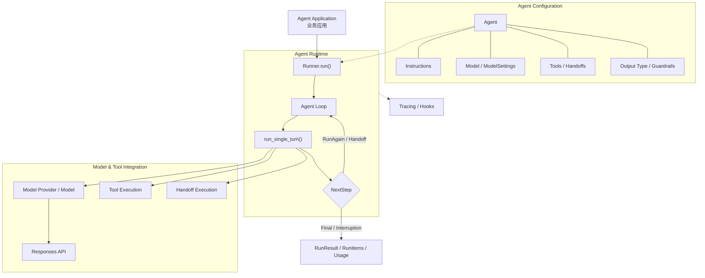
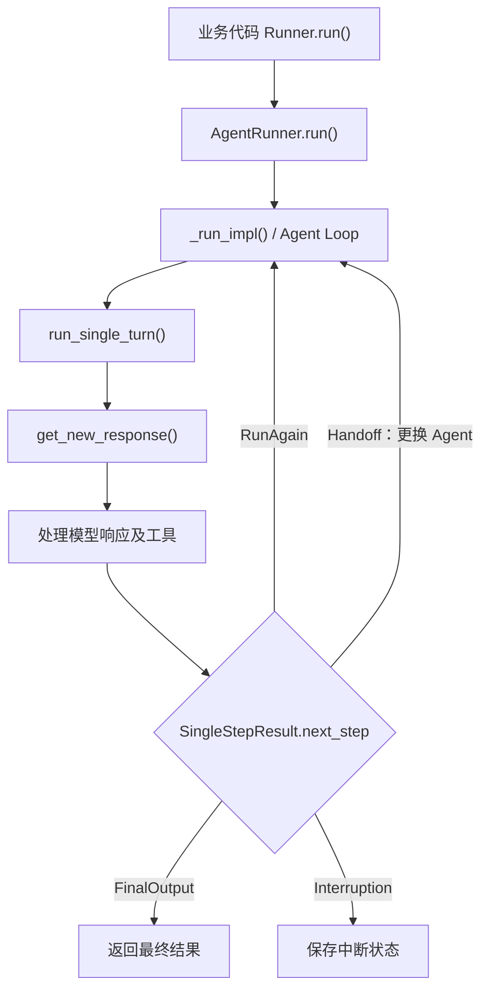
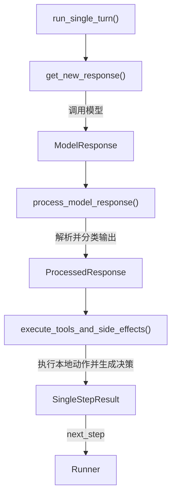
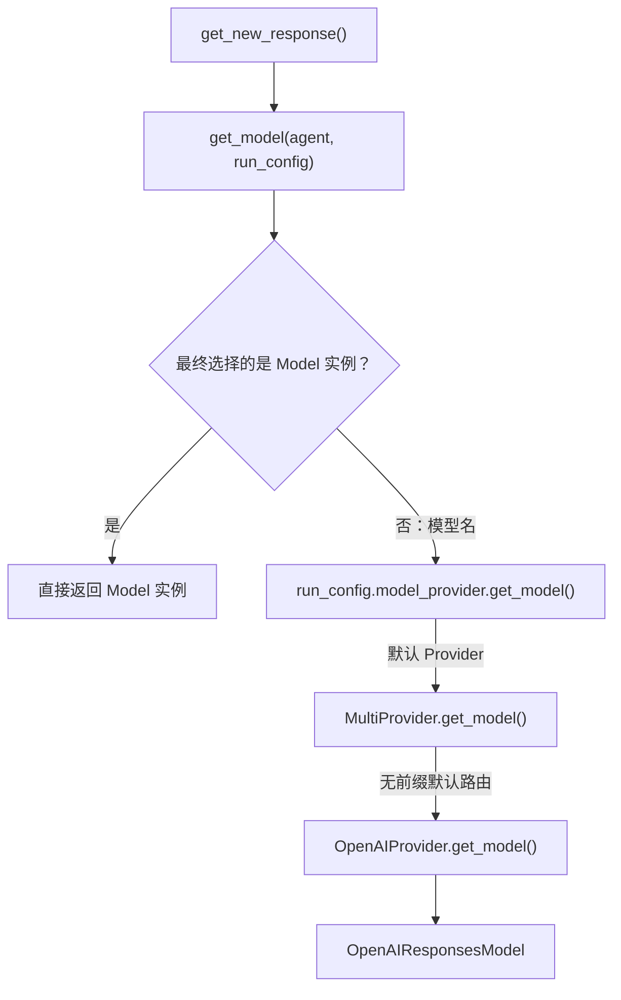
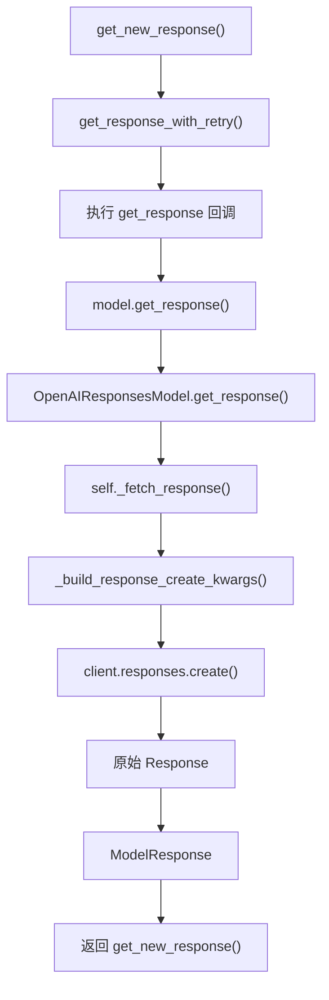

# OpenAI Agents SDK（Python）核心源码研究

> **研究目标：** 理解 OpenAI Agents SDK 的架构设计、核心模块与执行机制，重点研究模型、工具和执行器如何协作，以及 Agent 如何继续执行、切换 Agent、暂停与结束任务。
>
> **研究方法：** 问题 → 结构 → 调用链 → 设计取舍 → 实验验证 → 实际应用。
>
> **当前进度：** 已研究 SDK 架构、Agent Loop、Single Turn、Model Provider、Responses API 调用及模型响应解析。下一步研究 Tool Execution。

---

## 1. 背景：为什么需要 Agents SDK？

### 1.1 从 LLM 调用到 Agent

普通 LLM 调用通常是一次请求与响应：

```text
Prompt → LLM → Answer
```

但实际任务往往不是一次模型调用就能完成的。

例如用户提问：

> 明天上海适合户外跑步吗？

Agent 可能需要：

```text
用户提问
   ↓
LLM 理解任务
   ↓
决定查询天气
   ↓
调用天气工具
   ↓
获得天气结果：台风预警
   ↓
LLM 根据结果进行判断
   ↓
建议用户避免户外跑步
```

复杂任务还可能需要多轮工具调用、读取上下文、查询 Memory、执行其他操作。

因此，Agent 系统通常涉及：

**Agent = LLM + Tools + Context / Memory + Execution Logic**

核心问题是：**谁来管理这些模型调用、工具执行、上下文传递与循环控制？**

### 1.2 Agents SDK 解决什么问题？

Agents SDK 提供构建 Agent 应用所需的通用运行机制。

主要职责：

- 将 Agent 配置转换为模型请求。
- 处理模型返回的 Function Tool Call。
- 调用应用注册的工具，并将结果反馈给模型。
- 管理 Agent Loop，决定什么时候继续调用模型。
- 支持 Handoff，在不同 Agent 之间交接控制权。
- 提供 Guardrails、Tracing、Session 等辅助能力。

可以类比前端框架：

| 前端开发 | Agent 开发 |
|---|---|
| Vue / React | OpenAI Agents SDK |
| 业务 Web 应用 | Agent 应用 |
| 组件管理、响应式、生命周期 | Agent Loop、Tool、Handoff |
| 业务逻辑、数据接口 | Agent 规则、业务工具、外部系统 |

**Takeaways**

- Agents SDK 不是构建 Agent 应用的必要条件。开发者可以直接使用 Responses API，自行实现 Agent Loop。
- SDK 主要提供可复用的运行机制，不负责自动实现业务规则和数据能力。
- Agent 应用是最终的业务系统，Agents SDK 是构建和运行 Agent 应用的框架。

---

## 2. 整体架构与核心抽象

### 2.1 SDK 核心架构



这张图展示的是概念架构及模块关系，不是每个函数的严格调用顺序。

### 2.2 核心抽象

| 抽象 | 核心职责 |
|---|---|
| Agent | 配置对象，声明名称、Instructions、Model、Tools、Handoffs 等 |
| Runner | 执行 Agent Loop，管理运行状态与控制流 |
| Model | 统一模型调用接口，负责与底层模型服务交互 |
| ModelProvider | 将模型名称解析为具体 Model 实例 |
| Tool | Agent 可以调用的外部能力 |
| Handoff | 将当前 Agent 的控制权交接给另一个 Agent |
| Guardrails | 对输入、输出或工具交互执行校验 |
| Tracing | 记录和观察 Agent 的执行过程 |

### 2.3 最小使用示例

```python
from agents import Agent, Runner, function_tool

@function_tool
def get_weather(city: str) -> str:
    """获取指定城市的天气。"""
    return f"{city}: 晴，20°C（模拟数据）"

agent = Agent(
    name="Weather Assistant",
    instructions="你是一个天气助手。",
    model="gpt-4.1",
    tools=[get_weather],
)

result = await Runner.run(
    agent,
    input="What's the weather in Tokyo?"
)

print(result.final_output)
```

这里：

- `Agent` 声明模型、指令和工具。
- `Runner.run()` 启动执行流程。
- 模型决定是否调用 `get_weather`。
- SDK 负责调用工具，并处理工具结果。
- 最终得到 `RunResult.final_output`。

### 2.4 为什么分离 Agent 和 Runner？

SDK 将 Agent 配置与具体执行过程分离。

```text
              Agent 配置
                  │
          ┌───────┴───────┐
          ▼               ▼
        Run A           Run B
     独立执行状态      独立执行状态
```

这样可以复用同一份 Agent 配置，而每次运行分别管理输入、生成项、轮次及执行上下文。

但需要注意：

- Agent 对象并非严格不可变。
- 分离 Agent 和 Runner 不是实现复用的唯一方式。
- 如果共享 Session 或可变 Context，仍需要考虑状态隔离。

**Takeaway：Agent 负责定义能力，Runner 负责执行。职责分离使配置复用和运行状态管理更清晰。**

---

## 3. 核心执行机制：Agent Loop

**核心问题：Runner 如何判断什么时候继续执行、切换 Agent、暂停或结束任务？**

### 3.1 Agent Loop 整体执行链路



### 3.2 `_run_impl()`：Agent Loop 的核心控制器

源码入口：

`src/agents/run.py` → `AgentRunner._run_impl()`

核心职责：

- 维护当前 Agent。
- 维护运行输入和本次生成的 RunItems。
- 统计模型调用轮次。
- 执行 Single Turn。
- 根据 `NextStep` 决定下一步。

简化伪代码：

```python
async def simplified_run(starting_agent, input, max_turns=10):
    current_agent = starting_agent
    original_input = ItemHelpers.input_to_items(input)
    generated_items = []
    current_turn = 0

    while True:
        current_turn += 1

        if max_turns is not None and current_turn > max_turns:
            raise MaxTurnsExceeded()

        # 1. 执行一轮模型调用及本地处理
        turn_result = await run_single_turn(
            agent=current_agent,
            original_input=original_input,
            generated_items=generated_items,
        )

        # 2. 更新输入历史与生成项
        original_input = turn_result.original_input
        generated_items = (
            turn_result.pre_step_items
            + turn_result.new_step_items
        )

        # 3. 判断下一步
        next_step = turn_result.next_step

        if isinstance(next_step, NextStepFinalOutput):
            # 完成 Guardrails、Hooks、持久化等
            return await finalize_result(turn_result)

        elif isinstance(next_step, NextStepHandoff):
            current_agent = next_step.new_agent
            continue

        elif isinstance(next_step, NextStepInterruption):
            # 保存现场，等待后续恢复
            return build_interruption_result(turn_result)

        elif isinstance(next_step, NextStepRunAgain):
            continue
```

注意：`finalize_result()` 和 `build_interruption_result()` 是教学伪代码中的抽象函数，不代表真实源码中存在完全相同的方法。

### 3.3 NextStep：执行状态机

`SingleStepResult.next_step` 有四种主要状态：

| NextStep | 含义 | Runner 行为 |
|---|---|---|
| `NextStepRunAgain` | 需要再次调用模型 | 使用当前 Agent 进入下一轮 |
| `NextStepHandoff` | 需要切换 Agent | 更新 `current_agent` 后继续 |
| `NextStepFinalOutput` | 已产生候选最终输出 | 完成收尾处理并返回结果 |
| `NextStepInterruption` | 执行需要暂停 | 保存状态，等待审批或恢复 |

需要注意：

**NextStepFinalOutput 不等于模型从未调用过工具。**

模型可能在前面已经执行过多次工具调用，也可能根据 `tool_use_behavior` 直接采用工具结果作为最终输出。

### 3.4 Turn 与 max_turns

一个 Turn 是一次逻辑模型调用及其响应处理过程。

- 一个 Turn 可以产生多个 Tool Calls。
- 工具执行本身不会额外增加 Turn。
- 一次逻辑模型请求内部发生重试，也不会额外增加 Turn。
- `max_turns` 限制模型调用轮次，而不是工具调用总数。

**Takeaway：Runner 本质上是 Agent 的运行控制器，通过 `NextStep` 状态机管理继续、交接、结束和暂停。**

---

## 4. Single Turn：一次模型交互如何执行？

**核心问题：`run_single_turn()` 具体负责什么？**

### 4.1 单轮执行分为三个阶段



三个阶段：

1. **模型调用**：准备 Agent 配置并请求模型。
2. **响应解析**：识别文本、Function Call、Handoff 等输出。
3. **执行与决策**：执行工具或交接处理，决定本轮结束后应该做什么。

### 4.2 `run_single_turn()` 核心伪代码

```python
async def run_single_turn(agent, input, context):
    # 阶段一：准备并调用模型
    tools = await get_all_tools(agent, context)
    handoffs = await get_handoffs(agent, context)
    instructions = await agent.get_system_prompt(context)
    output_schema = get_output_schema(agent)

    response = await get_new_response(
        agent=agent,
        instructions=instructions,
        input=input,
        tools=tools,
        handoffs=handoffs,
        output_schema=output_schema,
    )

    # 阶段二：解析模型输出
    processed = process_model_response(
        agent=agent,
        response=response,
        all_tools=tools,
        handoffs=handoffs,
        output_schema=output_schema,
    )

    # 阶段三：执行工具及副作用，决定下一步
    return await execute_tools_and_side_effects(
        agent=agent,
        processed_response=processed,
        model_response=response,
        context=context,
    )
```

这是根据真实模块分工整理的教学伪代码，省略了 Guardrails、Hooks、Session、异常等细节。

### 4.3 为什么将解析和执行分开？

假设模型同时返回两个工具调用及一条消息：

```text
FunctionCall("get_weather", {"city": "上海"})
FunctionCall("get_time", {"city": "上海"})
Message("正在查询天气和时间")
```

这只是示意，非真实 JSON 格式。

**解析阶段：**

识别工具名称、Call ID、参数及输出类型，生成待执行任务。

**执行阶段：**

执行工具、处理审批、Guardrails、异常及结果收集，并形成下一步控制指令。

这样可以将“模型提出什么操作”与“SDK 如何执行操作”解耦。

### 4.4 SingleStepResult：单轮执行结果

源码：

`src/agents/run_internal/run_steps.py` → `SingleStepResult`

精简结构：

```python
@dataclass
class SingleStepResult:
    original_input: str | list
    model_response: ModelResponse

    pre_step_items: list[RunItem]
    new_step_items: list[RunItem]

    next_step: (
        NextStepRunAgain
        | NextStepHandoff
        | NextStepFinalOutput
        | NextStepInterruption
    )

    tool_input_guardrail_results: list
    tool_output_guardrail_results: list
```

这不是完整的数据类定义，而是用于理解主要字段的简化结构。

重点看两个字段：

- `new_step_items`：本轮生成的消息、工具调用、工具结果等。
- `next_step`：告诉 Runner 应该继续、切换 Agent、结束还是中断。

**Takeaway：Single Turn 负责执行一轮模型交互及本地处理，Runner 负责整个任务的生命周期。两者通过 `SingleStepResult.next_step` 衔接。**

---

## 5. Model Provider 与 Responses API

**核心问题：Agent 中的 `model="gpt-4.1"` 只是字符串，SDK 怎样找到具体模型，并最终发起 API 请求？**

模型调用可以拆成两个阶段：

1. Model Resolution：解析并获取 Model 实例。
2. Model Invocation：使用 Model 实例真正调用模型 API。

### 5.1 Model、ModelProvider 和 Runner 的区别

| 对象 | 职责 |
|---|---|
| `Agent.model` | 声明模型名称或提供 Model 实例 |
| `ModelProvider` | 定义根据名称获取 Model 的接口 |
| `MultiProvider` | 默认模型路由器 |
| `OpenAIProvider` | 提供具体 OpenAI Model |
| `Model` | 统一模型调用接口 |
| `OpenAIResponsesModel` | Responses API 的具体适配器 |
| `Runner` | 决定什么时候需要调用模型 |

### 5.2 第一阶段：Model Resolution



#### 5.2.1 get_model()：选择模型配置

源码：

`src/agents/run_internal/turn_preparation.py` → `get_model()`

```python
def get_model(agent, run_config):
    # RunConfig 优先
    if isinstance(run_config.model, Model):
        return run_config.model

    if isinstance(run_config.model, str):
        return run_config.model_provider.get_model(
            run_config.model
        )

    # 再检查 Agent 配置
    if isinstance(agent.model, Model):
        return agent.model

    return run_config.model_provider.get_model(
        agent.model
    )
```

核心规则：

- `RunConfig.model` 优先于 `Agent.model`。
- 如果已经是 `Model` 实例，则直接返回。
- 如果是模型名称字符串，则通过 `ModelProvider` 解析。

例如：

```python
agent = Agent(
    name="Assistant",
    model="gpt-4.1-mini"
)

result = await Runner.run(
    agent,
    "你好",
    run_config=RunConfig(model="gpt-4.1")
)
```

这次运行优先使用 `RunConfig` 中的 `"gpt-4.1"`。

#### 5.2.2 为什么会调用 MultiProvider？

源码：

`src/agents/run_config.py` → `RunConfig.model_provider`

```python
model_provider: ModelProvider = field(
    default_factory=MultiProvider
)
```

这里：

- `ModelProvider` 是抽象基类，定义接口。
- `MultiProvider` 是具体实现类。
- `default_factory=MultiProvider` 表示默认创建一个 MultiProvider 实例。

因此：

```python
run_config = RunConfig()

provider = run_config.model_provider
model = provider.get_model("gpt-4.1")
```

运行时实际会调用：

```python
MultiProvider.get_model("gpt-4.1")
```

这是 Python 的动态方法分派。

如果用户传入：

```python
RunConfig(model_provider=MyProvider())
```

则会调用：

```python
MyProvider.get_model(...)
```

**ModelProvider 定义接口，具体执行哪个 get_model()，取决于实际对象类型。**

#### 5.2.3 MultiProvider 如何路由？

源码：

`src/agents/models/multi_provider.py` → `MultiProvider.get_model()`

主要逻辑：

- 模型名称没有 Provider 前缀，默认交给 OpenAIProvider。
- 模型名称有受支持的前缀，根据前缀找到对应 Provider。
- 最终返回具体 Model 对象。

```text
MultiProvider
    ├── OpenAIProvider
    ├── 其他已注册 Provider
    └── 自定义 Provider
```

#### 5.2.4 OpenAIProvider 返回什么？

源码：

`src/agents/models/openai_provider.py` → `OpenAIProvider.get_model()`

精简逻辑：

```python
def get_model(self, model_name):
    name = model_name or get_default_model()
    client = self._get_client()

    if not self._use_responses:
        return OpenAIChatCompletionsModel(
            model=name,
            openai_client=client,
        )

    if use_websocket_transport:
        return OpenAIResponsesWSModel(
            model=name,
            openai_client=client,
        )

    return OpenAIResponsesModel(
        model=name,
        openai_client=client,
    )
```

这里省略了实际源码的连接配置等细节。

三种实现：

| Model | 底层 API / 传输方式 |
|---|---|
| `OpenAIResponsesModel` | Responses API + HTTP |
| `OpenAIResponsesWSModel` | Responses API + WebSocket |
| `OpenAIChatCompletionsModel` | Chat Completions API |

默认普通 HTTP 路径使用 `OpenAIResponsesModel`。

**此时还没有真正发送模型请求，只是拿到了具体 Model 对象。**

### 5.3 第二阶段：Model Invocation

获取 Model 实例后，继续调用模型 API。

完整链路：



#### 5.3.1 get_new_response()：发起模型调用

源码：

`src/agents/run_internal/run_loop.py`

关键代码：

```python
new_response = await get_response_with_retry(
    get_response=lambda: model.get_response(
        system_instructions=filtered.instructions,
        input=filtered.input,
        model_settings=model_settings,
        tools=all_tools,
        output_schema=output_schema,
        handoffs=handoffs,
        # ...其他参数
    ),
    # ...重试及超时配置
)
```

为什么不直接调用 `model.get_response()`？

因为 SDK 使用统一包装器处理正常调用、超时及符合策略的重试。

#### 5.3.2 get_response_with_retry()：执行模型调用回调

源码：

`src/agents/run_internal/model_retry.py`

核心逻辑：

```python
response = await _await_model_attempt(
    get_response(),
    timeout
)
```

其中 `get_response()` 是上一步传入的 lambda：

```python
get_response = lambda: model.get_response(...)
```

因此实际执行的是：

```python
model.get_response(...)
```

注意两种循环的区别：

| Agent Loop | Retry Loop |
|---|---|
| 管理多轮模型调用 | 管理当前请求的失败重试 |
| 处理工具结果后可能继续 | 请求失败且符合策略时重试 |
| 新的逻辑模型轮次消耗 Turn | 同一逻辑调用内部重试不额外消耗 Turn |

正常模型请求成功时，不需要发生重试。

#### 5.3.3 model.get_response()：动态分派到具体实现

因为默认 Model 实例是：

```python
model = OpenAIResponsesModel(...)
```

所以：

```python
await model.get_response(...)
```

实际调用：

`OpenAIResponsesModel.get_response()`

源码：

`src/agents/models/openai_responses.py`

这里也解释了为什么 VS Code 可能跳到 `interface.py`：

- IDE 根据静态类型 `Model` 定位到抽象方法。
- Python 运行时根据实际对象类型，执行 `OpenAIResponsesModel.get_response()`。

#### 5.3.4 _fetch_response()：构造与发送请求

`OpenAIResponsesModel.get_response()` 内部继续调用：

```python
response = await self._fetch_response(
    system_instructions,
    input,
    model_settings,
    tools,
    output_schema,
    handoffs,
    previous_response_id=previous_response_id,
    conversation_id=conversation_id,
    stream=False,
    prompt=prompt,
)
```

`_fetch_response()` 负责：

1. 将 SDK 配置转换为 Responses API 请求参数。
2. 获取 OpenAI API Client。
3. 发起底层请求。

关键伪代码：

```python
create_kwargs = self._build_response_create_kwargs(
    # model、instructions、input、tools 等
)

client = self._get_client()

if not stream:
    response = await client.responses.create(
        **create_kwargs
    )
```

其中：

```python
client.responses.create(...)
```

才是真正发出 Responses API 请求的位置。

### 5.4 Response → ModelResponse

Responses API 返回原始 `Response`。

具体 Model 适配器将其转换为 SDK 统一的 `ModelResponse`。

简化代码：

```python
return ModelResponse(
    output=response.output,
    usage=usage,
    response_id=response.id,
    request_id=getattr(response, "_request_id", None),
)
```

| 类型 | 含义 |
|---|---|
| `Response` | Responses API 原始响应 |
| `ModelResponse` | SDK 的统一模型响应结构 |

为什么要转换？

因为 Responses API 与 Chat Completions API 的原始响应格式不同，而 Runner 不应该分别实现多套模型响应处理逻辑。

**Takeaway：ModelResponse 是模型适配层与 Agent Runtime 之间的统一数据接口。**

---

## 6. 模型返回之后：Response Processing

> 本节是结合我们后续已学习的模型响应解析内容补充的，原始笔记尚未单独整理这一部分。

**核心问题：模型返回的内容如何变成 SDK 能够执行的动作？**

### 6.1 Responses API 返回的可能不只是文本

例如模型返回一个 Function Call：

```json
{
  "id": "resp_123",
  "status": "completed",
  "output": [
    {
      "type": "function_call",
      "name": "get_weather",
      "arguments": "{\"city\":\"上海\"}",
      "call_id": "call_001"
    }
  ]
}
```

这是简化示例。

关键字段：

- `type`：模型输出的类型。
- `name`：要调用的工具名称。
- `arguments`：工具调用参数。
- `call_id`：工具调用标识，用来关联后续结果。

这里要特别注意：

**模型返回 Function Call，并不等于工具已经执行。**

另外，`status="completed"` 只表示此次模型响应已完成，不代表整个 Agent Run 已结束。

### 6.2 process_model_response()：解析模型输出

源码：

`src/agents/run_internal/turn_resolution.py` → `process_model_response()`

处理过程：

```text
ModelResponse
     ↓
遍历 response.output
     ↓
识别输出类型
     ├── Message
     ├── Function Tool Call
     ├── Handoff Call
     └── 其他模型输出
     ↓
ProcessedResponse
```

精简伪代码：

```python
for output in response.output:

    if isinstance(output, ResponseOutputMessage):
        items.append(MessageOutputItem(...))

    elif isinstance(output, ResponseFunctionToolCall):

        if is_handoff_tool_call(output):
            items.append(HandoffCallItem(...))
            handoffs.append(ToolRunHandoff(...))

        else:
            tool = find_function_tool(output)
            items.append(ToolCallItem(...))
            functions.append(ToolRunFunction(...))

return ProcessedResponse(
    new_items=items,
    functions=functions,
    handoffs=handoffs,
)
```

这里完成的是**识别和分类**，不是实际执行 Python 工具函数。

### 6.3 ProcessedResponse → SingleStepResult

`ProcessedResponse` 主要保存本轮识别出的模型输出、待执行工具及 Handoff。

后续：

```text
ProcessedResponse
    ↓
execute_tools_and_side_effects()
    ↓
实际执行工具 / 处理 Handoff 等动作
    ↓
SingleStepResult
    ↓
Runner 根据 next_step 控制下一轮
```

几个对象的区别：

| 对象 | 作用 |
|---|---|
| `Response` | 底层 API 原始响应 |
| `ModelResponse` | 统一模型响应格式 |
| `ProcessedResponse` | 解析、分类模型输出 |
| `SingleStepResult` | 保存单轮执行产物和下一步控制指令 |

**Takeaway：模型响应完成不代表 Agent 任务完成。SDK 还需要识别模型意图、执行必要操作，再决定是否继续调用模型。**

---

## 7. 架构设计取舍（Design Trade-offs）

### 7.1 Runner.run(agent, input) vs agent.run(input)

为什么要将执行器与 Agent 配置分离？

当前结论：

- Agent 以配置和能力声明为主要职责。
- Runner 管理执行循环及每次运行的状态。
- 这种分离有利于复用 Agent 配置，并统一执行逻辑。
- 分离不是实现复用的唯一方式，也不保证共享对象自动隔离。

### 7.2 为什么使用 ModelProvider 和 Model 两层抽象？

主要是为了隔离两类变化：

- ModelProvider 负责根据名称选择和路由模型。
- Model 负责与实际模型服务交互。

因此 Runner 不需要因为底层 API 改变而修改自己的 Agent Loop。

代价是增加了接口和适配器层，也增加了源码追踪成本。

### 7.3 Handoff 为什么借用 Function Calling？

Handoff 将“切换 Agent”表达为一种特殊工具调用，复用模型的 Function Calling 能力。

这样可以在不新增模型协议的情况下，实现模型驱动的 Agent 交接。

待进一步研究的问题：

- Handoff 如何找到目标 Agent？
- 如何控制 Handoff 是否可用？
- 同一轮有多个工具调用或 Handoff 时如何处理？
- 如果业务必须先满足某些条件才能切换，如何保证确定性？

不能简单认为 `@input_guardrail` 就是每次 Handoff 前的校验机制；具体限制需要研究 Handoff 回调、工具可用性及业务控制逻辑。

### 7.4 模型驱动控制流 vs 显式工作流

初步技术选型思考：

| 场景 | 倾向 |
|---|---|
| 单 Agent + 工具调用 | Agents SDK |
| 客服分流、多 Agent 协作 | Agents SDK |
| 固定审批步骤与确定性分支 | 显式工作流或状态机 |
| 复杂且严格受控的业务流程 | 需要进一步比较 Agents SDK、LangGraph 或自建执行引擎 |

这些属于初步分析，后续需要通过源码实验和框架对比验证。

---

## 8. 后续研究计划

当前已完成的主链路：

```text
Runner.run()
    ↓
Agent Loop
    ↓
run_single_turn()
    ↓
get_new_response()
    ↓
get_model()
    ↓
ModelProvider / Model
    ↓
get_response_with_retry()
    ↓
OpenAIResponsesModel.get_response()
    ↓
_fetch_response()
    ↓
client.responses.create()
    ↓
Response
    ↓
ModelResponse
    ↓
process_model_response()
    ↓
ProcessedResponse
```

下一步：

**Tool Execution → Handoff → 运行终止与中断恢复 → 实验验证。**

重点实验：

| 实验 | 验证目标 |
|---|---|
| 正常 Tool Call | 工具执行与结果回传 |
| Tool 抛出异常 | 错误处理与失败转换 |
| 工具参数不合法 | 参数校验及错误路径 |
| 连续工具调用 | Agent Loop 与 max_turns |
| stop_on_first_tool | 工具直接结束执行 |
| Handoff | Agent 切换与上下文传递 |
| NextStepInterruption | 中断状态保存及恢复 |

每个实验保留：输入、模型响应、关键源码位置、Trace、最终输出，以及实际结果与预期的对比。

---

## 9. 核心源码索引

| 模块 | 源码 |
|---|---|
| Runner 入口与 Agent Loop | `src/agents/run.py` |
| Single Turn / get_new_response | `src/agents/run_internal/run_loop.py` |
| get_model | `src/agents/run_internal/turn_preparation.py` |
| RunConfig | `src/agents/run_config.py` |
| Model / ModelProvider 接口 | `src/agents/models/interface.py` |
| MultiProvider | `src/agents/models/multi_provider.py` |
| OpenAIProvider | `src/agents/models/openai_provider.py` |
| OpenAIResponsesModel | `src/agents/models/openai_responses.py` |
| 重试机制 | `src/agents/run_internal/model_retry.py` |
| 响应分类与执行分发 | `src/agents/run_internal/turn_resolution.py` |
| NextStep / SingleStepResult | `src/agents/run_internal/run_steps.py` |
| 工具定义 | `src/agents/tool.py` |

GitHub：[openai/openai-agents-python](https://github.com/openai/openai-agents-python)

**源码行号应以研究时固定的 Git Commit 为准。** 不同版本可能重构函数位置，正式分享时再补充对应 Commit 的精确行号。

---

## 10. 核心 Takeaways

1. **Agent 定义能力，Runner 驱动执行。**
2. **Agent Loop 是控制流状态机，而不只是 while True。**
3. **Single Turn 负责一次模型交互及本地处理，最终返回 SingleStepResult。**
4. **ModelProvider 负责模型解析与路由，Model 适配器负责实际 API 请求。**
5. **Response → ModelResponse → ProcessedResponse 是从底层 API 数据到 SDK 可执行意图的转换过程。**
6. **工具执行与模型输出解析相互分离，Runner 根据 NextStep 决定下一轮动作。**

最终要研究清楚的是：

**OpenAI Agents SDK 如何把模型的一次次决策，组织成能够调用工具、切换 Agent、维护状态并最终完成任务的通用 Agent Runtime。**
