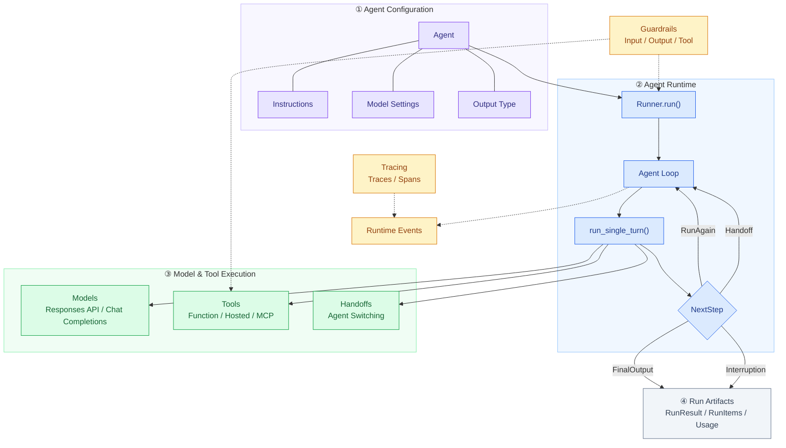
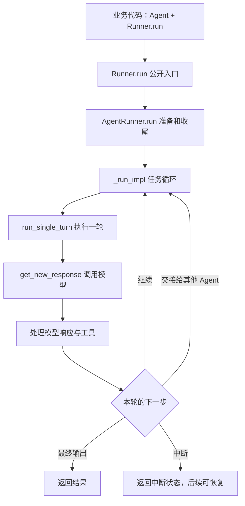
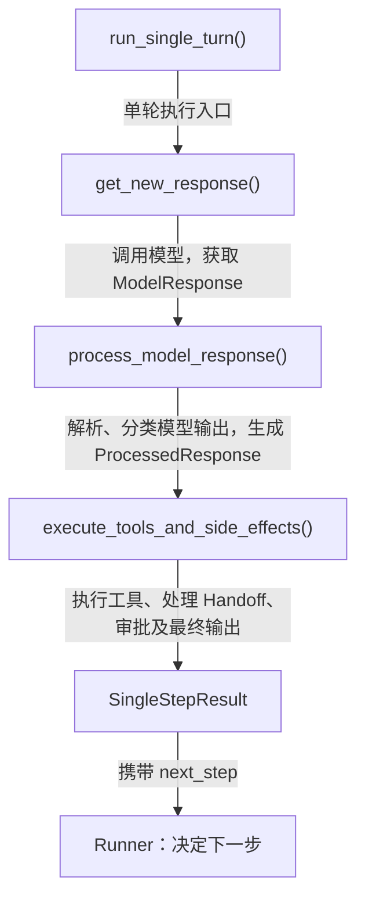
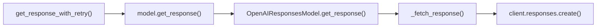
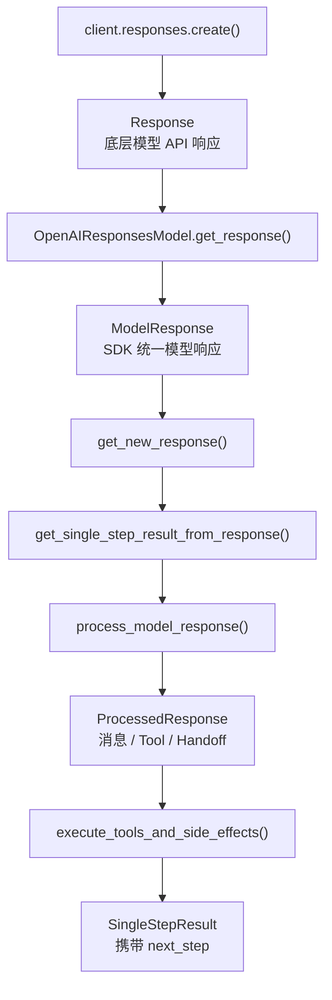

# 深入 OpenAI Agents SDK：从一次模型调用到 Agent Runtime

> **研究目标：** 理解 OpenAI Agents SDK（Python）的核心架构与执行机制，重点关注模型、工具和执行器如何协作，以及 Agent 如何继续执行、切换 Agent 和结束任务。
>
> **研究方法：** 问题 → 结构 → 调用链 → 设计取舍 → 实验验证 → 应用。
>
> **源码仓库：** [openai/openai-agents-python](https://github.com/openai/openai-agents-python)
>
> 本文主要研究非流式执行路径。代码包含源码片段与教学伪代码；伪代码用于突出核心机制，不代表可以直接替换 SDK 内部实现。

# 第一章：为什么需要 Agents SDK？整体架构是什么？

## 1.1 从普通 LLM 调用到 Agent

假设我们现在要开发一个 AI 助手，用户问：

> 明天上海适合户外运动吗？

对于一个普通的 LLM 应用，处理方式可能非常简单：

```text
Prompt → LLM → Answer
```

但是，这里存在一个问题：

**模型怎么知道明天上海的真实天气？**

即使模型拥有大量知识，它也不一定掌握实时天气信息。

为了可靠地回答这个问题，我们可能需要先查询天气，再根据查询结果判断是否适合户外运动。

执行过程就变成：

```text
用户：明天上海适合户外运动吗？
    ↓
模型：我需要先查询天气
    ↓
调用天气 API
    ↓
返回天气数据：台风预警
    ↓
模型根据天气信息判断
    ↓
回答：不建议户外运动
```

可以看到，这已经不再是简单的一问一答。

模型需要先决定做什么，然后利用外部工具获取信息，最后结合结果生成答案。

如果任务再复杂一些呢？

比如用户希望系统结合自己的运动习惯、居住位置、明天天气和附近的运动场所，推荐一套锻炼计划。

这时系统可能需要：

- 查询天气、地图等多个外部工具。
- 读取用户的 Memory 或其他上下文。
- 根据工具结果决定是否继续调用工具。
- 将任务交给擅长不同领域的 Agent。
- 判断什么时候任务已经完成。

我们可以用一个简化公式来理解 Agent：

**Agent ≈ LLM + Tools + Context / Memory + Execution Logic**

这里的 Memory 是可选能力，并不是每个 Agent 都必须有持久化记忆。

那么问题来了：

**谁来管理这些模型调用、工具执行以及多步骤任务的推进过程？**

其实，我们完全可以基于 Responses API 自己编写执行循环：

```python

while True:
    response = await call_model()

    if response.has_tool_calls:
        results = await execute_tools(response)
        update_history(results)
    else:
        return response.final_output
```

看起来并不复杂。

模型需要工具，我们就执行工具；模型不再请求工具，我们就返回答案。

但是实际业务中，很快会遇到更多问题：

如果模型一次调用三个工具呢？如果工具执行失败呢？如果模型一直调用工具，陷入无限循环呢？如果模型想把任务交给另一个 Agent 呢？

这些问题都需要一套统一的运行机制来处理。

### Agents SDK 解决什么问题？

OpenAI Agents SDK 提供了构建 Agent 应用所需的通用运行能力，包括：

1. 将 Agent 配置转换为模型请求。
2. 处理模型返回的 Function Tool Call。
3. 执行工具，并将执行结果交给模型。
4. 管理 Agent Loop，决定是否继续调用模型。
5. 支持 Handoff，在不同 Agent 之间交接控制权。
6. 提供 Guardrails、Session、Tracing 等辅助能力。

可以把它类比为前端开发中的 Vue 或 React。

即使没有框架，我们也能直接使用 JavaScript 开发 Web 应用；但框架提供了一套可复用的运行机制，减少重复开发。

同样，**Agents SDK 并不是构建 Agent 应用的必要条件，它只是帮助开发者复用已有的 Agent Runtime 能力。**

具体的业务规则、工具实现和外部数据，仍然需要开发者提供。

**Takeaway：Agents SDK 解决的不是模型推理能力问题，而是如何组织模型调用、工具执行与任务生命周期的问题。**

既然它是一套运行框架，那么 OpenAI 是怎么组织它的？

## 1.2 OpenAI Agents SDK 的整体架构

先看整体架构图。



这张图表达的是 SDK 的模块关系，而不是严格的函数调用顺序。Tools、Handoffs 和 Guardrails 也属于 Agent 可以配置的能力，这里为了突出运行职责，将它们单独展示。

其中最值得关注的是四个核心抽象：

| 抽象 | 职责 |
|---|---|
| Agent | 配置对象，描述名称、Instructions、Tools、Model 等 |
| Runner | 执行 Agent Loop，管理运行状态与控制流 |
| Tool | Agent 可以调用的外部能力 |
| Handoff | 将执行控制权转交给其他 Agent |

我们先看一个最简单的 Agent。

```python
from dataclasses import dataclass
from agents import Agent, Runner, function_tool

@dataclass
class Weather:
    city: str
    temperature_range: str
    conditions: str

@function_tool
def get_weather(city: str) -> Weather:
    """获取指定城市的天气。"""
    return Weather(
        city=city,
        temperature_range="14-20C",
        conditions="Sunny with wind."
    )

agent = Agent(
    name="Weather Assistant",
    instructions="You are a helpful weather assistant.",
    tools=[get_weather],
    model="gpt-4.1",
    handoffs=[],
)

result = await Runner.run(
    agent,
    input="What's the weather in Tokyo?"
)

print(result.final_output)
```


现在先看两个对象：

```python
agent = Agent(...)
```

```python
result = await Runner.run(agent, input)
```

你可能会产生一个疑问：

**为什么 OpenAI 将 Agent 和 Runner 分成两个对象，而不是直接调用 `agent.run()`？**

## 1.3 Agent 和 Runner 为什么分离？

先看 Agent。

它主要是一个配置对象：

```text
Agent
├── name
├── instructions
├── tools
├── handoffs
├── model
├── model_settings
├── output_type
└── guardrails
```

它主要定义：

“我是谁？使用什么模型？具备什么工具？遵循什么规则？”

Runner 则负责真正执行这些配置。

它需要管理模型调用、工具执行、上下文、运行轮次以及最终结果。

这样做的一个直接好处是：**可以复用 Agent 配置，而每次执行分别管理运行状态。**

例如，有两个用户都使用同一个天气助手：

```text
                 Weather Agent
                   共享配置
                      │
              ┌───────┴───────┐
              ▼               ▼
            Run A           Run B
        history = [A]    history = [B]
        独立运行状态      独立运行状态
```

两个用户可以共享相同的 Instructions、Model 和 Tools。

但每次运行的输入、生成项和状态由各自的 Run 管理。

当然，这并不意味着 Agent 和 Runner 不分开就无法复用。

分离的核心价值是**职责解耦**：Agent 主要描述能力，Runner 负责运行控制。

而且，Agent 对象并非天然不可变。如果开发者主动共享 Session、可变 Context 或带状态的工具，仍需自行管理状态隔离。

**本章 Takeaway**

> Agent 主要负责能力声明，Runner 负责执行过程。将二者分离，使 Agent 配置复用与运行状态管理具有更清晰的职责边界。

接下来，我们真正进入 Runner 的内部，看看它是如何推进任务的。

---

# 第二章：Runner 如何执行 Agent？深入 Agent Loop

现在回到最开始的代码：

```python
result = await Runner.run(
    agent,
    "明天上海适合跑步吗？"
)
```

当这行代码开始执行，SDK 内部到底发生了什么？

## 2.1 从 Runner.run() 开始追踪

我们先沿着调用链往下看。



关键源码：

- [src/agents/run.py](https://github.com/openai/openai-agents-python/blob/main/src/agents/run.py)
openai-agents-python/src/agents/run.py:279

- [src/agents/run_internal/run_loop.py](https://github.com/openai/openai-agents-python/blob/main/src/agents/run_internal/run_loop.py)


可以看到，核心调用关系是：

```text
Runner.run()
    ↓
AgentRunner.run()
    ↓
AgentRunner._run_impl()
    ↓
run_single_turn()
```

其中最值得研究的是 `_run_impl()`。

因为这个函数负责整个 Agent 的执行循环。

### `_run_impl()` 的核心骨架

我们将复杂的真实源码精简成下面这段伪代码：

```python
# 伪代码：省略 Guardrails、Session、Hooks 等细节

async def simplified_run(starting_agent, input, max_turns=10):
    current_agent = starting_agent
    original_input = ItemHelpers.input_to_items(input)
    generated_items = []
    current_turn = 0

    while True:
        current_turn += 1

        if max_turns is not None and current_turn > max_turns:
            raise MaxTurnsExceeded()

        # 1. 执行一轮模型交互及本地处理
        turn_result = await run_single_turn(
            agent=current_agent,
            original_input=original_input,
            generated_items=generated_items,
        )

        # 2. 更新输入历史与生成项
        # Handoff 可能过滤或改写输入历史
        original_input = turn_result.original_input
        generated_items = (
            turn_result.pre_step_items
            + turn_result.new_step_items
        )

        # 3. 根据执行结果决定下一步
        next_step = turn_result.next_step

        if isinstance(next_step, NextStepFinalOutput):
            # 还需要完成输出校验、Hooks、持久化等
            return await finalize_result(turn_result)

        elif isinstance(next_step, NextStepHandoff):
            current_agent = next_step.new_agent
            continue

        elif isinstance(next_step, NextStepInterruption):
            # 保存执行现场，等待审批后恢复
            return build_interruption_result(turn_result)

        elif isinstance(next_step, NextStepRunAgain):
            continue
```

注意：`finalize_result()` 和 `build_interruption_result()` 是伪代码中的辅助抽象，并不代表真实 SDK 存在完全同名的方法。运行历史的实际维护也比这里复杂。

这段代码最核心的部分，就是：

```python
while True:
    ...
```

为什么需要一个循环？

因为 Agent 一次模型调用不一定就能完成任务。

例如：

```text
第 1 轮：模型决定查询天气
    ↓
执行 get_weather
    ↓
第 2 轮：模型读取天气结果
    ↓
发现还需要查询运动场所
    ↓
执行 search_places
    ↓
第 3 轮：模型生成最终建议
```

Runner 需要不断执行一轮模型交互，再根据结果决定是否继续。

**因此，Agent Loop 本质上就是 Agent 的执行控制器。**

不过，还有一个问题：

Runner 怎么知道什么时候应该继续，什么时候应该结束？

## 2.2 NextStep：Runner 如何决定下一步？

仔细看这行代码：

```python
next_step = turn_result.next_step
```

Runner 并没有直接分析模型的原始响应。

它只读取单轮执行产生的 `next_step`，再根据类型决定后续操作。

SDK 主要定义了四种状态：

| NextStep | 含义 | Runner 行为 |
|---|---|---|
| `NextStepRunAgain` | 需要再次调用模型 | 使用当前 Agent 进入下一轮 |
| `NextStepHandoff` | 需要交接给其他 Agent | 更新 `current_agent` 后继续 |
| `NextStepFinalOutput` | 已产生候选最终输出 | 完成收尾并返回结果 |
| `NextStepInterruption` | 当前执行需要暂停 | 保存状态，等待后续恢复 |

源码：

[src/agents/run_internal/run_steps.py](https://github.com/openai/openai-agents-python/blob/main/src/agents/run_internal/run_steps.py)
openai-agents-python/src/agents/run_internal/run_steps.py:163


### 为什么要设计 NextStep，而不是直接使用布尔值？

假设我们使用多个标志：

```python
should_continue = True
should_handoff = False
should_finish = True
```

这种设计可能产生互相矛盾的状态。

例如既要继续执行，又表示已经结束。

而 `NextStepFinalOutput`、`NextStepHandoff` 等类型可以更加明确地表达控制流结果。

这实际上是一种**状态机设计**：把下一步操作编码成数据，再由外层 Runner 统一处理。

### NextStepFinalOutput 一定意味着模型没调用工具吗？

不一定。

模型可能已经在前面的轮次调用过多个工具，然后才生成最终答案。

另外，某些 `tool_use_behavior` 配置允许直接使用工具输出作为最终结果。

因此 `NextStepFinalOutput` 的含义是：

**已经产生符合结束条件的候选结果，而不是整个任务从未执行过工具。**

### NextStepHandoff 又有什么不同？

如果模型决定将任务交给另外一个 Agent，Runner 需要更新：

```python
current_agent = next_step.new_agent
```

随后进入下一轮。

这意味着下一次模型调用使用的是新 Agent 的 Instructions、Tools、Model 等配置。

它不是简单地重新运行同一个 Agent。

### max_turns 如何防止无限循环？

再看：

```python
current_turn += 1

if max_turns is not None and current_turn > max_turns:
    raise MaxTurnsExceeded()
```

`max_turns` 用来限制 Agent 的模型调用轮次。

这里需要区分：

**Turn 不等于 Tool Call。**

例如：

```text
第 1 次模型调用
    ├── Tool Call A
    ├── Tool Call B
    └── Tool Call C

第 2 次模型调用
    └── Final Output
```

虽然执行了三个工具，但这里只有两个模型轮次。

另外，同一次逻辑模型请求内部发生的重试，也不会独立消耗新的 Turn。

所以 Agent Loop 的循环和请求失败后的 Retry Loop，并不是同一种循环。

**到这里，我们已经知道 Runner 何时继续、切换、暂停和结束。**

但是代码中还有一个重要函数没有展开：

```python
run_single_turn()
```

它到底负责什么？

## 2.3 Single Turn：一次模型交互内部发生了什么？

`run_single_turn()` 可以理解为 Agent Loop 的一个执行单元。

它负责完成当前轮次的模型调用及其本地处理，然后把下一步决策交还给 Runner。

从核心源码中，可以提炼出三个阶段。

### 第一阶段：调用模型

准备 Instructions、Tools、Handoffs、Model Settings 等配置，然后调用模型。

### 第二阶段：解析模型响应

识别模型返回的是普通文本、Function Tool Call，还是 Handoff 等操作。

### 第三阶段：执行并决定下一步

执行本地工具、处理 Handoff 和必要的副作用，最终生成 `SingleStepResult`。

核心伪代码：

```python
# 伪代码：省略复杂参数、Hooks、Guardrails 等

async def run_single_turn(agent, input, context):

    # 阶段一：准备并调用模型
    tools = await get_all_tools(agent, context)
    handoffs = await get_handoffs(agent, context)
    instructions = await agent.get_system_prompt(context)
    output_schema = get_output_schema(agent)

    response = await get_new_response(
        agent=agent,
        instructions=instructions,
        input=input,
        tools=tools,
        handoffs=handoffs,
        output_schema=output_schema,
    )

    # 阶段二：解析和分类模型输出
    processed = process_model_response(
        agent=agent,
        response=response,
        all_tools=tools,
        handoffs=handoffs,
        output_schema=output_schema,
    )

    # 阶段三：执行工具并决定下一步
    return await execute_tools_and_side_effects(
        agent=agent,
        processed_response=processed,
        model_response=response,
        context=context,
    )
```

对应执行流程：



为什么要把响应解析和工具执行分开？

假设一次模型响应包含：

```json
[
  {
    "type": "function_call",
    "name": "get_weather",
    "arguments": "{\"city\":\"上海\"}",
    "call_id": "call_weather"
  },
  {
    "type": "function_call",
    "name": "get_time",
    "arguments": "{\"city\":\"上海\"}",
    "call_id": "call_time"
  },
  {
    "type": "message",
    "role": "assistant",
    "content": [
      {
        "type": "output_text",
        "text": "正在查询天气和时间"
      }
    ]
  }
]
```

这是模型输出结构的教学示例，不代表每次工具调用都会同时返回文本消息。

解析阶段先识别：

- 两个 Function Tool Call。
- 工具名称、Call ID 和参数。
- 一个模型消息。

执行阶段再负责：

- 工具参数校验。
- 工具执行与结果收集。
- Handoff。
- 审批、异常及副作用处理。
- 下一步决策。

**这种分层将“模型提出了什么操作”与“SDK 如何执行操作”分开。**

### SingleStepResult 返回什么？

单轮执行完成后，返回 `SingleStepResult`。

源码：

[src/agents/run_internal/run_steps.py](https://github.com/openai/openai-agents-python/blob/main/src/agents/run_internal/run_steps.py)

精简数据结构：

```python
@dataclass
class SingleStepResult:
    original_input: str | list
    model_response: ModelResponse

    pre_step_items: list[RunItem]
    new_step_items: list[RunItem]

    next_step: (
        NextStepRunAgain
        | NextStepHandoff
        | NextStepFinalOutput
        | NextStepInterruption
    )

    tool_input_guardrail_results: list
    tool_output_guardrail_results: list
```

这不是完整的数据类定义，仅用于突出主要字段。

其中最重要的是：

- `new_step_items`：记录本轮产生的消息、工具调用与执行结果。
- `next_step`：告诉 Runner 下一步应该做什么。

我们可以把它理解为：

**SingleStepResult = 本轮执行产物 + 下一步控制指令。**

这就明确了 Runner 和 Single Turn 的职责边界：

**Runner 负责整个任务的生命周期，Single Turn 负责完成一轮模型交互及本地处理。**

**本章 Takeaway**

> Agent Loop 是一个运行控制状态机。Runner 反复执行 Single Turn，并根据 `SingleStepResult.next_step` 决定继续、切换 Agent、结束或暂停。

到这里，Runner 的工作原理已经清楚了。

但我们在 Single Turn 里面跳过了一个重要环节：

```python
response = await get_new_response(...)
```

这个函数究竟如何调用大模型？

---

# 第三章：Agent 如何调用模型，又如何理解模型响应？

现在我们已经知道：

```text
Runner
  ↓
Agent Loop
  ↓
run_single_turn()
  ↓
get_new_response()
```

接下来研究一个完整问题：

**SDK 如何从 Agent 中的模型配置，找到对应的大模型、发起请求，再理解模型返回的内容？**

这个过程可以分成三步：

1. 找到模型实例。
2. 通过模型实例发起 API 请求。
3. 解析模型返回的响应。

## 3.1 从模型名称到 Model 实例

假设这样配置 Agent：

```python
agent = Agent(
    name="Weather Assistant",
    instructions="你是一个天气助手",
    model="gpt-4.1",
    tools=[get_weather],
)
```

`"gpt-4.1"` 只是字符串，SDK 要先把它变成一个能发请求的 `Model` 实例。整个过程分两个动作：

1. `get_model()`：找到 Model 实例。
2. `model.get_response()`：用它发起请求（3.2 展开）。

### get_model() 的四个分支

`get_model()`（[turn_preparation.py](https://github.com/openai/openai-agents-python/blob/main/src/agents/run_internal/turn_preparation.py)）的核心逻辑：

```python
def get_model(agent, run_config):
    if isinstance(run_config.model, Model):            # 1. RunConfig 给了实例
        return run_config.model
    elif isinstance(run_config.model, str):            # 2. RunConfig 给了名称
        return run_config.model_provider.get_model(run_config.model)
    elif isinstance(agent.model, Model):               # 3. Agent 给了实例
        return agent.model
    return run_config.model_provider.get_model(agent.model)  # 4. Agent 给了名称或 None
```

两条规则：

1. **`RunConfig.model` 优先于 `Agent.model`**：`Runner.run(..., run_config=RunConfig(model="gpt-4.1"))` 会覆盖 Agent 上配置的 `"gpt-4.1-mini"`。
2. **Model 实例直接跳过 Provider**：只有字符串名称才需要 Provider 解析。

### ModelProvider：只负责“找模型”

```python
class ModelProvider(abc.ABC):
    @abc.abstractmethod
    def get_model(self, model_name: str | None) -> Model: ...
```

| 组件 | 职责 |
|---|---|
| `ModelProvider` | 查找接口 |
| `MultiProvider` | 默认路由器：按模型名前缀选择 Provider |
| `OpenAIProvider` | 构造具体的 OpenAI Model 实例 |
| `Model` / `OpenAIResponsesModel` | 调用接口 / Responses API 实现 |

`RunConfig.model_provider` 的默认值是 `MultiProvider`，所以对无前缀的 `"gpt-4.1"`：

```text
get_model()
  └─ MultiProvider.get_model("gpt-4.1")
       └─ 无前缀 → OpenAIProvider.get_model("gpt-4.1")
            └─ 返回 Model 实例
```

如果开发者提供自己的 `ModelProvider`，`get_model()` 和 Runner 都不需要修改——这就是这个抽象的价值。

### OpenAIProvider 返回哪种 Model？

`OpenAIProvider`（[openai_provider.py](https://github.com/openai/openai-agents-python/blob/main/src/agents/models/openai_provider.py)）根据配置返回不同实现：

```python
name = model_name or get_default_model()
if not self._use_responses:
    return OpenAIChatCompletionsModel(model=name, openai_client=...)
if use_websocket_transport:
    return OpenAIResponsesWSModel(model=name, openai_client=...)
return OpenAIResponsesModel(model=name, openai_client=...)
```

| Model | API / 传输 |
|---|---|
| `OpenAIResponsesModel` | Responses API + HTTP（本文默认） |
| `OpenAIResponsesWSModel` | Responses API + WebSocket |
| `OpenAIChatCompletionsModel` | Chat Completions |

**注意：到这里还没有发起请求，只是拿到了 Model 实例。**

## 3.2 获得 Model 实例后，如何真正发起 Responses API 请求？

拿到 `model = OpenAIResponsesModel(...)` 之后，一次调用经过三层：



### 第一层：get_response_with_retry()——统一的重试与超时

`get_new_response()` 把调用包成 lambda 交给重试包装器：

```python
new_response = await get_response_with_retry(
    get_response=lambda: model.get_response(
        system_instructions=filtered.instructions,
        input=filtered.input,
        model_settings=model_settings,
        tools=all_tools,
        output_schema=output_schema,
        handoffs=handoffs,
        tracing=..., previous_response_id=..., conversation_id=..., prompt=...,
    ),
    rewind=rewind_model_request,          # 失败重放前回滚已发送的输入
    retry_settings=model_settings.retry,
    timeout=model_settings.timeout,
)
```

为什么要多这一层？因为**重试、超时、失败前回滚（rewind）需要由同一个包装器统一控制**，而不是散落在每个 Model 适配器里。包装器内部最终执行的就是这个回调（[model_retry.py](https://github.com/openai/openai-agents-python/blob/main/src/agents/run_internal/model_retry.py)）：

```python
response = await _await_model_attempt(get_response(), timeout)
```

两个容易混淆的点：

- **调用不代表一定重试**：成功就直接返回，只有符合策略的失败才会重试。
- **Retry 与 Agent Loop 是两回事**：Agent Loop 负责多轮模型交互；Retry 只负责同一次逻辑调用内部的失败重试。

### 第二层：model.get_response()——同一行代码，落到不同实现

`get_model()` 返回的 `model`，类型标注是 `Model`，但运行时它是一个具体对象，比如 `OpenAIResponsesModel`：

```python
model: Model = get_model(agent, run_config)   # 运行时是 OpenAIResponsesModel
await model.get_response(...)                 # 执行的是这个具体对象的方法
```

Python 调用方法时看的是**对象本身**，而不是变量上的类型标注。所以同一行 `model.get_response(...)`，实际会走哪套实现，取决于你拿到的是哪个对象：

```text
model.get_response(...)
  ├─ OpenAIResponsesModel       → client.responses.create()
  ├─ OpenAIChatCompletionsModel → client.chat.completions.create()
  └─ LitellmModel               → litellm.acompletion()
```

这就是 Model 接口的意义：Runner 只需要写 `model.get_response(...)`，不需要用 `isinstance` 判断模型类型；具体发哪种请求，由实际拿到的对象决定。本文默认的对象是 `OpenAIResponsesModel`，所以下一层看它的实现。

### 第三层：_fetch_response()——真正发出 HTTP 请求

`OpenAIResponsesModel.get_response()` 内部调用 `_fetch_response()`，核心只有两步：

```python
create_kwargs = self._build_response_create_kwargs(
    # model、instructions、input、tools、model_settings、output_schema 等
)

client = self._get_client()
response = await client.responses.create(**create_kwargs)
```

- `_build_response_create_kwargs()`：把 SDK 内部配置翻译成 Responses API 字段（model、instructions、input、tools/handoffs 声明、output_schema、`previous_response_id`、`conversation_id` 等）。
- `client.responses.create()`：**真正发起 Responses API 请求的位置**。

所以 Runner 不需要知道 Responses API 接受哪些字段，参数转换全部由 Model 适配器完成。

### 为什么还要转换成 ModelResponse？

Responses API 返回原始 `Response`，而 SDK 还支持 Chat Completions 等不同协议。如果 Runner 针对每种协议分别解析，就会与底层 API 耦合，因此适配器统一返回 `ModelResponse`：

```python
return ModelResponse(
    output=response.output,
    usage=usage,
    response_id=response.id,
    request_id=getattr(response, "_request_id", None),
)
```

```text
Responses API Response ───────┐
                              ├── ModelResponse
Chat Completions Response ────┘
```

**Takeaway：ModelProvider 负责把模型名变成 Model 对象；Model 对象负责真正发请求。Runner 只认 `Model.get_response()` 这个约定，不关心底层是 Responses、Chat Completions 还是 LiteLLM。**

那么，模型返回以后，SDK 又是怎么知道下一步该做什么的？

## 3.3 模型返回后，SDK 如何解析响应？

我们已经追踪到：

```python
response = await client.responses.create(...)
```

现在假设模型返回的不是一句普通回答，而是：

```json
{
  "id": "resp_123",
  "status": "completed",
  "output": [
    {
      "type": "function_call",
      "name": "get_weather",
      "arguments": "{\"city\":\"上海\"}",
      "call_id": "call_001"
    }
  ],
  "usage": {
    "input_tokens": 100,
    "output_tokens": 30,
    "total_tokens": 130
  }
}
```

这是简化的响应示例。

注意：

**模型没有执行 get_weather，只是告诉 SDK：我需要调用这个工具。**

还有一个容易误解的地方：

`status="completed"` 只意味着这一次模型响应已经完成，不代表整个 Agent 任务完成。

因为接下来还可能需要执行工具，再次调用模型。

### Response、ModelResponse、ProcessedResponse 有什么区别？

我们现在可以看到模型返回路径：



整个过程涉及四种重要的数据结构：

| 对象 | 作用 |
|---|---|
| `Response` | 模型 API 的原始响应 |
| `ModelResponse` | SDK 统一模型响应格式 |
| `ProcessedResponse` | 解析并分类模型输出 |
| `SingleStepResult` | 保存本轮执行结果和下一步控制指令 |

它们并不是重复包装同一份数据，而是在不同层次解决不同问题。

`ModelResponse` 解决底层模型接口的差异。

`ProcessedResponse` 解决模型输出中包含哪些操作的问题。

`SingleStepResult` 则解决操作完成以后，Runner 下一步该做什么的问题。

### process_model_response() 如何分类模型输出？

源码：

[src/agents/run_internal/turn_resolution.py](https://github.com/openai/openai-agents-python/blob/main/src/agents/run_internal/turn_resolution.py)

它会根据当前 Agent 可用的 Tools、Handoffs 等配置，解析模型输出。

例如：

```python
for output in response.output:
    ...
```

可以把关键逻辑简化为：

```python
# 教学伪代码

for output in response.output:

    if isinstance(output, ResponseOutputMessage):
        # 普通模型消息
        items.append(MessageOutputItem(...))

    elif isinstance(output, ResponseFunctionToolCall):

        if is_handoff_tool_call(output):
            # Agent 交接请求
            items.append(HandoffCallItem(...))
            handoffs.append(ToolRunHandoff(...))

        else:
            # 普通 Function Tool 请求
            tool = find_function_tool(output)

            items.append(ToolCallItem(...))
            functions.append(ToolRunFunction(...))

return ProcessedResponse(
    new_items=items,
    functions=functions,
    handoffs=handoffs,
)
```

这里省略了其他模型输出、工具类型、校验与异常处理。

重点不是具体有多少种类型，而是这个函数的职责：

**根据模型输出和当前 Agent 的可用能力，识别并组织待执行操作。**

例如，模型返回：

```json
{
  "type": "function_call",
  "name": "get_weather",
  "arguments": "{\"city\":\"上海\"}",
  "call_id": "call_001"
}
```

`process_model_response()` 会识别这是一个 Function Tool Call，并匹配对应工具。

如果返回的工具名称是某个 Handoff，则会识别为 Agent 交接请求。

但是，**到这里还没有真正执行普通 Python 工具函数。**

### 为什么要把解析与执行分开？

因为模型提出操作意图，不意味着 SDK 可以立刻执行。

执行之前，还可能涉及工具查找、参数校验、权限审批、Guardrails 等逻辑。

因此，SDK 会先完成模型输出解析，形成 `ProcessedResponse`。

然后将它交给：

```python
execute_tools_and_side_effects(...)
```

由执行阶段处理工具调用、Handoff 及相关副作用。

最后生成：

```python
SingleStepResult(...)
```

交还给 Runner。

Runner 再读取：

```python
next_step = turn_result.next_step
```

决定下一轮动作。

于是整个执行流程终于闭合：

```text
Runner
    ↓
Single Turn
    ↓
Model Provider / Model
    ↓
Responses API
    ↓
ModelResponse
    ↓
ProcessedResponse
    ↓
Tool Execution
    ↓
SingleStepResult
    ↓
NextStep
    ↓
Runner
```

### 第三章的设计 Takeaway

为什么 SDK 要把 ModelProvider、Model、Response Processing 分成不同模块？

因为它们分别解决不同问题：

- **ModelProvider**：找到需要调用的模型。
- **Model**：隔离不同模型 API 的请求与响应差异。
- **Response Processing**：将模型输出转换成 Agent Runtime 能够理解的动作。
- **Runner**：不关心底层模型协议，只负责运行控制。

这种设计的好处是模块之间的职责清晰，便于替换 Model、扩展工具和维护 Agent Loop。

代价则是增加了抽象层，也让源码调用链更长。

**本章 Takeaway**

> Agents SDK 先解析模型配置并获得 Model 实例，再通过统一的 `get_response()` 接口调用模型。模型响应会依次经过统一包装与动作分类，最终交给执行阶段处理，从而使 Runner 不依赖具体模型 API。

到这里，我们已经研究了从用户请求进入 Runner，到真正发起模型调用，再到解析模型输出的完整链路。

但还有一个关键问题：

**模型返回 Function Call 后，SDK 究竟如何把它变成真实的 Python 函数执行？**

这就是下一章需要研究的 Tool Execution。

---

# 第四章：Tool Execution——模型如何调用并执行真实工具？

 我们获得结果后会解析出工具、转交、模型回答。
openai-agents-python/src/agents/run_internal/turn_resolution.py:4016

例如 3.3里模型返回了
```python
 {"type": "function_call", "name": "get_weather", "arguments": "{\"city\":\"上海\"}", "call_id": "call_001"}
 ```

 通过type可以把tool区分出来。


但tool实际上是一个python函数，大模型并不能直接读取 Python 内存中的函数对象，也无法自己执行它

```python
def get_weather(city: str) -> str:
    """查询指定城市的天气"""
    return f"{city}：晴天"
```

这里就需要sdk需要把函数变成模型能够理解的描述，提供一个执行入口。


# 第五章：Handoff——如何实现多 Agent 控制权交接？

*待研究*

# 第六章：State & Lifecycle——上下文、Session、中断与恢复机制

*待研究*

# 第七章：Guardrails、Streaming 与 Tracing——安全、流式执行与可观测性

*待研究*

# 第八章：源码实验——验证工具异常、循环停止、Handoff 与恢复机制

*待研究*

# 第九章：架构设计取舍——Agents SDK、Responses API 与 LangGraph

*待研究*

# 第十章：总结与应用——如何设计自己的 Agent Runtime？

*待研究*

---

## 当前源码阅读索引

以下是前三章涉及的核心源码文件。

| 研究内容 | 源码路径 |
|---|---|
| Agent 定义 | [src/agents/agent.py](https://github.com/openai/openai-agents-python/blob/main/src/agents/agent.py) |
| Runner 与 Agent Loop | [src/agents/run.py](https://github.com/openai/openai-agents-python/blob/main/src/agents/run.py) |
| Single Turn / get_new_response | [src/agents/run_internal/run_loop.py](https://github.com/openai/openai-agents-python/blob/main/src/agents/run_internal/run_loop.py) |
| get_model | [src/agents/run_internal/turn_preparation.py](https://github.com/openai/openai-agents-python/blob/main/src/agents/run_internal/turn_preparation.py) |
| RunConfig | [src/agents/run_config.py](https://github.com/openai/openai-agents-python/blob/main/src/agents/run_config.py) |
| Model / ModelProvider 接口 | [src/agents/models/interface.py](https://github.com/openai/openai-agents-python/blob/main/src/agents/models/interface.py) |
| MultiProvider | [src/agents/models/multi_provider.py](https://github.com/openai/openai-agents-python/blob/main/src/agents/models/multi_provider.py) |
| OpenAIProvider | [src/agents/models/openai_provider.py](https://github.com/openai/openai-agents-python/blob/main/src/agents/models/openai_provider.py) |
| OpenAIResponsesModel | [src/agents/models/openai_responses.py](https://github.com/openai/openai-agents-python/blob/main/src/agents/models/openai_responses.py) |
| 模型重试 | [src/agents/run_internal/model_retry.py](https://github.com/openai/openai-agents-python/blob/main/src/agents/run_internal/model_retry.py) |
| 响应解析与执行分发 | [src/agents/run_internal/turn_resolution.py](https://github.com/openai/openai-agents-python/blob/main/src/agents/run_internal/turn_resolution.py) |
| NextStep / SingleStepResult | [src/agents/run_internal/run_steps.py](https://github.com/openai/openai-agents-python/blob/main/src/agents/run_internal/run_steps.py) |
| 运行项定义 | [src/agents/items.py](https://github.com/openai/openai-agents-python/blob/main/src/agents/items.py) |

### 关键源码位置

以下保留原始研究笔记中使用的定位。行号与具体 Git Commit 有关，正式分享前应固定版本并核对。

```text
src/agents/run.py
    AgentRunner._run_impl()

src/agents/run_internal/run_loop.py
    run_single_turn()
    get_new_response()

src/agents/run_internal/turn_preparation.py:134
    get_model()

src/agents/models/interface.py
    Model
    ModelProvider

src/agents/models/multi_provider.py
    MultiProvider.get_model()

src/agents/models/openai_provider.py:244
    OpenAIProvider.get_model()

src/agents/run_internal/model_retry.py:580
    get_response_with_retry() 内部模型调用

src/agents/models/openai_responses.py:543
    OpenAIResponsesModel.get_response()

src/agents/models/openai_responses.py:803
    _fetch_response()

src/agents/models/openai_responses.py:830
    client.responses.create()

src/agents/models/openai_responses.py:620
    Response → ModelResponse

src/agents/run_internal/turn_resolution.py
    process_model_response()
    execute_tools_and_side_effects()

src/agents/run_internal/run_steps.py:192
    SingleStepResult
```

> **后续研究原则：** 每个新模块都沿真实调用链学习，保留核心 Mermaid 图、精简伪代码、真实源码位置、设计取舍和实验依据，而不为了覆盖所有 SDK 功能偏离研究主线。