# 深入 OpenAI Agents SDK：从一次模型调用到 Agent Runtime

> **研究目标：** 理解 OpenAI Agents SDK（Python）的核心架构与执行机制，重点关注模型、工具和执行器如何协作，以及 Agent 如何继续执行、切换 Agent 和结束任务。
>
> **研究方法：** 问题 → 结构 → 调用链 → 设计取舍 → 实验验证 → 应用。
>
> **源码仓库：** [openai/openai-agents-python](https://github.com/openai/openai-agents-python)
>
> 本文主要研究非流式执行路径。代码包含源码片段与教学伪代码；伪代码用于突出核心机制，不代表可以直接替换 SDK 内部实现。

## 第一章：为什么需要 Agents SDK？整体架构是什么？

### 1.1 从普通 LLM 调用到 Agent

假设我们现在要开发一个 AI 助手，用户问：

> 明天上海适合户外运动吗？

对于一个普通的 LLM 应用，处理方式可能非常简单：

```text
Prompt → LLM → Answer
```

但是，这里存在一个问题：

**模型怎么知道明天上海的真实天气？**

即使模型拥有大量知识，它也不一定掌握实时天气信息。

为了可靠地回答这个问题，我们可能需要先查询天气，再根据查询结果判断是否适合户外运动。

执行过程就变成：

```text
用户：明天上海适合户外运动吗？
    ↓
模型：我需要先查询天气
    ↓
调用天气 API
    ↓
返回天气数据：台风预警
    ↓
模型根据天气信息判断
    ↓
回答：不建议户外运动
```

可以看到，这已经不再是简单的一问一答。

模型需要先决定做什么，然后利用外部工具获取信息，最后结合结果生成答案。

如果任务再复杂一些呢？

比如用户希望系统结合自己的运动习惯、居住位置、明天天气和附近的运动场所，推荐一套锻炼计划。

这时系统可能需要：

- 查询天气、地图等多个外部工具。
- 读取用户的 Memory 或其他上下文。
- 根据工具结果决定是否继续调用工具。
- 将任务交给擅长不同领域的 Agent。
- 判断什么时候任务已经完成。

我们可以用一个简化公式来理解 Agent：

**Agent ≈ LLM + Tools + Context / Memory + Execution Logic**

这里的 Memory 是可选能力，并不是每个 Agent 都必须有持久化记忆。

那么问题来了：

**谁来管理这些模型调用、工具执行以及多步骤任务的推进过程？**

其实，我们完全可以基于 Responses API 自己编写执行循环：

```python

while True:
    response = await call_model()

    if response.has_tool_calls:
        results = await execute_tools(response)
        update_history(results)
    else:
        return response.final_output
```

看起来并不复杂。

模型需要工具，我们就执行工具；模型不再请求工具，我们就返回答案。

但是实际业务中，很快会遇到更多问题：

如果模型一次调用三个工具呢？如果工具执行失败呢？如果模型一直调用工具，陷入无限循环呢？如果模型想把任务交给另一个 Agent 呢？

这些问题都需要一套统一的运行机制来处理。

#### Agents SDK 解决什么问题？

OpenAI Agents SDK 提供了构建 Agent 应用所需的通用运行能力，包括：

1. 将 Agent 配置转换为模型请求。
2. 处理模型返回的 Function Tool Call。
3. 执行工具，并将执行结果交给模型。
4. 管理 Agent Loop，决定是否继续调用模型。
5. 支持 Handoff，在不同 Agent 之间交接控制权。
6. 提供 Guardrails、Session、Tracing 等辅助能力。

可以把它类比为前端开发中的 Vue 或 React。

即使没有框架，我们也能直接使用 JavaScript 开发 Web 应用；但框架提供了一套可复用的运行机制，减少重复开发。

同样，**Agents SDK 并不是构建 Agent 应用的必要条件，它只是帮助开发者复用已有的 Agent Runtime 能力。**

具体的业务规则、工具实现和外部数据，仍然需要开发者提供。

**Takeaway：Agents SDK 解决的不是模型推理能力问题，而是如何组织模型调用、工具执行与任务生命周期的问题。**

既然它是一套运行框架，那么 OpenAI 是怎么组织它的？

### 1.2 OpenAI Agents SDK 的整体架构

先看整体架构图。

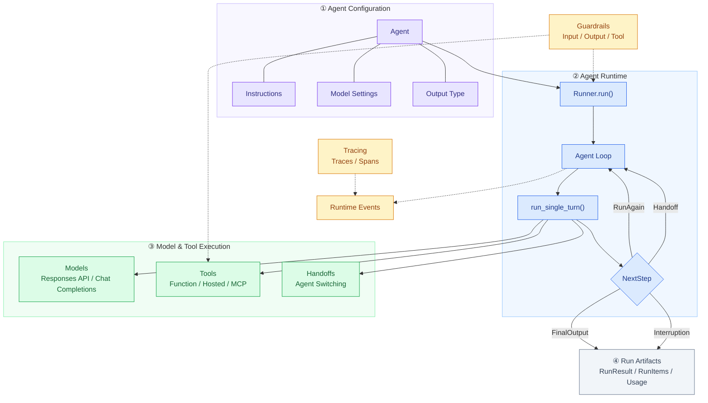

这张图表达的是 SDK 的模块关系，而不是严格的函数调用顺序。Tools、Handoffs 和 Guardrails 也属于 Agent 可以配置的能力，这里为了突出运行职责，将它们单独展示。

其中最值得关注的是四个核心抽象：

| 抽象 | 职责 |
|---|---|
| Agent | 配置对象，描述名称、Instructions、Tools、Model 等 |
| Runner | 执行 Agent Loop，管理运行状态与控制流 |
| Tool | Agent 可以调用的外部能力 |
| Handoff | 将执行控制权转交给其他 Agent |

我们先看一个最简单的 Agent。

```python
from dataclasses import dataclass
from agents import Agent, Runner, function_tool

@dataclass
class Weather:
    city: str
    temperature_range: str
    conditions: str

@function_tool
def get_weather(city: str) -> Weather:
    """获取指定城市的天气。"""
    return Weather(
        city=city,
        temperature_range="14-20C",
        conditions="Sunny with wind."
    )

agent = Agent(
    name="Weather Assistant",
    instructions="You are a helpful weather assistant.",
    tools=[get_weather],
    model="gpt-4.1",
    handoffs=[],
)

result = await Runner.run(
    agent,
    input="What's the weather in Tokyo?"
)

print(result.final_output)
```

现在先看两个对象：

```python
agent = Agent(...)
```

```python
result = await Runner.run(agent, input)
```

你可能会产生一个疑问：

**为什么 OpenAI 将 Agent 和 Runner 分成两个对象，而不是直接调用 `agent.run()`？**

### 1.3 Agent 和 Runner 为什么分离？

先看 Agent。

它主要是一个配置对象：

```text
Agent
├── name
├── instructions
├── tools
├── handoffs
├── model
├── model_settings
├── output_type
└── guardrails
```

它主要定义：

“我是谁？使用什么模型？具备什么工具？遵循什么规则？”

Runner 则负责真正执行这些配置。

它需要管理模型调用、工具执行、上下文、运行轮次以及最终结果。

这样做的一个直接好处是：**可以复用 Agent 配置，而每次执行分别管理运行状态。**

例如，有两个用户都使用同一个天气助手：

```text
                 Weather Agent
                   共享配置
                      │
              ┌───────┴───────┐
              ▼               ▼
            Run A           Run B
        history = [A]    history = [B]
        独立运行状态      独立运行状态
```

两个用户可以共享相同的 Instructions、Model 和 Tools。

但每次运行的输入、生成项和状态由各自的 Run 管理。

当然，这并不意味着 Agent 和 Runner 不分开就无法复用。

分离的核心价值是**职责解耦**：Agent 主要描述能力，Runner 负责运行控制。

而且，Agent 对象并非天然不可变。如果开发者主动共享 Session、可变 Context 或带状态的工具，仍需自行管理状态隔离。

### 本章 Takeaway

> Agent 主要负责能力声明，Runner 负责执行过程。将二者分离，使 Agent 配置复用与运行状态管理具有更清晰的职责边界。

接下来，我们真正进入 Runner 的内部，看看它是如何推进任务的。

---

## 第二章：Runner 如何执行 Agent？深入 Agent Loop

现在回到最开始的代码：

```python
result = await Runner.run(
    agent,
    "明天上海适合跑步吗？"
)
```

当这行代码开始执行，SDK 内部到底发生了什么？

### 2.1 从 Runner.run() 开始追踪

我们先沿着调用链往下看。

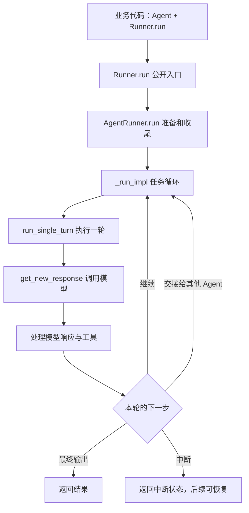

关键源码：

- [src/agents/run.py](https://github.com/openai/openai-agents-python/blob/main/src/agents/run.py)

  `openai-agents-python/src/agents/run.py:279`

- [src/agents/run_internal/run_loop.py](https://github.com/openai/openai-agents-python/blob/main/src/agents/run_internal/run_loop.py)

可以看到，核心调用关系是：

```text
Runner.run()
    ↓
AgentRunner.run()
    ↓
AgentRunner._run_impl()
    ↓
run_single_turn()
```

其中最值得研究的是 `_run_impl()`。

因为这个函数负责整个 Agent 的执行循环。

#### `_run_impl()` 的核心骨架

我们将复杂的真实源码精简成下面这段伪代码：

```python
# 伪代码：省略 Guardrails、Session、Hooks 等细节

async def simplified_run(starting_agent, input, max_turns=10):
    current_agent = starting_agent
    original_input = ItemHelpers.input_to_items(input)
    generated_items = []
    current_turn = 0

    while True:
        current_turn += 1

        if max_turns is not None and current_turn > max_turns:
            raise MaxTurnsExceeded()

        # 1. 执行一轮模型交互及本地处理
        turn_result = await run_single_turn(
            agent=current_agent,
            original_input=original_input,
            generated_items=generated_items,
        )

        # 2. 更新输入历史与生成项
        # Handoff 可能过滤或改写输入历史
        original_input = turn_result.original_input
        generated_items = (
            turn_result.pre_step_items
            + turn_result.new_step_items
        )

        # 3. 根据执行结果决定下一步
        next_step = turn_result.next_step

        if isinstance(next_step, NextStepFinalOutput):
            # 还需要完成输出校验、Hooks、持久化等
            return await finalize_result(turn_result)

        elif isinstance(next_step, NextStepHandoff):
            current_agent = next_step.new_agent
            continue

        elif isinstance(next_step, NextStepInterruption):
            # 保存执行现场，等待审批后恢复
            return build_interruption_result(turn_result)

        elif isinstance(next_step, NextStepRunAgain):
            continue
```

注意：`finalize_result()` 和 `build_interruption_result()` 是伪代码中的辅助抽象，并不代表真实 SDK 存在完全同名的方法。运行历史的实际维护也比这里复杂。

这段代码最核心的部分，就是：

```python
while True:
    ...
```

为什么需要一个循环？

因为 Agent 一次模型调用不一定就能完成任务。

例如：

```text
第 1 轮：模型决定查询天气
    ↓
执行 get_weather
    ↓
第 2 轮：模型读取天气结果
    ↓
发现还需要查询运动场所
    ↓
执行 search_places
    ↓
第 3 轮：模型生成最终建议
```

Runner 需要不断执行一轮模型交互，再根据结果决定是否继续。

**因此，Agent Loop 本质上就是 Agent 的执行控制器。**

不过，还有一个问题：

Runner 怎么知道什么时候应该继续，什么时候应该结束？

### 2.2 NextStep：Runner 如何决定下一步？

仔细看这行代码：

```python
next_step = turn_result.next_step
```

Runner 并没有直接分析模型的原始响应。

它只读取单轮执行产生的 `next_step`，再根据类型决定后续操作。

SDK 主要定义了四种状态：

| NextStep | 含义 | Runner 行为 |
|---|---|---|
| `NextStepRunAgain` | 需要再次调用模型 | 使用当前 Agent 进入下一轮 |
| `NextStepHandoff` | 需要交接给其他 Agent | 更新 `current_agent` 后继续 |
| `NextStepFinalOutput` | 已产生候选最终输出 | 完成收尾并返回结果 |
| `NextStepInterruption` | 当前执行需要暂停 | 保存状态，等待后续恢复 |

源码：

[src/agents/run_internal/run_steps.py](https://github.com/openai/openai-agents-python/blob/main/src/agents/run_internal/run_steps.py)
`openai-agents-python/src/agents/run_internal/run_steps.py:163`

#### 为什么要设计 NextStep，而不是直接使用布尔值？

假设我们使用多个标志：

```python
should_continue = True
should_handoff = False
should_finish = True
```

这种设计可能产生互相矛盾的状态。

例如既要继续执行，又表示已经结束。

而 `NextStepFinalOutput`、`NextStepHandoff` 等类型可以更加明确地表达控制流结果。

这实际上是一种**状态机设计**：把下一步操作编码成数据，再由外层 Runner 统一处理。

#### NextStepFinalOutput 一定意味着模型没调用工具吗？

不一定。

模型可能已经在前面的轮次调用过多个工具，然后才生成最终答案。

另外，某些 `tool_use_behavior` 配置允许直接使用工具输出作为最终结果。

因此 `NextStepFinalOutput` 的含义是：

**已经产生符合结束条件的候选结果，而不是整个任务从未执行过工具。**

#### NextStepHandoff 又有什么不同？

如果模型决定将任务交给另外一个 Agent，Runner 需要更新：

```python
current_agent = next_step.new_agent
```

随后进入下一轮。

这意味着下一次模型调用使用的是新 Agent 的 Instructions、Tools、Model 等配置。

它不是简单地重新运行同一个 Agent。

#### max_turns 如何防止无限循环？

再看：

```python
current_turn += 1

if max_turns is not None and current_turn > max_turns:
    raise MaxTurnsExceeded()
```

`max_turns` 用来限制 Agent 的模型调用轮次。

这里需要区分：

**Turn 不等于 Tool Call。**

例如：

```text
第 1 次模型调用
    ├── Tool Call A
    ├── Tool Call B
    └── Tool Call C

第 2 次模型调用
    └── Final Output
```

虽然执行了三个工具，但这里只有两个模型轮次。

另外，同一次逻辑模型请求内部发生的重试，也不会独立消耗新的 Turn。

所以 Agent Loop 的循环和请求失败后的 Retry Loop，并不是同一种循环。

**到这里，我们已经知道 Runner 何时继续、切换、暂停和结束。**

但是代码中还有一个重要函数没有展开：

```python
run_single_turn()
```

它到底负责什么？

### 2.3 Single Turn：一次模型交互内部发生了什么？

`run_single_turn()` 可以理解为 Agent Loop 的一个执行单元。

它负责完成当前轮次的模型调用及其本地处理，然后把下一步决策交还给 Runner。

从核心源码中，可以提炼出三个阶段。

**第一阶段：调用模型**

准备 Instructions、Tools、Handoffs、Model Settings 等配置，然后调用模型。

**第二阶段：解析模型响应**

识别模型返回的是普通文本、Function Tool Call，还是 Handoff 等操作。

**第三阶段：执行并决定下一步**

执行本地工具、处理 Handoff 和必要的副作用，最终生成 `SingleStepResult`。

核心伪代码：

```python
# 伪代码：省略复杂参数、Hooks、Guardrails 等

async def run_single_turn(agent, input, context):

    # 阶段一：准备并调用模型
    tools = await get_all_tools(agent, context)
    handoffs = await get_handoffs(agent, context)
    instructions = await agent.get_system_prompt(context)
    output_schema = get_output_schema(agent)

    response = await get_new_response(
        agent=agent,
        instructions=instructions,
        input=input,
        tools=tools,
        handoffs=handoffs,
        output_schema=output_schema,
    )

    # 阶段二：解析和分类模型输出
    processed = process_model_response(
        agent=agent,
        response=response,
        all_tools=tools,
        handoffs=handoffs,
        output_schema=output_schema,
    )

    # 阶段三：执行工具并决定下一步
    return await execute_tools_and_side_effects(
        agent=agent,
        processed_response=processed,
        model_response=response,
        context=context,
    )
```

对应执行流程：

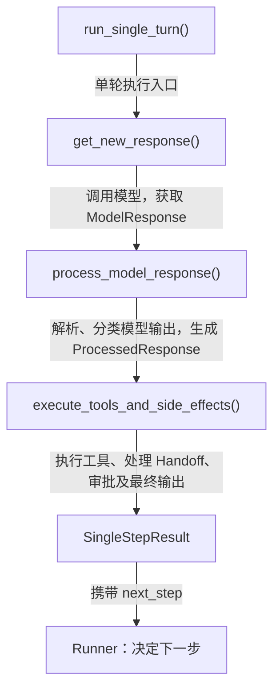

为什么要把响应解析和工具执行分开？

假设一次模型响应包含：

```json
[
  {
    "type": "function_call",
    "name": "get_weather",
    "arguments": "{\"city\":\"上海\"}",
    "call_id": "call_weather"
  },
  {
    "type": "function_call",
    "name": "get_time",
    "arguments": "{\"city\":\"上海\"}",
    "call_id": "call_time"
  },
  {
    "type": "message",
    "role": "assistant",
    "content": [
      {
        "type": "output_text",
        "text": "正在查询天气和时间"
      }
    ]
  }
]
```

这是模型输出结构的教学示例，不代表每次工具调用都会同时返回文本消息。

解析阶段先识别：

- 两个 Function Tool Call。
- 工具名称、Call ID 和参数。
- 一个模型消息。

执行阶段再负责：

- 工具参数校验。
- 工具执行与结果收集。
- Handoff。
- 审批、异常及副作用处理。
- 下一步决策。

**这种分层将“模型提出了什么操作”与“SDK 如何执行操作”分开。**

#### SingleStepResult 返回什么？

单轮执行完成后，返回 `SingleStepResult`。

源码：

[src/agents/run_internal/run_steps.py](https://github.com/openai/openai-agents-python/blob/main/src/agents/run_internal/run_steps.py)

精简数据结构：

```python
@dataclass
class SingleStepResult:
    original_input: str | list
    model_response: ModelResponse

    pre_step_items: list[RunItem]
    new_step_items: list[RunItem]

    next_step: (
        NextStepRunAgain
        | NextStepHandoff
        | NextStepFinalOutput
        | NextStepInterruption
    )

    tool_input_guardrail_results: list
    tool_output_guardrail_results: list
```

这不是完整的数据类定义，仅用于突出主要字段。

其中最重要的是：

- `new_step_items`：记录本轮产生的消息、工具调用与执行结果。
- `next_step`：告诉 Runner 下一步应该做什么。

我们可以把它理解为：

**SingleStepResult = 本轮执行产物 + 下一步控制指令。**

这就明确了 Runner 和 Single Turn 的职责边界：

**Runner 负责整个任务的生命周期，Single Turn 负责完成一轮模型交互及本地处理。**

### 本章 Takeaway

> Agent Loop 是一个运行控制状态机。Runner 反复执行 Single Turn，并根据 `SingleStepResult.next_step` 决定继续、切换 Agent、结束或暂停。

到这里，Runner 的工作原理已经清楚了。

但我们在 Single Turn 里面跳过了一个重要环节：

```python
response = await get_new_response(...)
```

这个函数究竟如何调用大模型？

---

## 第三章：Agent 如何调用模型，又如何理解模型响应？

现在我们已经知道：

```text
Runner
  ↓
Agent Loop
  ↓
run_single_turn()
  ↓
get_new_response()
```

接下来研究一个完整问题：

**SDK 如何从 Agent 中的模型配置，找到对应的大模型、发起请求，再理解模型返回的内容？**

这个过程可以分成三步：

1. 找到模型实例。
2. 通过模型实例发起 API 请求。
3. 解析模型返回的响应。

### 3.1 从模型名称到 Model 实例

假设这样配置 Agent：

```python
agent = Agent(
    name="Weather Assistant",
    instructions="你是一个天气助手",
    model="gpt-4.1",
    tools=[get_weather],
)
```

`"gpt-4.1"` 只是字符串，SDK 要先把它变成一个能发请求的 `Model` 实例。整个过程分两个动作：

1. `get_model()`：找到 Model 实例。
2. `model.get_response()`：用它发起请求（3.2 展开）。

#### get_model() 的四个分支

`get_model()`（[turn_preparation.py](https://github.com/openai/openai-agents-python/blob/main/src/agents/run_internal/turn_preparation.py)）的核心逻辑：

```python
def get_model(agent, run_config):
    if isinstance(run_config.model, Model):            # 1. RunConfig 给了实例
        return run_config.model
    elif isinstance(run_config.model, str):            # 2. RunConfig 给了名称
        return run_config.model_provider.get_model(run_config.model)
    elif isinstance(agent.model, Model):               # 3. Agent 给了实例
        return agent.model
    return run_config.model_provider.get_model(agent.model)  # 4. Agent 给了名称或 None
```

两条规则：

1. **`RunConfig.model` 优先于 `Agent.model`**：`Runner.run(..., run_config=RunConfig(model="gpt-4.1"))` 会覆盖 Agent 上配置的 `"gpt-4.1-mini"`。
2. **Model 实例直接跳过 Provider**：只有字符串名称才需要 Provider 解析。

#### ModelProvider：只负责“找模型”

```python
class ModelProvider(abc.ABC):
    @abc.abstractmethod
    def get_model(self, model_name: str | None) -> Model: ...
```

| 组件 | 职责 |
|---|---|
| `ModelProvider` | 查找接口 |
| `MultiProvider` | 默认路由器：按模型名前缀选择 Provider |
| `OpenAIProvider` | 构造具体的 OpenAI Model 实例 |
| `Model` / `OpenAIResponsesModel` | 调用接口 / Responses API 实现 |

`RunConfig.model_provider` 的默认值是 `MultiProvider`，所以对无前缀的 `"gpt-4.1"`：

```text
get_model()
  └─ MultiProvider.get_model("gpt-4.1")
       └─ 无前缀 → OpenAIProvider.get_model("gpt-4.1")
            └─ 返回 Model 实例
```

如果开发者提供自己的 `ModelProvider`，`get_model()` 和 Runner 都不需要修改——这就是这个抽象的价值。

#### OpenAIProvider 返回哪种 Model？

`OpenAIProvider`（[openai_provider.py](https://github.com/openai/openai-agents-python/blob/main/src/agents/models/openai_provider.py)）根据配置返回不同实现：

```python
name = model_name or get_default_model()
if not self._use_responses:
    return OpenAIChatCompletionsModel(model=name, openai_client=...)
if use_websocket_transport:
    return OpenAIResponsesWSModel(model=name, openai_client=...)
return OpenAIResponsesModel(model=name, openai_client=...)
```

| Model | API / 传输 |
|---|---|
| `OpenAIResponsesModel` | Responses API + HTTP（本文默认） |
| `OpenAIResponsesWSModel` | Responses API + WebSocket |
| `OpenAIChatCompletionsModel` | Chat Completions |

**注意：到这里还没有发起请求，只是拿到了 Model 实例。**

### 3.2 获得 Model 实例后，如何真正发起 Responses API 请求？

拿到 `model = OpenAIResponsesModel(...)` 之后，一次调用经过三层：

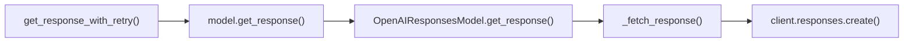

#### 第一层：get_response_with_retry()——统一的重试与超时

`get_new_response()` 把调用包成 lambda 交给重试包装器：

```python
new_response = await get_response_with_retry(
    get_response=lambda: model.get_response(
        system_instructions=filtered.instructions,
        input=filtered.input,
        model_settings=model_settings,
        tools=all_tools,
        output_schema=output_schema,
        handoffs=handoffs,
        tracing=..., previous_response_id=..., conversation_id=..., prompt=...,
    ),
    rewind=rewind_model_request,          # 失败重放前回滚已发送的输入
    retry_settings=model_settings.retry,
    timeout=model_settings.timeout,
)
```

为什么要多这一层？因为**重试、超时、失败前回滚（rewind）需要由同一个包装器统一控制**，而不是散落在每个 Model 适配器里。包装器内部最终执行的就是这个回调（[model_retry.py](https://github.com/openai/openai-agents-python/blob/main/src/agents/run_internal/model_retry.py)）：

```python
response = await _await_model_attempt(get_response(), timeout)
```

两个容易混淆的点：

- **调用不代表一定重试**：成功就直接返回，只有符合策略的失败才会重试。
- **Retry 与 Agent Loop 是两回事**：Agent Loop 负责多轮模型交互；Retry 只负责同一次逻辑调用内部的失败重试。

#### 第二层：model.get_response()——同一行代码，落到不同实现

`get_model()` 返回的 `model`，类型标注是 `Model`，但运行时它是一个具体对象，比如 `OpenAIResponsesModel`：

```python
model: Model = get_model(agent, run_config)   # 运行时是 OpenAIResponsesModel
await model.get_response(...)                 # 执行的是这个具体对象的方法
```

Python 调用方法时看的是**对象本身**，而不是变量上的类型标注。所以同一行 `model.get_response(...)`，实际会走哪套实现，取决于你拿到的是哪个对象：

```text
model.get_response(...)
  ├─ OpenAIResponsesModel       → client.responses.create()
  ├─ OpenAIChatCompletionsModel → client.chat.completions.create()
  └─ LitellmModel               → litellm.acompletion()
```

这就是 Model 接口的意义：Runner 只需要写 `model.get_response(...)`，不需要用 `isinstance` 判断模型类型；具体发哪种请求，由实际拿到的对象决定。本文默认的对象是 `OpenAIResponsesModel`，所以下一层看它的实现。

#### 第三层：_fetch_response()——真正发出 HTTP 请求

`OpenAIResponsesModel.get_response()` 内部调用 `_fetch_response()`，核心只有两步：

```python
create_kwargs = self._build_response_create_kwargs(
    # model、instructions、input、tools、model_settings、output_schema 等
)

client = self._get_client()
response = await client.responses.create(**create_kwargs)
```

- `_build_response_create_kwargs()`：把 SDK 内部配置翻译成 Responses API 字段（model、instructions、input、tools/handoffs 声明、output_schema、`previous_response_id`、`conversation_id` 等）。
- `client.responses.create()`：**真正发起 Responses API 请求的位置**。

所以 Runner 不需要知道 Responses API 接受哪些字段，参数转换全部由 Model 适配器完成。

#### 为什么还要转换成 ModelResponse？

Responses API 返回原始 `Response`，而 SDK 还支持 Chat Completions 等不同协议。如果 Runner 针对每种协议分别解析，就会与底层 API 耦合，因此适配器统一返回 `ModelResponse`：

```python
return ModelResponse(
    output=response.output,
    usage=usage,
    response_id=response.id,
    request_id=getattr(response, "_request_id", None),
)
```

```text
Responses API Response ───────┐
                              ├── ModelResponse
Chat Completions Response ────┘
```

**Takeaway：ModelProvider 负责把模型名变成 Model 对象；Model 对象负责真正发请求。Runner 只认 `Model.get_response()` 这个约定，不关心底层是 Responses、Chat Completions 还是 LiteLLM。**

那么，模型返回以后，SDK 又是怎么知道下一步该做什么的？

### 3.3 模型返回后，SDK 如何解析响应？

我们已经追踪到：

```python
response = await client.responses.create(...)
```

现在假设模型返回的不是一句普通回答，而是：

```json
{
  "id": "resp_123",
  "status": "completed",
  "output": [
    {
      "type": "function_call",
      "name": "get_weather",
      "arguments": "{\"city\":\"上海\"}",
      "call_id": "call_001"
    }
  ],
  "usage": {
    "input_tokens": 100,
    "output_tokens": 30,
    "total_tokens": 130
  }
}
```

这是简化的响应示例。

注意：

**模型没有执行 get_weather，只是告诉 SDK：我需要调用这个工具。**

还有一个容易误解的地方：

`status="completed"` 只意味着这一次模型响应已经完成，不代表整个 Agent 任务完成。

因为接下来还可能需要执行工具，再次调用模型。

#### Response、ModelResponse、ProcessedResponse 有什么区别？

我们现在可以看到模型返回路径：

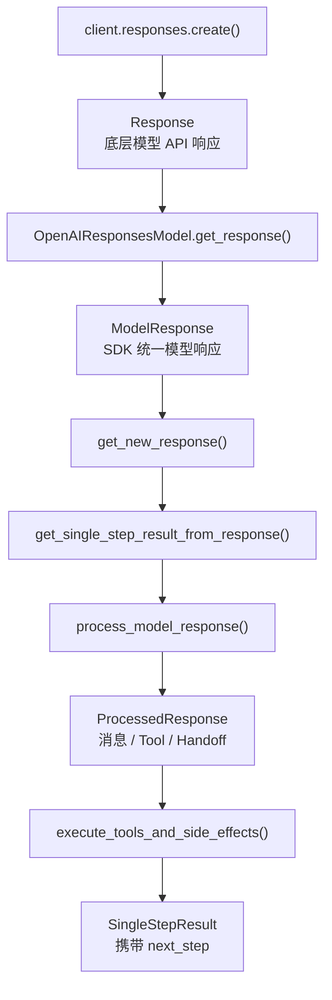

整个过程涉及四种重要的数据结构：

| 对象 | 作用 |
|---|---|
| `Response` | 模型 API 的原始响应 |
| `ModelResponse` | SDK 统一模型响应格式 |
| `ProcessedResponse` | 解析并分类模型输出 |
| `SingleStepResult` | 保存本轮执行结果和下一步控制指令 |

它们并不是重复包装同一份数据，而是在不同层次解决不同问题。

`ModelResponse` 解决底层模型接口的差异。

`ProcessedResponse` 解决模型输出中包含哪些操作的问题。

`SingleStepResult` 则解决操作完成以后，Runner 下一步该做什么的问题。

#### process_model_response() 如何分类模型输出？

源码：

[src/agents/run_internal/turn_resolution.py](https://github.com/openai/openai-agents-python/blob/main/src/agents/run_internal/turn_resolution.py)

它会根据当前 Agent 可用的 Tools、Handoffs 等配置，解析模型输出。

例如：

```python
for output in response.output:
    ...
```

可以把关键逻辑简化为：

```python
# 教学伪代码

for output in response.output:

    if isinstance(output, ResponseOutputMessage):
        # 普通模型消息
        items.append(MessageOutputItem(...))

    elif isinstance(output, ResponseFunctionToolCall):

        if is_handoff_tool_call(output):
            # Agent 交接请求
            items.append(HandoffCallItem(...))
            handoffs.append(ToolRunHandoff(...))

        else:
            # 普通 Function Tool 请求
            tool = find_function_tool(output)

            items.append(ToolCallItem(...))
            functions.append(ToolRunFunction(...))

return ProcessedResponse(
    new_items=items,
    functions=functions,
    handoffs=handoffs,
)
```

这里省略了其他模型输出、工具类型、校验与异常处理。

重点不是具体有多少种类型，而是这个函数的职责：

**根据模型输出和当前 Agent 的可用能力，识别并组织待执行操作。**

例如，模型返回：

```json
{
  "type": "function_call",
  "name": "get_weather",
  "arguments": "{\"city\":\"上海\"}",
  "call_id": "call_001"
}
```

`process_model_response()` 会识别这是一个 Function Tool Call，并匹配对应工具。

如果返回的工具名称是某个 Handoff，则会识别为 Agent 交接请求。

但是，**到这里还没有真正执行普通 Python 工具函数。**

#### 为什么要把解析与执行分开？

因为模型提出操作意图，不意味着 SDK 可以立刻执行。

执行之前，还可能涉及工具查找、参数校验、权限审批、Guardrails 等逻辑。

因此，SDK 会先完成模型输出解析，形成 `ProcessedResponse`。

然后将它交给：

```python
execute_tools_and_side_effects(...)
```

由执行阶段处理工具调用、Handoff 及相关副作用。

最后生成：

```python
SingleStepResult(...)
```

交还给 Runner。

Runner 再读取：

```python
next_step = turn_result.next_step
```

决定下一轮动作。

于是整个执行流程终于闭合：

```text
Runner
    ↓
Single Turn
    ↓
Model Provider / Model
    ↓
Responses API
    ↓
ModelResponse
    ↓
ProcessedResponse
    ↓
Tool Execution
    ↓
SingleStepResult
    ↓
NextStep
    ↓
Runner
```

#### 第三章的设计 Takeaway

为什么 SDK 要把 ModelProvider、Model、Response Processing 分成不同模块？

因为它们分别解决不同问题：

- **ModelProvider**：找到需要调用的模型。
- **Model**：隔离不同模型 API 的请求与响应差异。
- **Response Processing**：将模型输出转换成 Agent Runtime 能够理解的动作。
- **Runner**：不关心底层模型协议，只负责运行控制。

这种设计的好处是模块之间的职责清晰，便于替换 Model、扩展工具和维护 Agent Loop。

代价则是增加了抽象层，也让源码调用链更长。

### 本章 Takeaway

> Agents SDK 先解析模型配置并获得 Model 实例，再通过统一的 `get_response()` 接口调用模型。模型响应会依次经过统一包装与动作分类，最终交给执行阶段处理，从而使 Runner 不依赖具体模型 API。

到这里，我们已经研究了从用户请求进入 Runner，到真正发起模型调用，再到解析模型输出的完整链路。

但还有一个关键问题：

**模型返回 Function Call 后，SDK 究竟如何把它变成真实的 Python 函数执行？**

这就是下一章需要研究的 Tool Execution。

---

## 第四章：Tool Execution——模型如何调用并执行真实工具？

# 第四章：Tool Execution——模型如何调用并执行真实工具？

第三章我们已经研究了 Agent 如何调用模型，以及如何通过 `process_model_response()` 解析模型响应。

假设用户问：

> 上海今天的天气怎么样？

模型没有直接回答，而是返回：

```json
{
  "type": "function_call",
  "name": "get_weather",
  "arguments": "{\"city\":\"上海\"}",
  "call_id": "call_001"
}
```

这条响应表达的是：

**模型希望 SDK 调用名为 `get_weather` 的工具，并传入参数 `city="上海"`。**

但模型本身并没有执行任何 Python 代码。

那么问题来了：

1. `get_weather` 只是一个 Python 函数，模型为什么知道它的存在？
2. SDK 如何根据模型返回的名称找到真正的函数？
3. 找到函数以后，又是如何执行并将结果返回给模型的？

我们从工具的注册开始，一步步追踪整个执行过程。

## 4.1 FunctionTool：如何让模型认识 Python 函数？

先看一个普通 Python 函数：

```python
def get_weather(city: str) -> str:
    """查询指定城市的天气。"""
    return f"{city}：晴天"
```

这个函数只能由 Python 程序直接调用。

但大模型并不能读取 Python 进程中的函数对象，也无法直接执行它。

为了让模型能够使用这个函数，SDK 需要提供两种能力：

**第一，向模型描述工具。**

告诉模型工具叫什么、有什么用途、需要什么参数。

**第二，为 SDK 保存执行入口。**

当模型请求调用工具时，SDK 能够找到并执行原始 Python 函数。

为此，Agents SDK 定义了 `FunctionTool`。

源码：

`openai-agents-python/src/agents/tool.py:423`

精简结构：

```python
@dataclass
class FunctionTool:
    name: str
    description: str
    params_json_schema: dict
    on_invoke_tool: Callable
```

字段可以分成两组：

| 字段 | 作用 |
|---|---|
| `name` | 工具名称 |
| `description` | 工具描述 |
| `params_json_schema` | 参数 JSON Schema |
| `on_invoke_tool` | 工具执行回调 |

其中：

```python
on_invoke_tool: Callable
```

保存的是一个可调用入口，而不是工具已经执行完成的结果。

所以可以简单理解：

**FunctionTool = 工具描述 + 工具执行入口。**

### 手动创建 FunctionTool

我们完全可以手动包装原始 Python 函数：

```python
import json
from agents import FunctionTool

def get_weather(city: str) -> str:
    return f"{city}：晴天"

async def invoke_weather(ctx, args_json: str):
    args = json.loads(args_json)
    return get_weather(**args)

weather_tool = FunctionTool(
    name="get_weather",
    description="查询指定城市的天气",
    params_json_schema={
        "type": "object",
        "properties": {
            "city": {"type": "string"}
        },
        "required": ["city"],
        "additionalProperties": False,
    },
    on_invoke_tool=invoke_weather,
)
```

这里是用于理解包装机制的简化示例，没有实现 SDK 自动包装时的完整参数校验、异常处理等能力。

最关键的是：

```python
on_invoke_tool=invoke_weather
```

它让 `FunctionTool` 能够最终追踪到原始 Python 函数。

但是手动填写工具名称、参数 Schema 和执行回调比较麻烦。

所以 SDK 提供了 `@function_tool` 装饰器。

## 4.2 @function_tool 是如何自动包装函数的？

现在只需要：

```python
from agents import function_tool

@function_tool
def get_weather(city: str) -> str:
    """查询指定城市的天气。"""
    return f"{city}：晴天"
```

Python 装饰器可以接收一个函数，并返回另一个对象。

因此，上面的代码概念上等价于：

```python
def get_weather(city: str) -> str:
    """查询指定城市的天气。"""
    return f"{city}：晴天"

get_weather = function_tool(get_weather)
```

执行完以后：

```python
print(type(get_weather))
# <class 'agents.tool.FunctionTool'>
```

此时 `get_weather` 变量已经指向 `FunctionTool` 实例。

但原始 Python 函数仍然被包装逻辑引用。

**注意：装饰器执行时只是注册工具，不会执行天气查询。**

我们直接看源码。

### 第一步：生成工具 Schema

源码：

`openai-agents-python/src/agents/tool.py:2536`

在 `_create_function_tool()` 中：

```python
schema = function_schema(
    func=the_func,
    name_override=name_override,
    description_override=description_override
    or (callable_description if use_docstring_info else None),
    docstring_style=docstring_style,
    use_docstring_info=use_docstring_info,
    strict_json_schema=strict_mode,
)
```

`function_schema()` 会根据原始函数的签名、类型注解及文档字符串，生成工具名称、描述和参数 Schema。

例如：

```python
def get_weather(city: str) -> str:
    """查询指定城市的天气。"""
```

可以得到类似：

```json
{
  "name": "get_weather",
  "description": "查询指定城市的天气",
  "parameters": {
    "type": "object",
    "properties": {
      "city": {"type": "string"}
    },
    "required": ["city"],
    "additionalProperties": false
  }
}
```

这是简化示例。

### 第二步：创建执行回调

源码：

`openai-agents-python/src/agents/tool.py:2589`

SDK 会定义：

```python
async def _on_invoke_tool_impl(ctx, input):
    # 解析并校验模型传入的参数
    prepared = _prepare_arguments(input, ctx.tool_name)

    args = prepared.args
    kwargs = prepared.kwargs

    # 调用原始 Python 函数
    result = await invoke_original_function(
        *args, **kwargs
    )

    return result
```

这是教学伪代码。

真实源码会复用预处理过的参数，区分同步和异步 Python 函数。

其中实际执行原始函数的位置是：

`openai-agents-python/src/agents/tool.py:2601-2610`

例如同步函数：

```python
result = await asyncio.to_thread(
    the_func, *args, **kwargs_dict
)
```

这里的 `the_func` 就是最初传给装饰器的 Python 函数。

### 第三步：组装 FunctionTool

源码：

`openai-agents-python/src/agents/tool.py:2647`

```python
function_tool = _build_wrapped_function_tool(
    name=schema.name,
    description=schema.description or "",
    params_json_schema=schema.params_json_schema,
    invoke_tool_impl=_on_invoke_tool_impl,
    # ...错误处理及其他配置
)
```

SDK 最终构造并返回 `FunctionTool` 实例。

这里的执行回调还会经过一层错误处理包装。

因此，`FunctionTool.on_invoke_tool` 不一定直接等于 `_on_invoke_tool_impl`，但最终可以调用到它。

将整个过程串起来：

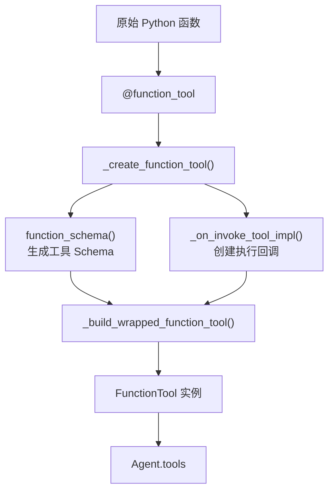

到这里，我们已经理解了：

**Python 函数是如何被注册为 FunctionTool 的。**

但是 FunctionTool 是 SDK 内部的 Python 对象。

接下来的问题是：

**Runner 如何取得这些工具，并把它们提供给模型？**

## 4.3 从 Runner.run() 开始，Tool 如何提供给模型？

回到第一章的代码：

```python
agent = Agent(
    name="Weather Agent",
    tools=[get_weather],
)

result = await Runner.run(
    agent,
    "上海天气怎么样？"
)
```

我们已经在第二章研究过 Runner 的调用链：

```text
Runner.run()
    ↓
AgentRunner.run()
    ↓
AgentRunner._run_impl()
    ↓
run_single_turn()
```

其中 `run_single_turn()` 负责当前模型轮次的处理。

源码：

`openai-agents-python/src/agents/run_internal/run_loop.py:2682`

### 第一步：准备当前 Agent 的 Tools

在 `run_single_turn()` 中：

`openai-agents-python/src/agents/run_internal/run_loop.py:2729`

```python
all_tools = await get_all_tools(
    execution_agent,
    context_wrapper
)
```

`get_all_tools()` 会进一步调用 `Agent.get_all_tools()`。

除了 Agent 中注册的工具，SDK 还可能加载 MCP Tools，并根据 `is_enabled` 等条件筛选当前可用工具。

最终得到：

```python
all_tools = [
    FunctionTool(name="get_weather", ...)
]
```

注意，此时仍然没有执行 `get_weather()`。

这里只是在准备当前 Agent 可供模型选择的工具。

### 第二步：将 Tools 传入 Model

源码：

`openai-agents-python/src/agents/run_internal/run_loop.py:2754`

```python
new_response = await get_new_response(
    bindings,
    system_prompt,
    input,
    output_schema,
    all_tools,
    handoffs,
    # ...
)
```

随后继续进入之前第三章学过的：

```text
get_new_response()
    ↓
model.get_response()
    ↓
OpenAIResponsesModel.get_response()
    ↓
_fetch_response()
```

SDK 会把 `all_tools` 传给 Model 适配器。

但 Responses API 并不认识 `FunctionTool` 实例，所以 Model 适配器还需要进行格式转换。

### 第三步：转换为 Responses API 的工具声明

源码：

`openai-agents-python/src/agents/models/openai_responses.py:1957`

在 `Converter.convert_tools()` 中，SDK 会根据工具类型进行转换。

对于 FunctionTool：

`openai-agents-python/src/agents/models/openai_responses.py:2040`

```python
# 核心源码精简

def _convert_function_tool(tool: FunctionTool):
    return {
        "type": "function",
        "name": tool.name,
        "description": tool.description,
        "parameters": tool.params_json_schema,
        "strict": tool.strict_json_schema,
    }
```

注意：

**这里生成的是 API 请求数据，不是新的 FunctionTool 对象。**

模型只能看到：

```json
{
  "type": "function",
  "name": "get_weather",
  "description": "查询指定城市的天气",
  "parameters": {
    "type": "object",
    "properties": {
      "city": {"type": "string"}
    },
    "required": ["city"],
    "additionalProperties": false
  },
  "strict": true
}
```

模型不会看到：

```python
on_invoke_tool
```

更不会看到完整的 Python 函数对象。

所以可以把工具分成两种表示：

| SDK 内部 | Responses API |
|---|---|
| `FunctionTool` 对象 | Function Tool Schema |
| 保存真实执行回调 | 只有名称、描述和参数 |
| SDK 执行时使用 | 模型选择工具时使用 |

模型根据这些 Schema，决定是否发起 Function Call。

接下来，我们沿着模型的响应继续追踪。

## 4.4 模型返回 Function Call 后，SDK 如何找到对应工具？

假设模型返回：

```json
{
  "type": "function_call",
  "name": "get_weather",
  "arguments": "{\"city\":\"上海\"}",
  "call_id": "call_001"
}
```

第三章中，我们已经看到：

```text
ModelResponse
    ↓
process_model_response()
    ↓
ProcessedResponse
```

现在进入 `process_model_response()`。

源码：

`openai-agents-python/src/agents/run_internal/turn_resolution.py:3000`

### 第一步：建立工具查找表

源码：

`openai-agents-python/src/agents/run_internal/turn_resolution.py:3024`

```python
handoff_map = {
    handoff.tool_name: handoff
    for handoff in handoffs
}

function_map = build_function_tool_lookup_map(
    [
        tool for tool in all_tools
        if isinstance(tool, FunctionTool)
    ]
)
```

SDK 先遍历当前可用的工具，建立查找映射。

对于普通无命名空间的工具，可以理解成：

```python
function_map = {
    ("bare", "get_weather"): get_weather_tool
}
```

实际查找键还支持命名空间和其他工具标识。

为什么不每次根据工具名称遍历所有工具？

因为建立字典后，就可以通过查找键快速找到工具对象。

### 第二步：匹配模型返回的 Function Call

源码：

`openai-agents-python/src/agents/run_internal/turn_resolution.py:3651`

精简逻辑：

```python
if is_handoff_tool_call(output, handoff_map):
    # Handoff，交给第五章的处理流程
    ...
else:
    lookup_key = get_function_tool_lookup_key_for_call(
        output
    )

    func_tool = function_map.get(lookup_key)
```

假设模型返回：

```python
output.name = "get_weather"
```

SDK 会找到对应的 `FunctionTool`。

然后生成：

`openai-agents-python/src/agents/run_internal/turn_resolution.py:3725`

```python
functions.append(
    ToolRunFunction(
        tool_call=output,
        function_tool=func_tool,
    )
)
```

这里有一个重要的数据结构：

```python
ToolRunFunction
```

它同时持有：

- `tool_call`：模型返回的调用请求，包括参数和 `call_id`。
- `function_tool`：SDK 中注册的真实 FunctionTool 对象。

这就把模型的调用意图和 Python 执行入口联系起来了。

**但此时仍然没有执行 Python 函数。**

`process_model_response()` 主要负责识别工具并组织待执行操作，接下来才进入执行阶段。

## 4.5 Tool Execution：SDK 如何真正执行 Python 函数？

现在已经获得：

```python
ToolRunFunction(
    tool_call=...,
    function_tool=get_weather_tool,
)
```

下一步是谁来执行它？

我们继续按源码调用链往下追。

### 第一层：execute_tools_and_side_effects()

源码：

`openai-agents-python/src/agents/run_internal/turn_resolution.py:924`

这个函数负责当前轮次的工具执行、审批和 Handoff 等操作。

它会先组织执行计划。

源码：

`openai-agents-python/src/agents/run_internal/tool_planning.py:629`

```python
# _build_plan_for_fresh_turn() 的关键逻辑

return ToolExecutionPlan(
    function_runs=processed_response.functions,
    computer_actions=processed_response.computer_actions,
    custom_tool_calls=processed_response.custom_tool_calls,
    # ...其他工具类型
)
```

注意：

```python
function_runs=processed_response.functions
```

前面解析出来的 `ToolRunFunction`，现在进入了 `ToolExecutionPlan`。

这样做是因为 SDK 不只支持 FunctionTool，还支持 Computer、Shell、Custom Tool 等不同工具类型。

**ToolExecutionPlan 负责描述哪些工具需要执行。**

### 第二层：_execute_tool_plan()

源码：

`openai-agents-python/src/agents/run_internal/tool_planning.py:941`

在：

`turn_resolution.py:1050`

SDK 调用：

```python
await _execute_tool_plan(
    plan=plan,
    bindings=bindings,
    hooks=hooks,
    context_wrapper=context_wrapper,
    run_config=run_config,
    # ...
)
```

对于 FunctionTool，执行计划会调用：

`openai-agents-python/src/agents/run_internal/tool_planning.py:1034`

```python
execute_function_tool_calls(
    bindings=bindings,
    tool_runs=plan.function_runs,
    hooks=hooks,
    context_wrapper=context_wrapper,
    config=run_config,
    # ...
)
```

非并行分支也会调用同一个函数。

到这里，我们终于从通用的工具执行计划进入 FunctionTool 专属执行逻辑。

### 第三层：FunctionTool 批量执行器

源码：

`openai-agents-python/src/agents/run_internal/tool_execution.py:2191`

```python
async def execute_function_tool_calls(...):
    return await _FunctionToolBatchExecutor(
        bindings=bindings,
        tool_runs=tool_runs,
        # ...
    ).execute()
```

这里创建 `_FunctionToolBatchExecutor`。

为什么不直接调用 `function_tool.on_invoke_tool()`？

因为一次模型响应可能包含多个 Function Call。

SDK 需要统一管理：

- 多工具任务调度和并发。
- 工具审批。
- Tool Guardrails。
- Hooks。
- 执行异常与结果收集。

因此将批量调度与单个工具执行分离。

### 第四层：创建并执行单个工具任务

源码：

`openai-agents-python/src/agents/run_internal/tool_execution.py:1492`

执行器调用：

```python
self._fill_tool_task_slots(pending_tool_runs)
```

接着进入：

`openai-agents-python/src/agents/run_internal/tool_execution.py:1548`

```python
def _create_tool_task(self, tool_run, order):
    task = asyncio.create_task(
        self._run_single_tool(
            task_state=task_state,
            func_tool=tool_run.function_tool,
            tool_call=tool_run.tool_call,
        )
    )
```

这里可以清楚地看到：

```python
func_tool=tool_run.function_tool
tool_call=tool_run.tool_call
```

前面 `process_model_response()` 关联起来的 FunctionTool 和模型调用请求，一直传递到了这里。

继续进入：

`openai-agents-python/src/agents/run_internal/tool_execution.py:1667`

```python
async def _run_single_tool(...):
    # 处理审批等逻辑

    result = await self._execute_single_tool_body(
        # ...
    )
```

如果调用需要人工审批且尚未批准，SDK 会先暂停，而不是直接执行工具。

进入 `_execute_single_tool_body()` 后，还会处理 Tool Input Guardrails 和相关 Hooks。

### 第五层：调用 FunctionTool 的执行回调

源码：

`openai-agents-python/src/agents/run_internal/tool_execution.py:1942`

找到：

```python
invocation_result = await _invoke_function_tool_with_metadata(
    function_tool=func_tool,
    context=tool_context,
    arguments=tool_call.arguments,
)
```

对应调用位置：

`openai-agents-python/src/agents/run_internal/tool_execution.py:1954`

现在按 F12 进入：

`openai-agents-python/src/agents/tool.py:2089`

```python
async def _invoke_function_tool_with_metadata(
    *,
    function_tool: FunctionTool,
    context: ToolContext[Any],
    arguments: str,
):
    ...
```

这个方法负责执行 FunctionTool 回调，并处理超时及 SDK 生成的错误结果元数据。

其中最关键的代码在：

`openai-agents-python/src/agents/tool.py:2100`

```python
output = await function_tool.on_invoke_tool(
    invoke_context,
    arguments
)
```

终于走到了 FunctionTool 在注册时保存的执行入口。

继续进入 `@function_tool` 创建的 `_on_invoke_tool_impl()`。

源码：

`openai-agents-python/src/agents/tool.py:2589`

前面已经介绍过，它会解析、校验参数，并调用原始 Python 函数。

```python
# 原始函数的最终调用

if not is_sync_function_tool:
    result = await the_func(*args, **kwargs_dict)
else:
    result = await asyncio.to_thread(
        the_func, *args, **kwargs_dict
    )
```

这是不需要 Context 参数时的精简分支。

到这里，原始 Python 函数才真正执行：

```python
get_weather(city="上海")
```

并返回：

```text
上海：晴天
```

### 完整的 Tool Execution 调用链

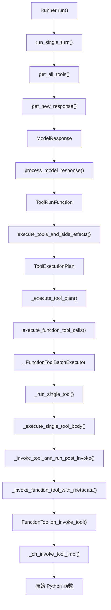

这张图是普通 FunctionTool 的主要执行路径，省略了部分参数准备、Hooks、Guardrails、审批与并发控制细节。

这里最值得理解的并不是函数有多少层，而是 **每一层负责的事情不同**。

| 组件 | 主要职责 |
|---|---|
| `process_model_response()` | 识别模型请求，匹配 FunctionTool |
| `ToolExecutionPlan` | 整理需要执行的各类工具 |
| `_execute_tool_plan()` | 分发工具执行计划 |
| `_FunctionToolBatchExecutor` | 管理 FunctionTool 的任务与执行过程 |
| `_invoke_function_tool_with_metadata()` | 触发执行回调，处理超时及结果元数据 |
| `_on_invoke_tool_impl()` | 解析参数，调用原始 Python 函数 |

## 4.6 工具执行后，SDK 如何将结果返回模型？

假设工具已经执行完成：

```python
get_weather("上海")
# 上海：晴天
```

工具结果不会自动变成 Agent 的最终回答。

SDK 首先需要将结果封装为模型可以接收的消息。

### 第一步：创建 ToolCallOutputItem

源码：

`openai-agents-python/src/agents/run_internal/tool_execution.py:2019`

关键代码：

```python
raw_output_item = ItemHelpers.tool_call_output_item(
    tool_call,
    provider_result,
    # ...
)

output_item = ToolCallOutputItem(
    output=final_result,
    raw_item=raw_output_item,
    agent=self.public_agent,
    # ...
)
```

其中：

```python
ItemHelpers.tool_call_output_item(...)
```

会构造模型协议对应的工具输出项。

对于普通 Function Call，模型最终可以看到类似：

```json
{
  "type": "function_call_output",
  "call_id": "call_001",
  "output": "上海：晴天"
}
```

注意这里的：

```python
call_id
```

它用于关联模型之前发起的某一次工具调用和对应的结果。

不要把它与工具名称混淆：

- `name`：用于查找注册的工具。
- `call_id`：用于标识一次具体的工具调用。

### 第二步：Runner 决定是否继续调用模型

工具执行完成后，SDK 需要判断：

**工具结果已经足够了吗？还是应该再次让模型根据结果生成回答？**

这个行为由：

```python
Agent.tool_use_behavior
```

控制。

源码：

`openai-agents-python/src/agents/run_internal/turn_resolution.py:766`

关键逻辑：

```python
if agent.tool_use_behavior == "run_llm_again":
    return NOT_FINAL_OUTPUT

elif agent.tool_use_behavior == "stop_on_first_tool":
    return ToolsToFinalOutputResult(
        is_final_output=True,
        final_output=tool_results[0].output,
    )
```

默认配置是：

```python
tool_use_behavior="run_llm_again"
```

表示工具执行完成后，通常会生成：

```python
NextStepRunAgain()
```

Runner 随后进入下一轮，将工具结果交给模型。

例如：

```text
第 1 轮
模型：调用 get_weather
    ↓
SDK 执行 Python 函数
    ↓
工具：上海，晴天
    ↓
NextStepRunAgain

第 2 轮
模型读取工具结果
    ↓
生成最终回答
    ↓
NextStepFinalOutput
```

当然，Agent 也可以配置：

```python
tool_use_behavior="stop_on_first_tool"
```

让工具结果直接成为最终输出。

因此：

**工具执行完成，不一定代表 Agent 执行结束。**

Tool Execution 负责完成当前工具调用；是否继续推理仍然由 Agent Runtime 决定。

## 4.7 设计取舍：为什么工具执行要拆成这么多层？

从最开始的：

```python
@function_tool
def get_weather(...):
    ...
```

到最终执行：

```python
function_tool.on_invoke_tool(...)
```

我们经过了模型适配、响应解析、工具计划和执行调度等多个模块。

为什么不直接在 `process_model_response()` 中调用 Python 函数？

因为 **模型提出操作意图，与 SDK 实际执行操作，是两个不同的职责。**

假设模型同时返回：

```text
get_weather("上海")
get_weather("北京")
get_weather("广州")
```

如果只有简单的直接调用逻辑，后续增加并发管理、超时、权限审批、异常处理和结果收集时，就会越来越复杂。

现在的设计将各阶段解耦：

**第一，工具声明与实际执行分离。**

`FunctionTool` 保存 Schema 和执行回调；模型只看到工具声明，不接触 Python 函数对象。

**第二，模型响应解析与执行分离。**

`process_model_response()` 负责识别并匹配操作，执行阶段才真正调用工具。

**第三，工具调度与单次调用分离。**

`ToolExecutionPlan` 负责组织不同类型的工具，批量执行器负责 FunctionTool 的并发与生命周期，底层回调负责执行业务函数。

这种设计使 SDK 更容易支持复杂工具场景。

但代价也很明显：**内部调用链变得更长，阅读源码和排查问题需要跨越多个模块。**

### 本章 Takeaway

> **FunctionTool 是连接模型操作意图与真实 Python 函数的桥梁。**
>
> SDK 先通过 `@function_tool` 将原始函数包装成 FunctionTool，再将工具 Schema 暴露给模型。模型返回 Function Call 后，`process_model_response()` 根据工具名称找到已注册对象，并通过 ToolExecutionPlan、FunctionTool 执行器和执行回调，最终调用原始 Python 函数。

整个过程可以压缩成：

```text
Python Function
    ↓ @function_tool
FunctionTool
    ↓
Agent.tools
    ↓
Responses API Tool Schema
    ↓
Model Function Call
    ↓
process_model_response()
    ↓
ToolRunFunction
    ↓
ToolExecutionPlan
    ↓
execute_function_tool_calls()
    ↓
FunctionTool.on_invoke_tool()
    ↓
原始 Python 函数
    ↓
ToolCallOutputItem
    ↓
NextStepRunAgain / NextStepFinalOutput
```

我们现在已经理解了，**模型如何通过 Function Calling 驱动真实 Python 函数执行**。

但下一章会遇到一个有意思的问题：

如果模型希望执行的不是一个 Python 函数，而是把任务交接给另一个 Agent 呢？

Handoff 不是 FunctionTool，却同样能够通过 Function Calling 触发。

SDK 又是怎么做到的？

这就是第五章研究的内容。

---

## 本章核心源码索引

| 核心对象 / 函数 | 本地源码位置 |
|---|---|
| `FunctionTool` 定义 | `openai-agents-python/src/agents/tool.py:423` |
| `function_tool()` 装饰器 | `openai-agents-python/src/agents/tool.py:2461` |
| `_create_function_tool()` | `openai-agents-python/src/agents/tool.py:2536` |
| `_on_invoke_tool_impl()` | `openai-agents-python/src/agents/tool.py:2589` |
| 原始 Python 函数执行 | `openai-agents-python/src/agents/tool.py:2601` |
| `_build_wrapped_function_tool()` 调用 | `openai-agents-python/src/agents/tool.py:2647` |
| `run_single_turn()` | `openai-agents-python/src/agents/run_internal/run_loop.py:2682` |
| `get_all_tools()` 调用 | `openai-agents-python/src/agents/run_internal/run_loop.py:2729` |
| `get_new_response()` 调用 | `openai-agents-python/src/agents/run_internal/run_loop.py:2754` |
| `Converter.convert_tools()` | `openai-agents-python/src/agents/models/openai_responses.py:1957` |
| `_convert_function_tool()` | `openai-agents-python/src/agents/models/openai_responses.py:2040` |
| `process_model_response()` | `openai-agents-python/src/agents/run_internal/turn_resolution.py:3000` |
| FunctionTool 名称查找 | `openai-agents-python/src/agents/run_internal/turn_resolution.py:3665` |
| `ToolRunFunction` 生成 | `openai-agents-python/src/agents/run_internal/turn_resolution.py:3725` |
| `execute_tools_and_side_effects()` | `openai-agents-python/src/agents/run_internal/turn_resolution.py:924` |
| `_build_plan_for_fresh_turn()` | `openai-agents-python/src/agents/run_internal/tool_planning.py:629` |
| `_execute_tool_plan()` | `openai-agents-python/src/agents/run_internal/tool_planning.py:941` |
| `execute_function_tool_calls()` | `openai-agents-python/src/agents/run_internal/tool_execution.py:2191` |
| `_FunctionToolBatchExecutor.execute()` | `openai-agents-python/src/agents/run_internal/tool_execution.py:1492` |
| `_run_single_tool()` | `openai-agents-python/src/agents/run_internal/tool_execution.py:1667` |
| `_invoke_tool_and_run_post_invoke()` | `openai-agents-python/src/agents/run_internal/tool_execution.py:1942` |
| `_invoke_function_tool_with_metadata()` | `openai-agents-python/src/agents/tool.py:2089` |
| `on_invoke_tool()` 调用 | `openai-agents-python/src/agents/tool.py:2100` |
| `ToolCallOutputItem` 创建 | `openai-agents-python/src/agents/run_internal/tool_execution.py:2027` |
| 工具结束条件判断 | `openai-agents-python/src/agents/run_internal/turn_resolution.py:766` |

以上行号按本次核对的 GitHub `main` 分支标注；本地检

## 第五章：Handoff——如何实现多 Agent 控制权交接？

第四章我们研究了 Tool Execution，知道模型可以通过 Function Calling 请求 SDK 执行 Python 工具。

但如果用户的任务比较复杂，需要多个专业 Agent 协作呢？

例如一个 AI 客服系统，用户说：

> 我上周买的耳机坏了，我想申请退款。

系统有两个 Agent：

- **Triage Agent**：负责接待用户、识别需求。
- **Refund Agent**：负责处理退款问题。

Triage Agent 判断这是退款问题后，应该把任务交给 Refund Agent。

这个将任务执行控制权从一个 Agent 转移到另一个 Agent 的过程，就是 **Handoff**。

## 5.1 Handoff 如何使用？

SDK 提供了非常简单的配置方式：

```python
from agents import Agent, Runner

refund_agent = Agent(
    name="Refund Agent",
    instructions="你负责处理退款问题。"
)

triage_agent = Agent(
    name="Triage Agent",
    instructions="识别用户需求，必要时转交专家。",
    handoffs=[refund_agent]
)

result = await Runner.run(
    triage_agent,
    "我想申请退款"
)

print(result.final_output)
print(result.last_agent.name)
```

这里最重要的是：

```python
handoffs=[refund_agent]
```

它表示 Triage Agent **可以**把执行权交给 Refund Agent，并不是创建 Agent 时立即交接。

模型运行过程中，可以根据用户需求决定是否触发 Handoff。

还记得第四章注册普通工具时使用的是：

```python
tools=[get_weather]
```

现在却是：

```python
handoffs=[refund_agent]
```

那么问题来了：

**既然 Handoff 不在 tools 里面，模型为什么还能通过 Function Calling 发起 Agent 交接？**

## 5.2 Handoff 和 FunctionTool 是什么关系？

先回到我们之前学习的 `FunctionTool`。

源码：

`openai-agents-python/src/agents/tool.py:423`

```python
@dataclass
class FunctionTool:
    name: str
    description: str
    params_json_schema: dict
    on_invoke_tool: Callable
```

这是精简后的结构。

`FunctionTool` 负责保存工具描述和 Python 执行入口。

而 `Tool` 本身并不是所有工具共同继承的父类，而是一个 Python Union 类型。

源码：

`openai-agents-python/src/agents/tool.py:1531`

```python
Tool = (
    FunctionTool
    | FileSearchTool
    | WebSearchTool
    | ComputerTool[Any]
    # ...其他工具类型
)
```

再看 Handoff。

源码：

`openai-agents-python/src/agents/handoffs/__init__.py:114`

```python
@dataclass
class Handoff:
    tool_name: str
    tool_description: str
    input_json_schema: dict
    on_invoke_handoff: Callable
    agent_name: str
```

同样是精简结构。

我们可以发现，它与 FunctionTool 很相似：

| FunctionTool | Handoff |
|---|---|
| `name` | `tool_name` |
| `description` | `tool_description` |
| `params_json_schema` | `input_json_schema` |
| `on_invoke_tool` | `on_invoke_handoff` |

但 **Handoff 不是 FunctionTool 的子类，也不属于 Tool 联合类型。**

两者最大的区别在于执行行为：

- `FunctionTool.on_invoke_tool()`：调用实际工具逻辑。
- `Handoff.on_invoke_handoff()`：返回目标 Agent，让 Runner 可以完成控制权交接。

因此，SDK 内部把它们设计成两个不同的对象。

但是，模型并不需要知道这些 Python 类型。

**SDK 可以把两种对象都转换成模型能够理解的 Function Tool 声明。**

## 5.3 SDK 如何创建并向模型暴露 Handoff？

我们配置的是：

```python
handoffs=[refund_agent]
```

这里传入的是普通 `Agent` 对象，不是 Handoff 对象。

所以 SDK 首先需要把它转换成 Handoff。

### 第一步：创建 Handoff 对象

源码：

`openai-agents-python/src/agents/run_internal/turn_preparation.py:88`

在 `get_handoffs()` 中：

```python
# 关键源码精简
for handoff_item in agent.handoffs:
    if isinstance(handoff_item, Handoff):
        handoffs.append(handoff_item)

    elif isinstance(handoff_item, Agent):
        handoffs.append(handoff(handoff_item))
```

也就是说：

```python
handoffs=[refund_agent]
```

最终会经过：

```python
handoff(refund_agent)
```

创建 Handoff 对象。

源码：

`openai-agents-python/src/agents/handoffs/__init__.py:256`

关键部分：

```python
# 教学伪代码
def handoff(agent):

    async def _invoke_handoff_impl(ctx, input_json):
        # 处理可选的交接参数与回调
        return agent

    return Handoff(
        tool_name="transfer_to_refund_agent",
        tool_description="交接给 Refund Agent",
        input_json_schema={...},
        on_invoke_handoff=_invoke_handoff_impl,
        agent_name=agent.name,
    )
```

真实源码中还包含输入校验、错误处理包装、可用性控制等逻辑。

最值得关注的是：

`openai-agents-python/src/agents/handoffs/__init__.py:341`

```python
return agent
```

**Handoff 的执行入口最终会返回目标 Agent。**

这里的目标 Agent 是 `handoff(refund_agent)` 创建时捕获的对象，不是模型动态生成的新 Agent。

这与第四章的 FunctionTool 包装机制很相似：SDK 保存一个可调用入口，等待模型请求后执行。

### 第二步：转换为模型能理解的工具

现在已经有了 Handoff 对象。

但模型依然无法直接理解 Python 的 `Handoff` 类。

因此，SDK 需要把它转换成 Responses API 的工具声明。

回到第三章学习过的 Model 适配器。

源码：

`openai-agents-python/src/agents/models/openai_responses.py:1957`

`Converter.convert_tools()` 负责转换工具配置。

除了处理普通 Tools，它还会单独处理 Handoffs。

源码：

`openai-agents-python/src/agents/models/openai_responses.py:2027`

```python
for handoff in handoffs:
    converted_tools.append(
        cls._convert_handoff_tool(handoff)
    )
```

继续看：

`openai-agents-python/src/agents/models/openai_responses.py:2194`

```python
@classmethod
def _convert_handoff_tool(cls, handoff):
    return FunctionToolParam(
        name=handoff.tool_name,
        parameters=handoff.input_json_schema,
        strict=handoff.strict_json_schema,
        type="function",
        description=handoff.tool_description,
    )
```

这段代码就是答案。

**SDK 把 Handoff 对象转换成了 Responses API 的 Function Tool 声明。**

模型最终能够看到类似这样的内容：

```json
{
  "type": "function",
  "name": "transfer_to_refund_agent",
  "description": "将任务交接给退款 Agent",
  "parameters": {
    "type": "object",
    "properties": {},
    "required": [],
    "additionalProperties": false
  },
  "strict": true
}
```

这是简化示例。

注意这里的 `FunctionToolParam`。

**它是 API 请求的数据结构，不是 SDK 中的 `FunctionTool` 类。**

因此，Handoff 并没有变成 FunctionTool 实例，只是被转换成了相同的模型调用协议。

现在，对于模型来说：

```text
get_weather
transfer_to_refund_agent
```

都表现为可以调用的工具。

但是对于 SDK 来说：

```text
get_weather               → 执行 Python 函数

transfer_to_refund_agent  → 切换 Agent
```

两者的执行语义完全不同。

## 5.4 模型返回 Function Call 后，SDK 怎么识别 Handoff？

假设模型决定把退款请求交给 Refund Agent。

它会返回：

```json
{
  "type": "function_call",
  "name": "transfer_to_refund_agent",
  "arguments": "{}",
  "call_id": "call_002"
}
```

注意，这与普通 FunctionTool 返回的结构几乎相同。

不能仅凭：

```python
type == "function_call"
```

就判断是 FunctionTool 还是 Handoff。

那么 SDK 如何区分？

答案是：**根据工具名称，查找当前 Agent 注册的工具对象。**

### 第一步：建立工具查找表

源码：

`openai-agents-python/src/agents/run_internal/turn_resolution.py:3024`

在 `process_model_response()` 中：

```python
handoff_map = {
    handoff.tool_name: handoff
    for handoff in handoffs
}

function_map = build_function_tool_lookup_map(
    [
        tool for tool in all_tools
        if isinstance(tool, FunctionTool)
    ]
)
```

SDK 事先遍历当前可用的 Handoffs 和 FunctionTools，建立查找结构。

例如：

```python
# 简化示意
handoff_map = {
    "transfer_to_refund_agent": refund_handoff
}
```

这样，收到模型返回的工具名称时，就不必每次遍历整个列表。

普通 FunctionTool 的查找键还可能包含命名空间。

### 第二步：匹配模型返回的工具

源码：

`openai-agents-python/src/agents/run_internal/turn_resolution.py:3651`

核心逻辑：

```python
# 精简版

if is_handoff_tool_call(output, handoff_map):

    handoff = ToolRunHandoff(
        tool_call=output,
        handoff=handoff_map[output.name],
    )

    run_handoffs.append(handoff)

else:
    lookup_key = get_function_tool_lookup_key_for_call(output)

    func_tool = function_map.get(lookup_key)
    # 后续处理普通 FunctionTool
```

判断 Handoff 的函数在：

`openai-agents-python/src/agents/run_internal/turn_resolution.py:218`

它会检查这是否为 `ResponseFunctionToolCall`，并确认调用名称与已注册 Handoff 匹配；带命名空间的调用不会匹配为 Handoff。

所以，模型返回：

```python
name = "transfer_to_refund_agent"
```

SDK 就可以通过：

```python
handoff_map[output.name]
```

找到对应的 Handoff 对象。

随后创建：

```python
ToolRunHandoff(
    tool_call=output,
    handoff=refund_handoff
)
```

这里依然没有切换 Agent。

`process_model_response()` 主要负责**识别并组织待执行操作**。

真正的 Agent 交接发生在后面的执行阶段。

## 5.5 SDK 如何真正切换 Agent？

现在我们已经拿到了：

```python
ToolRunHandoff(...)
```

接下来就进入 `execute_handoffs()`。

源码：

`openai-agents-python/src/agents/run_internal/turn_resolution.py:520`

这里有三个重要动作。

### 1）执行 Handoff 回调，取得目标 Agent

源码：

`openai-agents-python/src/agents/run_internal/turn_resolution.py:579`

```python
new_agent = await handoff.on_invoke_handoff(
    context_wrapper,
    actual_handoff.tool_call.arguments
)
```

还记得 5.3 中 `handoff()` 创建的执行入口吗？

它最终会：

```python
return agent
```

因此，这里的 `new_agent` 就是 Refund Agent。

SDK 还会执行相关 Handoff Hooks，并记录交接产生的运行项。

### 2）生成 NextStepHandoff

源码：

`openai-agents-python/src/agents/run_internal/turn_resolution.py:753`

关键代码：

```python
return SingleStepResult(
    # ...其他字段
    next_step=NextStepHandoff(new_agent),
)
```

这里终于和第二章学习的 `NextStep` 连接起来了。

`NextStepHandoff` 表示：

**这一轮需要交给另外一个 Agent，Runner 应当更新当前执行对象。**

### 3）Runner 更新 current_agent

源码：

`openai-agents-python/src/agents/run.py:1455`

```python
elif isinstance(turn_result.next_step, NextStepHandoff):
    current_agent = turn_result.next_step.new_agent
    # ...更新运行状态与输入历史
```

这样，下一轮模型调用就会使用 Refund Agent 的配置，包括其 Instructions、Tools、Model 等。

注意：**Handoff 并不是重新创建一个独立的 Runner，也不是结束当前 Run 后要求业务代码再调用一次 Runner。**

它是在同一个 Agent Loop 中切换 `current_agent`。

同时，目标 Agent 默认可以接续已有对话历史，必要时可通过 `input_filter` 等机制调整交接的上下文。

### 完整 Handoff 执行链

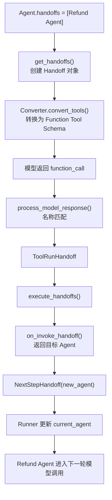

到这里，我们就把 Handoff 的完整执行过程串起来了。

**模型负责提出交接请求，SDK 负责解析和执行交接，Runner 负责更新执行控制流。**

## 5.6 设计取舍：为什么 Handoff 要复用 Function Calling？

假设 SDK 不使用 Function Calling，而是要求模型返回一种全新的协议：

```json
{
  "type": "handoff",
  "target_agent": "refund_agent"
}
```

那么模型服务和 SDK 就需要额外约定、支持并处理这种新协议。

而现在，SDK 直接利用已有的 Function Calling 能力。

模型只需要选择：

```text
transfer_to_refund_agent
```

SDK 就能够将它解释成 Agent 交接。

这是一种**协议复用**的设计：

- 模型侧统一使用 Function Calling 表达操作意图。
- SDK 根据已注册对象识别具体操作。
- Runner 根据 `NextStep` 控制执行流程。

这种设计的好处是不用为 Agent 交接额外设计一套模型调用协议。

代价则是 SDK 需要管理名称匹配、可用性、冲突校验和不同类型操作的执行分发。

另外，Handoff 并不是唯一的多 Agent 协作方式。

如果希望专家 Agent **接管后续对话**，可以使用 Handoff。

如果希望专家 Agent 只是完成一个子任务，并把结果返回给主 Agent，则可以使用 `Agent.as_tool()`。

两者的核心区别是控制权：

| 模式 | 控制权归属 |
|---|---|
| `Handoff` | 转移给目标 Agent |
| `Agent.as_tool()` | 主 Agent 保持控制权，专家 Agent 作为工具被调用 |

### 本章 Takeaway

> **Handoff 和 FunctionTool 在 SDK 内部是不同的数据类型，但可以被转换成相同协议的 Function Tool 声明。模型统一通过 Function Calling 表达调用意图，SDK 再通过名称匹配确定执行普通工具还是 Agent 交接。**

Handoff 的核心执行链路是：

```text
Agent.handoffs
    ↓
get_handoffs()
    ↓
Converter._convert_handoff_tool()
    ↓
Model Function Call
    ↓
process_model_response()
    ↓
ToolRunHandoff
    ↓
execute_handoffs()
    ↓
on_invoke_handoff()
    ↓
NextStepHandoff
    ↓
Runner 更新 current_agent
```

这一机制体现了 Agents SDK 的一个重要架构思想：

**统一模型的操作表达协议，将具体操作语义和控制流管理留给 Agent Runtime。**

---

## 本章核心源码索引

| 核心对象 / 函数 | 本地源码位置 |
|---|---|
| `Tool` 联合类型 | `openai-agents-python/src/agents/tool.py:1531` |
| `Handoff` 定义 | `openai-agents-python/src/agents/handoffs/__init__.py:114` |
| `handoff()` 工厂函数 | `openai-agents-python/src/agents/handoffs/__init__.py:256` |
| `_invoke_handoff_impl()` | `openai-agents-python/src/agents/handoffs/__init__.py:313` |
| `get_handoffs()` | `openai-agents-python/src/agents/run_internal/turn_preparation.py:88` |
| `Converter.convert_tools()` | `openai-agents-python/src/agents/models/openai_responses.py:1957` |
| `_convert_handoff_tool()` | `openai-agents-python/src/agents/models/openai_responses.py:2194` |
| `process_model_response()` | `openai-agents-python/src/agents/run_internal/turn_resolution.py:3000` |
| Handoff 名称匹配 | `openai-agents-python/src/agents/run_internal/turn_resolution.py:3651` |
| `execute_handoffs()` | `openai-agents-python/src/agents/run_internal/turn_resolution.py:520` |
| `NextStepHandoff` 生成 | `openai-agents-python/src/agents/run_internal/turn_resolution.py:758` |
| Runner 更新 Agent | `openai-agents-python/src/agents/run.py:1455` |

以上行号按照本次核对的 GitHub `main` 分支标注，本地版本可能略有变化。

官方参考：

- [OpenAI Agents SDK — Handoffs](https://openai.github.io/openai-agents-python/handoffs/)
- [OpenAI Agents SDK — Multi-agent orchestration](https://openai.github.io/openai-agents-python/multi_agent/)

---

## 第六章：State & Lifecycle——上下文、Session、中断与恢复机制

前面我们已经研究了 Agent Loop、Tool Execution 和 Handoff。

现在回到一个问题：

如果 Agent 已经执行了好几步，却突然需要暂停，它怎么知道之后应该从哪里继续？

比如用户对客服 Agent 说：

> 帮我给订单 A123 退款 500 元。

模型决定调用退款工具：

```python
refund_order(order_id="A123", amount=500)
```

但退款涉及资金操作，不能让模型决定调用以后就立即执行。我们希望先让用户或者管理员确认。

于是，执行流程变成：

```text
用户申请退款
    ↓
模型决定调用 refund_order
    ↓
SDK 发现需要人工审批
    ↓
暂停 Agent 执行
    ↓
等待用户确认
    ↓
审批通过
    ↓
恢复 Agent 执行
```

这里出现了一个新问题：

暂停时需要保存什么？只保存聊天历史够不够？

这就涉及 Agents SDK 中的三个核心对象：RunContextWrapper、Session 和 RunState。

### 6.1 Agent 运行时，状态由谁管理？

这三个对象很容易混淆，因为它们都与 Context 或 State 有关。

但它们解决的是不同问题。

| 对象 | 主要职责 | 可以理解成 |
|---|---|---|
| RunContextWrapper | 保存当前 Run 的业务上下文及相关运行信息 | 工作环境 |
| Session | 跨多次 Runner.run() 保存对话历史 | 聊天记录 |
| RunState | 保存一次 Run 的执行现场，支持中断恢复 | 游戏存档 |

#### 1）RunContextWrapper：让工具访问业务数据

例如，查询订单需要知道当前用户的 user_id。

我们可以把用户信息作为 Context 传入 Runner：

```python
from dataclasses import dataclass
from agents import (
    Agent,
    Runner,
    RunContextWrapper,
    function_tool,
)

@dataclass
class AppContext:
    user_id: str

@function_tool
def get_user_id(
    ctx: RunContextWrapper[AppContext]
) -> str:
    """获取当前用户 ID。"""
    return ctx.context.user_id

agent = Agent[AppContext](
    name="Order Assistant",
    tools=[get_user_id],
)

result = await Runner.run(
    agent,
    "我的用户 ID 是什么？",
    context=AppContext(user_id="user_001"),
)
```

这里最重要的是：

`ctx.context.user_id`

工具能够读取应用传入的业务数据。

但需要注意：

Context 不会自动发送给 LLM。

模型不会仅仅因为 context.user_id 存在，就知道用户的 ID。只有通过工具结果、动态 Instructions 等方式显式提供，模型才能使用这些信息。

源码：

`openai-agents-python/src/agents/run_context.py:162`

```python
@dataclass(eq=False)
class RunContextWrapper(Generic[TContext]):
    context: TContext
    usage: Usage = field(default_factory=Usage)
    # ...其他运行信息
```

它不仅保存业务 Context，还维护当前运行的 Usage、审批状态等信息。

#### 2）Session：让 Agent 记住之前的对话

假设用户先说：

> 我要查询订单 A123。

随后又问：

> 它发货了吗？

第二次提问如果没有历史信息，模型可能不知道“它”指的是哪个订单。

所以我们需要 Session。

```python
from agents import SQLiteSession

session = SQLiteSession(
    "conversation_001",
    "conversations.db"
)

# 第一次运行
await Runner.run(
    agent,
    "我要查询订单 A123",
    session=session,
)

# 第二次运行
await Runner.run(
    agent,
    "它发货了吗？",
    session=session,
)
```

两次 Runner.run() 使用同一个 Session，SDK 就可以读取之前的对话历史。

源码：

`openai-agents-python/src/agents/memory/session.py:63`

核心接口：

```python
class Session(Protocol):

    async def get_items(self, limit=None):
        ...

    async def add_items(self, items):
        ...
```

get_items() 用于读取历史，add_items() 用于保存对话项目。

实际 Runner 还会负责准备和持久化相应的 Session 数据。

这里的重点是：Session 让 Agent 接续对话，但它并不等于执行状态快照。

那么，如果 Agent 已经调用模型，正等待退款工具的审批，Session 能让它恢复到审批的位置吗？

这就需要 RunState。

### 6.2 RunState：为什么 Agent 需要保存执行现场？

想象退款 Agent 已经完成了：

```text
第 1 步：理解用户的退款请求
第 2 步：调用模型，生成 refund_order
第 3 步：发现工具需要人工审批
第 4 步：暂停
```

此时如果重新运行：

```python
await Runner.run(agent, "给订单 A123 退款 500 元")
```

本质上可能重新开始模型推理，而不是从审批位置继续。

我们需要记录：

- 当前是哪个 Agent。

- 当前执行到了第几个 Turn。

- 已经获得了哪些模型响应。

- 已经产生了哪些 RunItems。

- 哪个工具调用还在等待审批。

这就是 RunState 的作用。

源码：

`openai-agents-python/src/agents/run_state.py:803`

它是一个可以序列化的运行状态对象。

真实源码中有大量字段，我们只关心下面这些：

```python
# 从 RunState 提炼的核心字段

@dataclass
class RunState:
    _current_agent: Agent
    _current_turn: int
    _max_turns: int | None

    _model_responses: list[ModelResponse]
    _generated_items: list[RunItem]

    _current_step: NextStep
    _last_processed_response: ProcessedResponse
    _context: RunContextWrapper
```

这是精简结构，不是完整类型定义。

其中最重要的是：

| 字段 | 作用 |
|---|---|
| `_current_agent` | 恢复时应该由哪个 Agent 继续 |
| `_current_turn` | 当前执行到第几轮 |
| `_model_responses` | 已经获得的模型响应 |
| `_generated_items` | 已经产生的运行项 |
| `_current_step` | 当前可恢复的执行步骤 |
| `_last_processed_response` | 最近一次已解析的模型响应 |

如果把 Session 比作聊天记录，那么 RunState 就像一个执行快照。

Session 记录过去发生了什么对话；RunState 记录当前任务执行到了哪里。

### 6.3 Agent 如何暂停执行？

前面第二章学习 Agent Loop 时，我们已经遇到过：

`NextStepInterruption`

当工具需要审批时，它就是关键的控制流结果。

#### 第一步：工具声明需要审批

例如：

```python
from agents import function_tool

@function_tool(needs_approval=True)
def refund_order(order_id: str, amount: int) -> str:
    """执行订单退款。"""
    return f"订单 {order_id} 退款 {amount} 元成功（模拟）"
```

这里的 needs_approval=True 表示工具调用需要先获得批准。

模型可以正常生成 refund_order 的 Function Call，但 SDK 不应该在审批完成前执行真正的退款逻辑。

#### 第二步：生成 NextStepInterruption

源码：

`openai-agents-python/src/agents/run_internal/run_steps.py:170`

精简结构：

```python
@dataclass
class NextStepInterruption:
    interruptions: list[ToolApprovalItem]
```

interruptions 保存待审批的工具调用。

注意：

NextStepInterruption 只是告诉 Runner 应该暂停，它本身不是完整的执行快照。

因此，SDK 还需要将现场数据更新到 RunState。

#### 第三步：保存执行现场

源码：

`openai-agents-python/src/agents/run_internal/agent_runner_helpers.py:514`

关键函数：

```python
def update_run_state_for_interruption(...):
    run_state._model_responses = model_responses
    run_state._last_processed_response = processed_response
    run_state._generated_items = generated_items

    if session_items is not None:
        run_state._session_items = list(session_items)

    run_state._current_step = next_step
    run_state._current_turn = current_turn
```

这里的设计很重要。

SDK 不只是记录“有个退款工具等待审批”，还保留已经完成的模型响应、运行项和执行位置。

这样恢复时，就可以继续处理之前暂停的操作，而不是无条件重新发起模型请求。

### 6.4 用户审批后，如何恢复？

从应用开发者的角度，API 非常简单。

```python
# 假设 agent 已注册需要审批的 refund_order 工具

result = await Runner.run(
    agent,
    "给订单 A123 退款 500 元"
)

# 执行被审批请求中断
if result.interruptions:

    # 1. 获取执行现场
    state = result.to_state()

    # 2. 用户或管理员审批
    # 这里只演示审批通过的情况
    for interruption in result.interruptions:
        state.approve(interruption)

    # 3. 从保存的现场恢复
    result = await Runner.run(agent, state)
```

真实业务中，必须先完成独立的人工审批和权限检查，才能调用 state.approve()。如果审批拒绝，可以使用 state.reject()。

如果恢复后又产生新的审批请求，就需要再次处理 result.interruptions。

从内部源码来看：

Runner.run() 收到 RunState 后，会识别这是恢复执行，而不是普通的新用户输入。

对于暂停的 NextStepInterruption，它会进入：

```python
resolve_interrupted_turn(...)
```

这个函数会利用保存的 ProcessedResponse、审批决定和已经完成的执行结果，继续处理尚未完成的工作。

因此，它不需要无条件重新调用模型，也不应该重复执行已经成功完成的工具。

最后再根据新的 NextStep 决定：

- 继续调用模型。

- 再次暂停。

- 切换 Agent。

- 结束任务。

整个过程可以表示为：

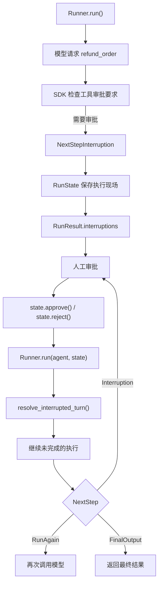

这里最值得关注的是：

恢复不是重新执行整个任务，而是利用 RunState 中保存的执行现场，继续处理尚未完成的步骤。

同时，恢复也不能无限制地重置 Turn 计数，否则就可能绕过原来的 max_turns 限制。

如果需要跨进程或跨服务恢复，还可以将 RunState 序列化后存储，再重新加载。

但是 RunState 可能包含业务 Context、工具参数、审批状态等敏感信息，必须放在可信的存储中，并对审批操作进行权限校验。若同时使用 Session，恢复时应保持原有会话后端和会话 ID 一致。

### 6.5 设计取舍：为什么不直接把所有状态放进 Session？

现在回到本章最初的问题。

为什么 OpenAI 要分别设计 RunContextWrapper、Session 和 RunState？

因为它们管理的是不同生命周期的信息。

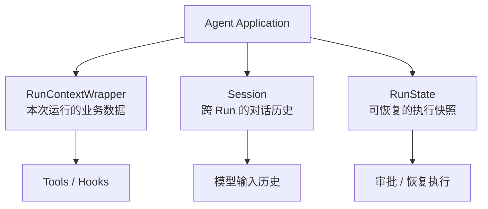

这种分离带来了三个好处。

**第一，业务上下文与模型输入分离。**

不是所有业务数据都应该自动发送给模型。例如用户 ID、数据库连接等依赖项，可以只交给本地工具使用。

**第二，对话历史与运行状态分离。**

普通聊天可能只需要 Session，而需要暂停和恢复的 Agent 工作流才需要额外保存 RunState。

**第三，避免恢复时重复执行已完成的工作。**

RunState 保留模型响应、已处理结果和审批状态，使 SDK 能从暂停边界继续，而不是简单重放整个 Agent Loop。

不过，这不意味着 SDK 能自动保证外部业务操作在所有失败情况下都“恰好执行一次”。对于真实退款、支付等操作，应用仍然需要使用幂等键、交易状态校验等机制，避免异常重试造成重复副作用。

### 本章 Takeaway

RunContextWrapper 管理本地业务上下文，Session 管理跨 Run 的对话历史，RunState 管理可恢复的执行状态。

当 Agent 需要审批时，SDK 通过 NextStepInterruption 暂停执行，并将执行现场保存进 RunState；审批完成后，Runner 利用保存的状态恢复未完成的工作。

这体现了 Agent Runtime 的一个重要设计原则：

不仅要知道如何推进任务，还要知道任务暂停时如何保存现场，以及恢复时哪些工作不应该重新执行。

### 本章核心源码索引

| 核心对象 / 函数 | 源码位置 |
|---|---|
| RunContextWrapper | `openai-agents-python/src/agents/run_context.py:162` |
| Session 接口 | `openai-agents-python/src/agents/memory/session.py:63` |
| RunState | `openai-agents-python/src/agents/run_state.py:803` |
| NextStepInterruption | `openai-agents-python/src/agents/run_internal/run_steps.py:170` |
| update_run_state_for_interruption() | `openai-agents-python/src/agents/run_internal/agent_runner_helpers.py:514` |
| resolve_interrupted_turn() 调用 | `openai-agents-python/src/agents/run.py` |

以上位置按照本次核对的 GitHub main 分支，正式分享时应与本地检出的 Git Commit 对照。

官方参考文档：

- Context Management

- Sessions

- Human-in-the-loop

下一章将继续研究 Guardrails、Streaming 与 Tracing，看看 SDK 如何校验执行过程、对外输出运行事件，并记录完整 Agent Trace。

---

## 第七章：Guardrails、Streaming 与 Tracing——安全、流式执行与可观测性

前面六章，我们已经理解了 Agent 如何调用模型、执行工具、切换 Agent，以及暂停和恢复。

但是，Agent 真正进入业务系统时，还需要解决三个问题：

1. 模型可能产生不符合业务要求的输入、输出或工具调用，谁来检查？
2. Agent 可能运行很久，用户怎么知道它正在做什么？
3. Agent 执行出错了，我们怎么定位问题发生在哪一步？

Agents SDK 分别提供了 **Guardrails、Streaming 和 Tracing** 来解决这些问题。

### 7.1 Guardrails：如何在 Agent 执行过程中进行校验？

继续使用之前的退款 Agent。

假设用户说：

> 帮我给订单 A123 退款 500 元。

我们可能需要检查：

- 用户输入是否属于客服支持范围。
- 工具调用的退款金额是否符合规则。
- 最终答案是否满足业务要求。

因此，SDK 将 Guardrails 分成三个层次：

| 类型 | 执行时机 | 主要用途 |
|---|---|---|
| Input Guardrail | 初始用户输入阶段 | 校验用户请求 |
| Tool Guardrail | FunctionTool 执行前后 | 检查工具参数和执行结果 |
| Output Guardrail | Agent 产生最终输出时 | 校验最终答案 |

需要注意：**Agent 级别的 Input Guardrail 只针对起始 Agent 运行，Output Guardrail 只针对产生最终输出的 Agent 运行。**

如果需要校验每一次函数工具调用，应使用 Tool Guardrail，而不能仅依赖 Agent 级别的 Guardrails。

#### 第一步：定义 Input Guardrail

源码：

`openai-agents-python/src/agents/guardrail.py:205`

SDK 提供了 `@input_guardrail` 装饰器。

```python
from agents import (
    Agent,
    GuardrailFunctionOutput,
    input_guardrail,
)

@input_guardrail(run_in_parallel=False)
def check_request(ctx, agent, user_input):
    text = (
        user_input
        if isinstance(user_input, str)
        else str(user_input)
    )

    is_off_topic = "求积分" in text

    return GuardrailFunctionOutput(
        output_info={"off_topic": is_off_topic},
        tripwire_triggered=is_off_topic,
    )

agent = Agent(
    name="Customer Support",
    instructions="处理用户的订单和售后问题。",
    input_guardrails=[check_request],
)
```

这里的关键对象是：

`openai-agents-python/src/agents/guardrail.py:17`

```python
@dataclass
class GuardrailFunctionOutput:
    output_info: Any
    tripwire_triggered: bool
```

`tripwire_triggered=True` 表示触发阻断条件。

SDK 会抛出相应的 `InputGuardrailTripwireTriggered` 异常，终止正常运行路径。

#### 第二步：Runner 在哪里执行 Guardrails？

源码：

`openai-agents-python/src/agents/run_internal/guardrails.py:127`

```python
async def run_input_guardrails(...):
    # 执行输入检查
    # 发现 tripwire 时抛出异常
    ...
```

输出检查位于：

`openai-agents-python/src/agents/run_internal/guardrails.py:183`

```python
async def run_output_guardrails(...):
    # 校验 Agent 的最终输出
    ...
```

其中有一个值得注意的设计：

**Input Guardrail 默认可以与模型执行并行。**

这样能减少额外延迟，但如果检查最终失败，模型请求可能已经开始，甚至已经消耗 Token。

如果业务要求必须先完成校验、再调用模型，可以使用：

```python
@input_guardrail(run_in_parallel=False)
```

这是一种安全约束与响应延迟之间的取舍。

#### 第三步：Tool Guardrail 如何保护工具？

假设模型请求：

```python
refund_order(order_id="A123", amount=100000)
```

即使模型生成了符合 JSON Schema 的参数，也不意味着业务允许退款 100000 元。

因此，SDK 还提供了：

`openai-agents-python/src/agents/tool_guardrails.py:140`

核心抽象：

```python
@dataclass
class ToolInputGuardrail:
    guardrail_function: Callable
```

它可以在 FunctionTool 执行前检查调用。

Tool Guardrail 支持三种处理结果：

```text
allow
    → 允许执行

reject_content
    → 拒绝这次调用，并将错误信息返回模型

raise_exception
    → 抛出异常，停止当前运行
```

对应源码：

`openai-agents-python/src/agents/tool_guardrails.py:55`

一个值得区分的细节是：**Tool Guardrail 不等于工具审批。**

- Guardrail 用来判断是否符合规则。
- `needs_approval` 用来要求人工授权。

并且，Handoff 使用独立的交接执行管线，不会自动经过 FunctionTool 的 Tool Guardrails；Hosted Tools 等工具类型也有各自的执行与检查边界。

#### Guardrails 执行关系

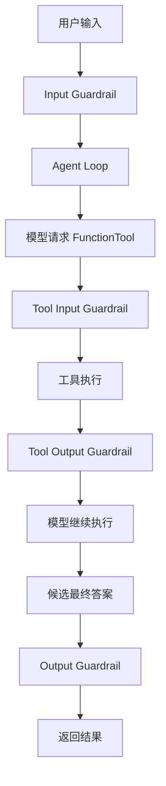

这是展示主要校验位置的简化流程，并不意味着每一轮一定经过所有 Guardrails。

### 7.2 Streaming：如何实时观察 Agent 执行？

如果一个 Agent 需要执行多个工具，整个任务可能持续比较久。

普通执行方式：

```python
result = await Runner.run(agent, "帮我查询订单")
```

调用者需要等待 Run 返回，才能拿到最终结果。

为了让用户及时看到执行进度，SDK 提供了：

```python
Runner.run_streamed()
```

#### Streaming 的基本使用

```python
from agents import Runner

result = Runner.run_streamed(
    agent,
    "帮我查询订单"
)

async for event in result.stream_events():

    if event.type == "raw_response_event":
        if event.data.type == "response.output_text.delta":
            print(event.data.delta, end="")

    elif event.type == "run_item_stream_event":
        print("运行事件：", event.name)

    elif event.type == "agent_updated_stream_event":
        print("当前 Agent：", event.new_agent.name)
```

这里注意：`Runner.run_streamed()` 返回的是 `RunResultStreaming`，不需要对这个调用本身使用 `await`。

之后通过异步迭代 `stream_events()` 获取运行事件。

源码：

`openai-agents-python/src/agents/run.py:2510`

`openai-agents-python/src/agents/result.py:616`

#### Streaming 不只是逐字输出

SDK 定义了三类重要事件：

源码：

`openai-agents-python/src/agents/stream_events.py:9`

| 事件类型 | 作用 |
|---|---|
| `RawResponsesStreamEvent` | 模型底层流式事件，如文本 delta |
| `RunItemStreamEvent` | SDK 处理后的消息、工具调用、Handoff 等事件 |
| `AgentUpdatedStreamEvent` | 当前执行的 Agent 发生变化 |

因此，前端不仅可以展示模型正在输出的文字，还能展示：

```text
正在调用 get_order...
订单查询完成
正在交接给 Refund Agent...
Refund Agent 正在处理...
```

在 SDK 内部，流式模型事件会被写入事件队列。

源码：

`openai-agents-python/src/agents/run_internal/run_loop.py:2553`

```python
streamed_result._event_queue.put_nowait(
    RawResponsesStreamEvent(data=event)
)
```

调用者则通过：

`openai-agents-python/src/agents/result.py:932`

```python
async def stream_events(self):
    ...
```

从队列消费事件。

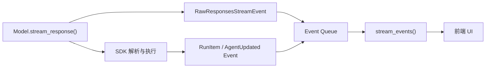

这里还有一个重要的工程细节：

**收到最后一个文本 Token，不等于整个 Agent Run 已经完成。**

工具收尾、Session 持久化以及 Guardrails 等工作可能仍在继续。

所以应消费完整的 `stream_events()`，再检查 `result.is_complete` 和最终结果。

对于需要严格输出审核的业务，也不能直接把未经校验的原始 Token 当成已经通过 Output Guardrail 的最终答案。

### 7.3 Tracing：如何知道 Agent 内部发生了什么？

Streaming 主要解决“运行时向外展示什么”。

但如果 Agent 回答错误，我们还想知道：

- 模型调用了几次？
- 哪次工具调用失败？
- Handoff 发生在哪里？
- 哪个步骤耗时最多？

这就需要 Tracing。

#### Trace 与 Span

可以把它理解成分布式链路追踪。

**Trace 表示一次完整工作流，Span 表示工作流中的一个执行步骤。**

例如：

```text
Trace：退款客服工作流
│
├── Agent Span：Triage Agent
│   ├── Model / Generation Span
│   └── Handoff Span
│
└── Agent Span：Refund Agent
    ├── Model / Generation Span
    ├── Function Span：get_order
    └── Model / Generation Span
```

SDK 可以自动记录模型调用、函数工具、Handoff 和 Guardrails 等事件。

#### 查看源码

`openai-agents-python/src/agents/tracing/create.py:28`

```python
def trace(
    workflow_name: str,
    trace_id: str | None = None,
    group_id: str | None = None,
    ...
) -> Trace:
    ...
```

同一个文件还定义了：

```text
agent_span()
function_span()
handoff_span()
guardrail_span()
custom_span()
```

它们用于标记不同类型的执行操作。

例如：

```python
from agents import Runner, trace, custom_span

with trace(
    "Customer Support Workflow",
    group_id="conversation_001",
):
    with custom_span("load_customer_context"):
        # 加载应用上下文
        pass

    result = await Runner.run(
        agent,
        "帮我查询订单"
    )
```

这里的 `custom_span()` 用来补充业务侧需要观察的步骤。

SDK 默认启用 Tracing，但可以通过 `RunConfig` 控制：

```python
from agents import RunConfig

run_config = RunConfig(
    workflow_name="Customer Support",
    trace_include_sensitive_data=False,
)
```

`trace_include_sensitive_data=False` 可减少模型和工具输入输出中的敏感内容被写入 Trace。正式接入生产环境时，还要结合数据保留和访问控制要求进行配置。

### 本章 Takeaway

> Guardrails 负责校验执行过程，Streaming 负责实时暴露运行事件，Tracing 负责记录执行链路。

它们并不会改变 Agent Loop 的核心控制模型。

**Runner 仍然通过 Single Turn 和 NextStep 推进任务；这三个机制只是分别在运行过程中增加校验、事件输出和链路记录。**

---

### 本章核心源码索引

| 核心对象 / 函数 | 本地源码位置 |
|---|---|
| `GuardrailFunctionOutput` | `openai-agents-python/src/agents/guardrail.py:17` |
| `InputGuardrail` | `openai-agents-python/src/agents/guardrail.py:67` |
| `run_input_guardrails()` | `openai-agents-python/src/agents/run_internal/guardrails.py:127` |
| `run_output_guardrails()` | `openai-agents-python/src/agents/run_internal/guardrails.py:183` |
| `ToolGuardrailFunctionOutput` | `openai-agents-python/src/agents/tool_guardrails.py:55` |
| `Runner.run_streamed()` | `openai-agents-python/src/agents/run.py:2510` |
| `RunResultStreaming` | `openai-agents-python/src/agents/result.py:616` |
| `stream_events()` | `openai-agents-python/src/agents/result.py:932` |
| 流式事件类型 | `openai-agents-python/src/agents/stream_events.py:9` |
| `trace()` | `openai-agents-python/src/agents/tracing/create.py:28` |
| `custom_span()` | `openai-agents-python/src/agents/tracing/create.py:271` |

官方参考：

- [Guardrails](https://openai.github.io/openai-agents-python/guardrails/)
- [Streaming](https://openai.github.io/openai-agents-python/streaming/)
- [Tracing](https://openai.github.io/openai-agents-python/tracing/)

下一章，我们将通过几个可复现的实验，验证这些运行机制在异常情况下的实际行为。

---

## 第八章：源码实验——验证工具异常、循环停止、Handoff 与恢复机制

前面我们已经理解了 Agents SDK 的主要执行机制。

但阅读源码只能告诉我们 SDK 设计上应该如何工作。为了真正掌握 Runtime，还需要通过实验观察它在异常情况下的行为。

这一章选择四个具有代表性的实验：

1. 工具执行失败会发生什么？
2. Agent 一直调用工具，如何停止？
3. Handoff 是否真的切换了 Agent？
4. 审批中断后，如何避免重新执行已完成的操作？

这些实验使用模拟业务数据。涉及模型请求的实验需要配置可用的 API，并建议配合 Trace 观察执行链路。

以下是实验代码与**预期行为**，不是声称已经执行得到的结果。

### 8.1 实验一：FunctionTool 执行失败

先看一个会抛出异常的工具：

```python
from agents import (
    Agent,
    Runner,
    ModelSettings,
    function_tool,
)

@function_tool
def unstable_tool(value: str) -> str:
    """执行测试操作。"""
    raise ValueError("模拟数据库故障")

agent = Agent(
    name="Test Agent",
    instructions="调用工具处理请求。",
    tools=[unstable_tool],
    model_settings=ModelSettings(
        tool_choice="unstable_tool"
    ),
)

result = await Runner.run(
    agent,
    "调用工具，参数 value 为 test",
)

print(result.final_output)
```

这里故意让工具抛出异常。

那么，整个 Runner 会立即崩溃吗？

**不一定。**

SDK 对 FunctionTool 提供了默认的错误处理机制。

源码：

`openai-agents-python/src/agents/tool.py:1833`

```python
def default_tool_error_function(
    ctx,
    error: Exception
) -> str:
    return "An error occurred while running the tool."
```

默认情况下，SDK 可以把执行异常转换为一条模型可见的工具错误结果。

模型收到错误信息后，仍可能继续推理并给出答复。

但是，如果这样声明：

```python
@function_tool(failure_error_function=None)
def unstable_tool(value: str) -> str:
    """执行测试操作。"""
    raise ValueError("模拟数据库故障")
```

则关闭了该装饰器的默认工具错误转换机制。错误会沿执行链传播，交由上层的工具执行或 Run 错误处理逻辑处理。

可以用：

```python
try:
    result = await Runner.run(
        agent,
        "调用 unstable_tool"
    )
except Exception as exc:
    print(type(exc).__name__, str(exc))
```

观察异常类型。

具体异常类型可能经过 SDK 包装，不应该假定最外层一定收到原始 `ValueError`。

这个实验验证了：

**FunctionTool 的执行回调与错误处理是两个不同的职责。工具异常既可以被转换为模型结果，也可以让当前 Run 失败。**

对应执行位置：

`openai-agents-python/src/agents/run_internal/tool_execution.py:1667`

### 8.2 实验二：Agent 无限调用工具怎么办？

假设模型不断决定调用工具：

```text
Turn 1：调用 get_weather
Turn 2：再次调用 get_weather
Turn 3：再次调用 get_weather
...
```

如果不限制执行轮次，任务可能持续消耗 Token 和计算资源。

第二章我们已经学过：

```python
max_turns
```

现在用实验验证它。

```python
from agents import (
    Agent,
    Runner,
    ModelSettings,
    MaxTurnsExceeded,
    function_tool,
)

@function_tool
def get_weather(city: str) -> str:
    """查询天气。"""
    return f"{city}：晴天"

agent = Agent(
    name="Weather Agent",
    instructions="先调用天气工具，再根据结果回答。",
    tools=[get_weather],
    model_settings=ModelSettings(
        tool_choice="get_weather"
    ),
)

try:
    result = await Runner.run(
        agent,
        "查询上海天气",
        max_turns=1,
    )
except MaxTurnsExceeded:
    print("超过最大模型调用轮次")
```

这里使用 `tool_choice` 请求模型调用指定工具，以便更稳定地复现。

如果第一轮返回工具调用，工具执行完成后 Runner 还需要再调用一次模型，便会触及 `max_turns=1` 的限制。

源码：

`openai-agents-python/src/agents/run.py:1506`

```python
current_turn += 1

if max_turns is not None and current_turn > max_turns:
    # 处理 MaxTurnsExceeded
    ...
```

**这里限制的是模型调用轮次，不是工具执行次数。**

同一轮模型返回多个工具调用，仍只对应一次逻辑模型轮次。

另外，当前 SDK 也支持通过 `error_handlers` 为 `max_turns` 提供自定义处理结果，不一定只能抛出异常。

实验的主要目的，是验证 Agent Loop 的边界条件。

### 8.3 实验三：Handoff 真的切换了 Agent 吗？

第五章我们已经知道，Handoff 最终产生：

```python
NextStepHandoff(new_agent)
```

但实际执行时，怎么证明 Runner 已经切换到另一个 Agent？

可以直接检查 `RunResult.last_agent`。

```python
from agents import Agent, Runner, ModelSettings

refund_agent = Agent(
    name="Refund Agent",
    instructions="你负责退款问题。"
)

triage_agent = Agent(
    name="Triage Agent",
    instructions="将退款问题交接给 Refund Agent。",
    handoffs=[refund_agent],
    model_settings=ModelSettings(
        tool_choice="transfer_to_refund_agent"
    ),
)

result = await Runner.run(
    triage_agent,
    "我想退款"
)

print(result.last_agent.name)
```

在模型按指定工具请求完成 Handoff 的情况下，预期输出为：

```text
Refund Agent
```

我们还可以检查运行项：

```python
for item in result.new_items:
    print(type(item).__name__)
```

观察其中是否包含：

```text
HandoffCallItem
HandoffOutputItem
```

这些对象对应交接请求和交接结果。

关键源码：

`openai-agents-python/src/agents/run_internal/turn_resolution.py`

可以重点搜索：

```python
ToolRunHandoff
execute_handoffs
NextStepHandoff
```

以及 Runner 中：

```python
current_agent = turn_result.next_step.new_agent
```

这个实验想验证的不是模型是否“说了自己已经交接”，而是 **SDK 的运行状态中，当前 Agent 是否真的发生变化**。

### 8.4 实验四：人工审批后如何恢复？

最后验证第六章的 `RunState`。

为了确保不会产生真实资金操作，我们定义一个模拟退款工具，并用计数器记录它实际执行了几次。

```python
from agents import Agent, Runner, ModelSettings, function_tool

execution_count = 0

@function_tool(needs_approval=True)
def refund_order(order_id: str, amount: int) -> str:
    """模拟订单退款。"""
    global execution_count
    execution_count += 1
    return f"订单 {order_id} 已模拟退款 {amount} 元"

agent = Agent(
    name="Refund Agent",
    instructions="需要退款时调用 refund_order。",
    tools=[refund_order],
    model_settings=ModelSettings(
        tool_choice="refund_order"
    ),
)

# 第一次运行
result = await Runner.run(
    agent,
    "给订单 A123 退款 500 元"
)

print("待审批数量：", len(result.interruptions))
print("实际执行次数：", execution_count)
```

如果模型发起了退款调用，预期：

```text
待审批数量：1
实际执行次数：0
```

因为工具需要审批，正常情况下不会在审批前执行业务函数体。

接下来模拟人工审批通过：

```python
if result.interruptions:
    state = result.to_state()

    for item in result.interruptions:
        state.approve(item)

    result = await Runner.run(agent, state)

    print("恢复后执行次数：", execution_count)
```

恢复后的第一次已批准工具执行，应该使计数器增加一次。

这里不要直接要求最终计数一定为 1：如果模型继续发起新的退款调用，可能再次触发审批或产生后续操作。实验应该通过运行项和 `call_id` 区分“恢复原有调用”和“新发起的调用”。

关键源码：

`openai-agents-python/src/agents/run_state.py:1308`

```python
def approve(self, approval_item, always_approve=False):
    ...
```

Runner 恢复时会进入：

`openai-agents-python/src/agents/run_internal/run_loop.py`

搜索：

```python
resolve_interrupted_turn
```

它会利用保存的 `ProcessedResponse` 和审批状态，继续处理暂停的执行。

这个实验尤其说明：

**RunState 不只是保存聊天记录，还保存了哪些操作已经完成、哪些操作正在等待继续。**

如果是真实支付或退款系统，还应加入业务幂等键与持久化操作记录。单靠 Agent Runtime 的恢复机制，不能保证外部交易在所有故障情况下都恰好执行一次。

### 8.5 四个实验验证了什么？

| 实验 | 主要验证对象 | 验证结论 |
|---|---|---|
| 工具异常 | FunctionTool / Tool Execution | 工具错误可转换为结果，也可传播 |
| 最大轮次 | Agent Loop / Runner | Runner 负责限制执行轮次 |
| Agent 交接 | Handoff / NextStep | 交接改变真正的执行 Agent |
| 审批恢复 | RunState / NextStepInterruption | 可以从执行快照恢复未完成操作 |

这四个实验实际上对应了 Agent Runtime 的四种重要边界：

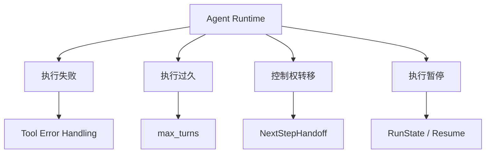

### 本章 Takeaway

> **理解 Agent Runtime 不能只研究正常情况下的 Agent Loop，还需要验证它面对异常、无限循环、控制权切换和中断恢复时的行为。**

真正可靠的 Agent 系统需要明确这些边界条件，而不只是让模型成功生成一次回答。

---

### 本章核心源码索引

| 实验 | 关键源码 |
|---|---|
| FunctionTool 默认错误处理 | `openai-agents-python/src/agents/tool.py:1833` |
| FunctionTool 执行 | `openai-agents-python/src/agents/run_internal/tool_execution.py:1667` |
| `max_turns` 判断 | `openai-agents-python/src/agents/run.py:1506` |
| Handoff 解析与执行 | `openai-agents-python/src/agents/run_internal/turn_resolution.py` |
| `RunState.approve()` | `openai-agents-python/src/agents/run_state.py:1308` |
| 中断恢复 | `openai-agents-python/src/agents/run_internal/run_loop.py` |

实验时建议记录 Model Request、实际 Function Call、`call_id`、RunItems、NextStep 和异常类型，并结合第七章的 Tracing 观察执行路径。

---

## 第九章：架构设计取舍——Agents SDK、Responses API 与 LangGraph

研究到这里，我们已经知道 OpenAI Agents SDK 是如何组织模型调用、工具执行、Agent 交接和运行状态的。

那么一个实际的架构问题出现了：

**既然直接使用 Responses API 也能实现工具调用，为什么还需要 Agents SDK？如果已经使用 Agents SDK，又为什么有人选择 LangGraph？**

这三个方案并不是完全相同层级的产品。

它们都可以用来构建 Agent 应用，但提供的抽象和默认控制方式不同。

### 9.1 Responses API：直接控制模型调用

先回到第三章。

如果直接调用 Responses API：

```python
response = await client.responses.create(
    model="gpt-4.1",
    input="上海明天适合跑步吗？",
    tools=[...],
)
```

当模型返回 Function Call 后，我们需要自己处理：

```python
# 教学伪代码

response = await call_model()

while has_function_calls(response):

    for tool_call in get_function_calls(response):
        tool = find_tool(tool_call.name)

        args = json.loads(tool_call.arguments)
        output = await execute_tool(tool, args)

        append_tool_result(
            call_id=tool_call.call_id,
            output=output,
        )

    response = await call_model_again()

return get_final_output(response)
```

注意，这是应用自己编写的工具执行循环。Responses API 的 Hosted Tools 可能由平台执行，但应用自定义的 Python Function Tool 通常需要应用侧完成执行与结果回传。

这个方式的优势是：

**开发者可以直接决定模型请求如何构造、工具如何调用、何时继续或结束。**

但是，随着业务变复杂，我们还需要自己处理：

- 工具参数校验、错误与重试。
- Agent 之间的控制权交接。
- Session 与执行状态。
- 人工审批和恢复。
- Streaming 和 Tracing。
- 最大轮次、Guardrails 等运行边界。

当然，所有这些机制都可以自己开发。

但这意味着需要维护一套自己的 Agent Runtime。

### 9.2 Agents SDK：把通用 Agent Loop 封装起来

如果使用 Agents SDK，同一个问题可以写成：

```python
from agents import Agent, Runner

agent = Agent(
    name="Weather Agent",
    instructions="先查询天气，再给出建议。",
    tools=[get_weather],
)

result = await Runner.run(
    agent,
    "上海明天适合跑步吗？"
)
```

开发者主要关注 Agent 的能力和业务实现，而 SDK 负责组织执行过程。

我们在前面章节已经阅读过它的核心架构：

```text
Agent
  ↓
Runner
  ↓
Agent Loop
  ↓
Model.get_response()
  ↓
process_model_response()
  ↓
Tool Execution / Handoff
  ↓
NextStep
  ↓
继续 / 交接 / 结束 / 暂停
```

这里最关键的抽象是：

```python
next_step = turn_result.next_step
```

SDK 把本轮执行结果转化成控制流指令，再由 Runner 统一推进。

因此，**Agents SDK 本质上是在 Responses API 等模型接口之上，提供一套可复用的 Agent Runtime。**

它的好处是减少执行循环和周边机制的重复开发。

但也有代价：当开发者需要修改非常底层的执行策略时，就需要理解 SDK 的内部抽象、扩展点和运行约束。

例如，在一个完全固定的五阶段审批工作流里，并不是每个步骤都适合交给模型决定。

这就引出了 LangGraph。

### 9.3 LangGraph：使用显式状态图组织工作流

LangGraph 的核心思路是：

**通过 State、Node 和 Edge 定义工作流，让执行器根据图结构推进任务。**

例如，一个退款流程可能是：

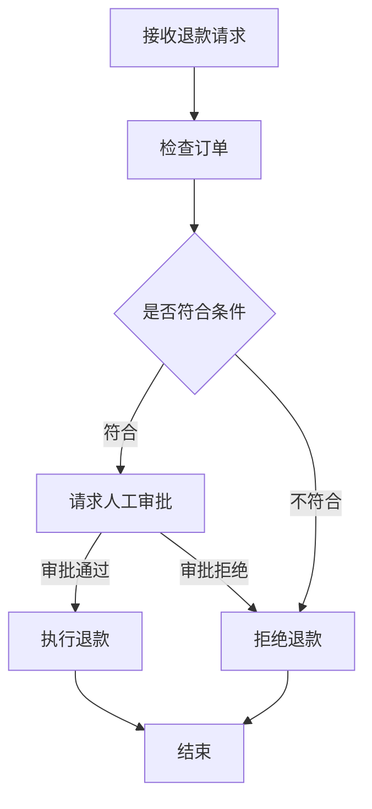

这种流程有几个明显特点：

- 执行步骤相对明确。
- 有业务条件分支。
- 部分步骤必须等待人工输入。
- 需要持久化流程状态。

在 LangGraph 中，开发者可以把这些步骤建模为 Node，通过 Edge 和条件路由控制下一步。

例如：

```python
# LangGraph 风格示意

builder.add_node("check_order", check_order)
builder.add_node("request_approval", request_approval)
builder.add_node("refund", refund)

builder.add_edge(START, "check_order")

builder.add_conditional_edges(
    "check_order",
    route_by_order_status,
)

graph = builder.compile(checkpointer=checkpointer)
```

这段代码省略了 State 类型、节点和完整路由配置，用于展示图式编排思想。

LangGraph 还提供 Checkpointer 和 Interrupt 等机制，用于保存图状态和恢复执行。

需要注意，它的恢复粒度和 Agents SDK 并不完全相同。例如，LangGraph 的动态 Interrupt 在恢复时可能从被中断节点的起点重新执行，因此节点内部的副作用也需要特别处理。

#### 与 Agents SDK 的主要区别

可以从控制流来理解两者。

Agents SDK 的典型方式：

```text
模型返回结果
    ↓
SDK 判断下一步
    ↓
RunAgain / Handoff / Final / Interruption
```

LangGraph 的典型方式：

```text
执行当前 Node
    ↓
更新 Graph State
    ↓
根据 Edge / Command 选择下一节点
    ↓
继续执行
```

这并不意味着 Agents SDK 不能执行确定性操作，或者 LangGraph 不能实现自主 Agent。

两者都可以混合模型决策与程序控制。

真正的区别是：**它们让开发者以不同的方式组织和表达整个工作流。**

### 9.4 三者应该怎么选择？

| 对比维度 | Responses API | Agents SDK | LangGraph |
|---|---|---|---|
| 核心抽象 | 模型请求与响应 | Agent + Runner + Tool | State + Node + Edge |
| Agent Loop | 开发者自行实现 | SDK 内置 | 可以通过图节点和路由实现 |
| 控制流 | 完全自行管理 | 以 Agent Loop、NextStep 为核心 | 以显式图状态与边为核心 |
| Function Tool | 自行处理本地工具执行 | 内置执行管线 | 在节点或 Agent 中组织执行 |
| 多 Agent | 自行编排 | Handoff、Agent.as_tool | 多节点、子图等 |
| 持久化 | 自行选择和实现 | Session、RunState | Checkpointer、Store |
| 适合场景 | 定制底层执行器 | 代码驱动的 Agent 应用 | 显式、复杂且有状态的工作流 |

这里不能简单地说哪个框架绝对更强。

选择取决于开发者希望控制哪个层次。

**场景一：只需要模型能力和少量工具。**

可以直接使用 Responses API，不一定需要引入完整 Agent 框架。

**场景二：模型负责动态决定工具调用和专家分工。**

Agents SDK 提供现成的 Agent Loop、Tool、Handoff 和 RunState，通常可以降低开发成本。

**场景三：业务流程有大量确定性节点、条件分支和持久化要求。**

LangGraph 的显式状态图会让整个流程结构更清晰。

在复杂系统中，也可以组合使用。例如由图工作流管理业务阶段，在某个节点内部调用 Agents SDK 完成一个相对自主的子任务。

### 9.5 从设计模式理解 Agents SDK

回顾源码，可以发现 Agents SDK 采用了几种典型的架构思想。

#### 1）接口隔离与依赖倒置

Runner 不依赖具体的 OpenAI HTTP 请求实现，而是依赖：

```python
Model.get_response()
```

具体实现可以是：

```text
OpenAIResponsesModel
OpenAIChatCompletionsModel
其他自定义 Model
```

这样更容易替换模型提供方和底层协议。

#### 2）控制流数据化

SDK 用：

```python
NextStepRunAgain
NextStepHandoff
NextStepFinalOutput
NextStepInterruption
```

表示下一步执行意图。

由外层 Runner 解释这些对象，而不是把所有执行逻辑混在模型响应解析函数里。

这使运行状态更容易组织，也为暂停与恢复提供了基础。

#### 3）协议复用

第五章最值得注意的例子就是 Handoff。

Handoff 不是 FunctionTool，但可以被转换为模型理解的 Function Tool 声明。

**模型协议保持统一，而 SDK 内部可以为不同操作赋予不同执行语义。**

#### 4）状态与执行分离

Agent 保存配置，Runner 执行配置，RunState 保存执行现场，Session 管理对话历史。

这些对象不必承担彼此所有的职责。

这种分离提高了复用性，但也带来了更多抽象和更长的源码调用链。

### 本章 Takeaway

> **Responses API 提供模型交互能力，Agents SDK 提供围绕模型的 Agent Runtime，LangGraph 则提供以显式状态图为核心的工作流编排 Runtime。**

它们的差异不只是功能列表，而在于**控制权如何表达、由谁管理，以及开发者需要维护多少执行逻辑**。

---

### 本章关键源码与参考

| 研究内容 | 源码位置 |
|---|---|
| Agent 定义 | `openai-agents-python/src/agents/agent.py` |
| Runner / Agent Loop | `openai-agents-python/src/agents/run.py` |
| NextStep | `openai-agents-python/src/agents/run_internal/run_steps.py` |
| Model 抽象 | `openai-agents-python/src/agents/models/interface.py` |
| Responses API 适配 | `openai-agents-python/src/agents/models/openai_responses.py` |
| 状态与恢复 | `openai-agents-python/src/agents/run_state.py` |

官方参考：

- [OpenAI Responses API — Function Calling](https://developers.openai.com/api/docs/guides/function-calling)
- [OpenAI Agents SDK](https://openai.github.io/openai-agents-python/)
- [LangGraph Overview](https://docs.langchain.com/oss/python/langgraph/overview)
- [LangGraph Persistence](https://docs.langchain.com/oss/python/langgraph/persistence)
- [LangGraph Interrupts](https://docs.langchain.com/oss/python/langgraph/interrupts)

下一章，我们把整个源码研究串起来，尝试回答一个最终问题：

**如果自己设计一个 Agent Runtime，应该怎么组织它的核心模块？**

---

## 第十章：总结与应用——如何设计自己的 Agent Runtime？

经过前九章，我们已经阅读了 OpenAI Agents SDK 的主要源码，也理解了模型、工具和执行器之间的协作关系。

现在回到本文最初的问题：

> 一个 Agent 为什么能在多次模型调用之间继续执行、使用外部工具、交接给其他 Agent，并最终完成任务？

答案并不是模型自己拥有了执行 Python 代码或切换进程的能力。

而是 **Agent Runtime 在模型之外建立了一套执行与控制机制。**

### 10.1 回顾 Agents SDK 的完整执行链路

先把此前研究的核心模块连接起来：

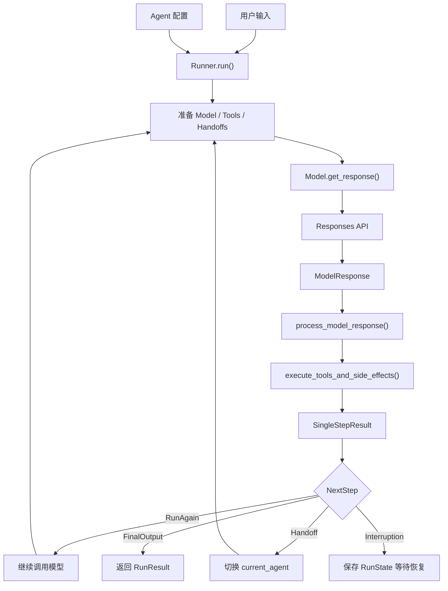

这张图省略了 Session、Guardrails、Tracing、Streaming 和异常处理等横切机制，但保留了 Agent Runtime 的主要控制流程。

现在我们可以用几个对象总结全部内容：

| 抽象 | 职责 |
|---|---|
| `Agent` | 描述模型配置、Instructions、Tools、Handoffs 等能力 |
| `ModelProvider` | 根据配置找到具体 Model |
| `Model` | 隔离不同模型 API 的请求与响应差异 |
| `FunctionTool` | 保存工具描述和执行入口 |
| `Handoff` | 表示可交接的目标 Agent 和执行回调 |
| `Runner` | 执行 Agent Loop，管理整体生命周期 |
| `ProcessedResponse` | 解析并分类模型返回的操作 |
| `SingleStepResult` | 保存本轮结果及下一步执行指令 |
| `Session` | 管理跨 Run 的对话历史 |
| `RunState` | 保存可恢复的运行现场 |

其中最核心的不是某一个类，而是这些对象之间的职责划分。

### 10.2 如果自己实现一个最小 Agent Runtime

我们尝试从零设计一个非常精简的执行器。

先不考虑 Streaming、Tracing 和 Guardrails，只实现：

1. 调用模型。
2. 识别模型返回的操作。
3. 执行工具。
4. 切换 Agent。
5. 判断继续、暂停还是结束。

可以写出这样的结构：

```python
# 教学伪代码：不是 Agents SDK 的真实实现

async def run_agent(starting_agent, input, max_turns=10):

    current_agent = starting_agent
    history = [input]
    current_turn = 0

    while True:

        # 1. 限制模型调用轮次
        current_turn += 1

        if current_turn > max_turns:
            raise MaxTurnsExceeded()

        # 2. 调用当前 Agent 的模型
        model = get_model(current_agent)

        response = await model.get_response(
            instructions=current_agent.instructions,
            input=history,
            tools=current_agent.tools,
            handoffs=current_agent.handoffs,
        )

        # 3. 将模型响应转换为待执行动作
        processed = process_model_response(
            response,
            current_agent,
        )

        # 4. 执行工具 / 处理交接并决定下一步
        step = await execute_actions(
            processed,
            current_agent,
        )

        # 5. 更新运行历史
        history.extend(step.new_items)

        # 6. 根据 NextStep 推进状态机
        if isinstance(step.next_step, NextStepRunAgain):
            continue

        elif isinstance(step.next_step, NextStepHandoff):
            current_agent = step.next_step.new_agent
            continue

        elif isinstance(step.next_step, NextStepFinalOutput):
            return step.next_step.output

        elif isinstance(step.next_step, NextStepInterruption):
            return save_run_state(
                current_agent,
                current_turn,
                history,
                step,
            )
```

这段代码只用了几十行，就概括了 Agent Runtime 的核心执行思路。

但它还不能直接用于生产。

因为这里的很多函数只是抽象占位符。

例如 `execute_actions()` 背后需要实现：

```text
工具名称查找
    ↓
参数解析和 Schema 校验
    ↓
执行权限与审批检查
    ↓
工具执行
    ↓
错误、超时和重试处理
    ↓
结果封装
    ↓
下一步控制流判断
```

而 `save_run_state()` 也需要真正保存：

```text
当前 Agent
当前 Turn
模型响应
已完成的 RunItems
待审批调用
恢复位置
执行上下文
```

这也解释了为什么 Agents SDK 的源码远比上面的循环复杂。

**难点不在于写出一个 while True，而在于让这个循环面对真实业务中的各种异常和边界条件时仍然可靠。**

### 10.3 从一个 Agent Loop 扩展成真正的 Runtime

如果自己设计 Agent Runtime，可以分成五层。

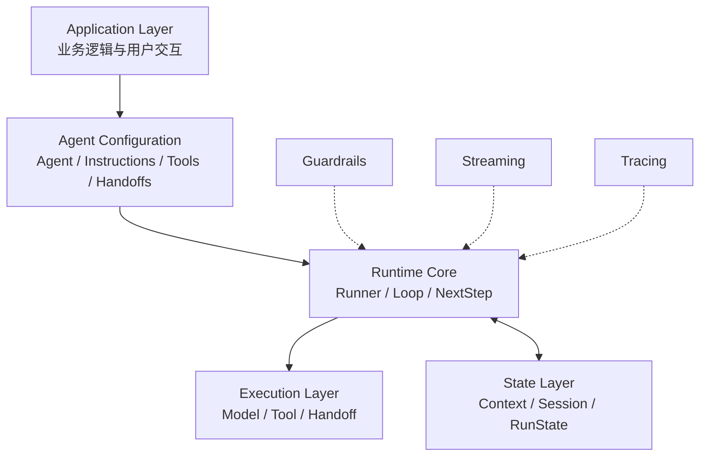

其中：

**Configuration Layer** 负责声明 Agent 具备哪些能力。

**Runtime Core** 负责整个 Agent Loop 的执行和控制流。

**Execution Layer** 负责真正的模型和工具调用。

**State Layer** 负责对话历史和运行现场。

而 Guardrails、Streaming 和 Tracing 作为横切能力，接入这些核心模块。

这样的划分与我们阅读的 OpenAI Agents SDK 整体架构相似。

### 10.4 真正落地时，需要考虑哪些工程问题？

在生产系统中，单纯让 Agent 能跑通并不够。

至少需要关注以下几类问题。

| 工程问题 | 设计关注点 |
|---|---|
| 模型调用 | 超时、重试、模型切换、成本和使用量 |
| 工具执行 | 参数校验、并发限制、失败处理、幂等性 |
| 控制流 | 最大轮次、Handoff、停止条件 |
| 状态管理 | Session、RunState、持久化与恢复 |
| 权限控制 | 工具可用性、人工审批、数据访问边界 |
| 运行可观测性 | Streaming、Tracing、错误与延迟指标 |
| 测试与评估 | 确定性测试、工具调用正确率、任务成功率 |

这里尤其需要区分三个概念：

#### 1）模型推理正确，不代表工具执行安全

即使模型选择了正确的工具，参数也可能不符合业务规则。

因此工具层必须具有独立的参数校验、权限检查和审批机制。

#### 2）RunState 可恢复，不代表外部操作天然幂等

SDK 能够保存已经处理的执行状态，但如果工具调用已经触发外部支付，随后网络中断，业务侧仍然需要判断该交易是否已经完成。

Agent Runtime 的恢复机制不能代替数据库事务或业务幂等控制。

#### 3）Agent 执行成功，不代表任务一定正确

Runner 返回 `NextStepFinalOutput`，只能说明符合当前 Runtime 的结束条件。

它不等于业务答案一定正确。

因此还需要引入 Evaluation，评估：

- 任务是否真正完成。
- 工具选择是否合理。
- 是否发生不必要的重复调用。
- Handoff 是否交给了正确的 Agent。
- 输出是否满足业务要求。

这也是从研究 Agent Runtime 进一步走向 Agent Evaluation 的自然方向。

### 10.5 对 Agent Runtime 的最终理解

现在我们可以重新审视本文最初的简化公式：

```text
Agent ≈ LLM + Tools + Context / Memory + Execution Logic
```

经过源码分析，可以把它进一步拆开：

```text
Model
    负责生成内容和操作请求

Tools
    负责实际的外部能力执行

Agent
    负责声明模型、工具和行为配置

Runner
    负责推进整个执行循环

NextStep
    负责表达执行控制决策

Context / Session / RunState
    负责不同生命周期的状态管理

Guardrails / Streaming / Tracing
    负责校验、事件输出与运行观测
```

从这个角度看，模型虽然是 Agent 的智能决策核心，但它并不负责整个系统的执行生命周期。

**真正把模型变成一个能够持续运行、使用工具和完成任务的 Agent 的，是模型之外的 Agent Runtime。**

它负责连接模型的“意图”和应用程序的“执行”。

### 10.6 后续可以深入的方向

读完核心源码之后，如果希望继续研究，可以沿三个方向展开。

**第一，深入执行可靠性。**

重点研究并行工具执行、异常传播、取消机制、Retry 与幂等边界，理解 Runtime 在故障情况下如何保证状态一致性。

**第二，构建自己的最小 Agent Runtime。**

先自己实现一个只支持 FunctionTool 的 Agent Loop，再逐步加入 Handoff、RunState、Guardrails 和 Streaming，与 OpenAI Agents SDK 进行对照。

**第三，研究 Agent Evaluation。**

基于 Trace 和 RunItems 构建评测数据，检查工具调用、Agent 交接、任务完成率和资源消耗，并将评测结果用于持续优化 Agent 的设计。

---

## 全文 Takeaway

> **Agents SDK 的核心不是封装了一次大模型调用，而是提供了一套围绕模型决策组织真实执行的 Agent Runtime。**
>
> 它通过 Model 抽象隔离模型 API，通过 FunctionTool 和 Handoff 连接模型意图与程序行为，通过 Runner 和 NextStep 管理执行控制流，通过 Session 和 RunState 管理运行状态，并用 Guardrails、Streaming 和 Tracing 增强执行过程的可靠性与可观测性。

最终，我们可以用一句话概括整个架构：

**模型决定下一步想做什么，Runtime 决定怎样执行、怎样继续，以及什么时候停止。**

---

## 核心源码阅读索引

| 研究内容 | 源码位置 |
|---|---|
| Agent 配置 | `openai-agents-python/src/agents/agent.py` |
| Runner / Agent Loop | `openai-agents-python/src/agents/run.py` |
| Single Turn | `openai-agents-python/src/agents/run_internal/run_loop.py` |
| ModelProvider | `openai-agents-python/src/agents/models/interface.py` |
| Responses API 适配 | `openai-agents-python/src/agents/models/openai_responses.py` |
| FunctionTool | `openai-agents-python/src/agents/tool.py` |
| Handoff | `openai-agents-python/src/agents/handoffs/__init__.py` |
| 模型响应解析与动作执行 | `openai-agents-python/src/agents/run_internal/turn_resolution.py` |
| NextStep | `openai-agents-python/src/agents/run_internal/run_steps.py` |
| RunState | `openai-agents-python/src/agents/run_state.py` |
| Guardrails | `openai-agents-python/src/agents/run_internal/guardrails.py` |
| Streaming | `openai-agents-python/src/agents/stream_events.py` |
| Tracing | `openai-agents-python/src/agents/tracing/` |

本文以非流式 Agent Loop 为主线，讨论的源码结构对应当前 OpenAI Agents Python SDK。内部函数名称与行号可能随版本变化，正式技术分享时建议固定 Git Commit 并重新核对关键调用点。

---

## 当前源码阅读索引

以下是前三章涉及的核心源码文件。

| 研究内容 | 源码路径 |
|---|---|
| Agent 定义 | [src/agents/agent.py](https://github.com/openai/openai-agents-python/blob/main/src/agents/agent.py) |
| Runner 与 Agent Loop | [src/agents/run.py](https://github.com/openai/openai-agents-python/blob/main/src/agents/run.py) |
| Single Turn / get_new_response | [src/agents/run_internal/run_loop.py](https://github.com/openai/openai-agents-python/blob/main/src/agents/run_internal/run_loop.py) |
| get_model | [src/agents/run_internal/turn_preparation.py](https://github.com/openai/openai-agents-python/blob/main/src/agents/run_internal/turn_preparation.py) |
| RunConfig | [src/agents/run_config.py](https://github.com/openai/openai-agents-python/blob/main/src/agents/run_config.py) |
| Model / ModelProvider 接口 | [src/agents/models/interface.py](https://github.com/openai/openai-agents-python/blob/main/src/agents/models/interface.py) |
| MultiProvider | [src/agents/models/multi_provider.py](https://github.com/openai/openai-agents-python/blob/main/src/agents/models/multi_provider.py) |
| OpenAIProvider | [src/agents/models/openai_provider.py](https://github.com/openai/openai-agents-python/blob/main/src/agents/models/openai_provider.py) |
| OpenAIResponsesModel | [src/agents/models/openai_responses.py](https://github.com/openai/openai-agents-python/blob/main/src/agents/models/openai_responses.py) |
| 模型重试 | [src/agents/run_internal/model_retry.py](https://github.com/openai/openai-agents-python/blob/main/src/agents/run_internal/model_retry.py) |
| 响应解析与执行分发 | [src/agents/run_internal/turn_resolution.py](https://github.com/openai/openai-agents-python/blob/main/src/agents/run_internal/turn_resolution.py) |
| NextStep / SingleStepResult | [src/agents/run_internal/run_steps.py](https://github.com/openai/openai-agents-python/blob/main/src/agents/run_internal/run_steps.py) |
| 运行项定义 | [src/agents/items.py](https://github.com/openai/openai-agents-python/blob/main/src/agents/items.py) |

### 关键源码位置

以下保留原始研究笔记中使用的定位。行号与具体 Git Commit 有关，正式分享前应固定版本并核对。

```text
src/agents/run.py
    AgentRunner._run_impl()

src/agents/run_internal/run_loop.py
    run_single_turn()
    get_new_response()

src/agents/run_internal/turn_preparation.py:134
    get_model()

src/agents/models/interface.py
    Model
    ModelProvider

src/agents/models/multi_provider.py
    MultiProvider.get_model()

src/agents/models/openai_provider.py:244
    OpenAIProvider.get_model()

src/agents/run_internal/model_retry.py:580
    get_response_with_retry() 内部模型调用

src/agents/models/openai_responses.py:543
    OpenAIResponsesModel.get_response()

src/agents/models/openai_responses.py:803
    _fetch_response()

src/agents/models/openai_responses.py:830
    client.responses.create()

src/agents/models/openai_responses.py:620
    Response → ModelResponse

src/agents/run_internal/turn_resolution.py
    process_model_response()
    execute_tools_and_side_effects()

src/agents/run_internal/run_steps.py:192
    SingleStepResult
```

> **后续研究原则：** 每个新模块都沿真实调用链学习，保留核心 Mermaid 图、精简伪代码、真实源码位置、设计取舍和实验依据，而不为了覆盖所有 SDK 功能偏离研究主线。
